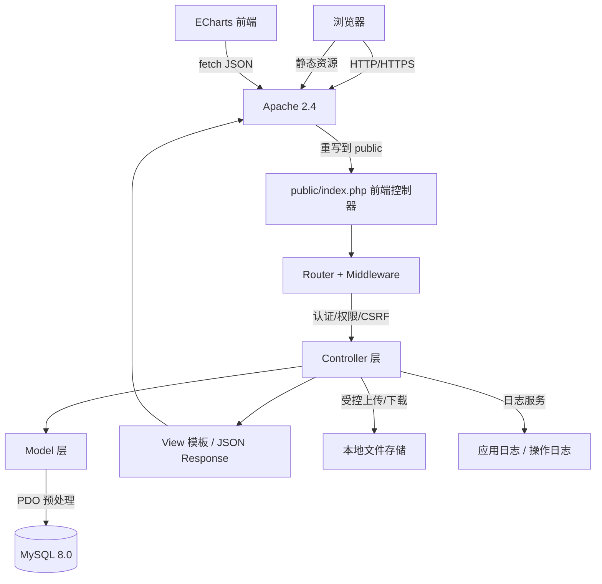
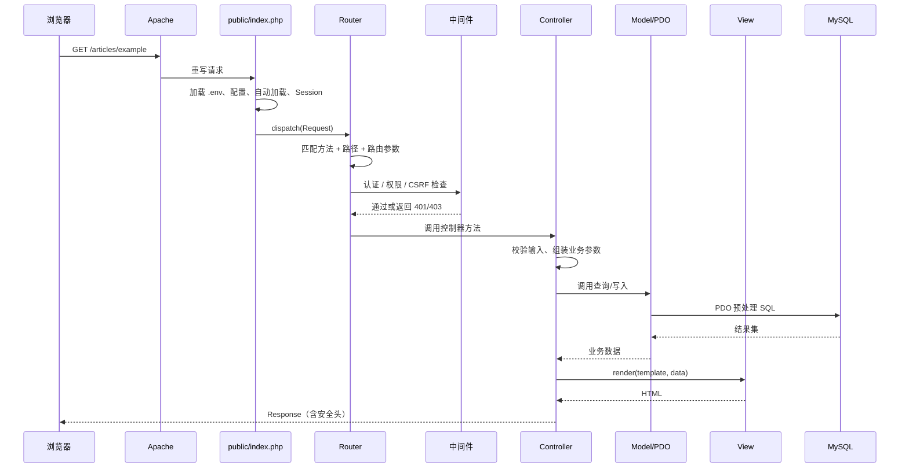

# TechHub 技术架构与目录规划

| 项目 | 内容 |
| --- | --- |
| 文档版本 | v0.3（后台实施后修订） |
| 编写日期 | 2026-11-25 |
| 架构风格 | 原生 PHP 8.2+ 实现的轻量 MVC + 前端控制器 |
| 数据库 | MySQL 8.0 + PDO |
| Web 服务器 | Apache 2.4+ |
| 当前状态 | 数据库、MVC、前台与后台 11 个业务模块、ECharts、日志和 RBAC 已实施并验证；Apache 部署、Git 和六份材料未完成 |
| 团队信息 | 待提供，不在文档中虚构姓名、学号、分工 |

## 1. 架构目标

1. 满足课程“原生 PHP 实现 MVC”的硬性要求，不引入 Laravel、ThinkPHP、Vue、React 等大型框架。
2. 让前端展示、后台管理、数据库访问和权限控制边界清晰。
3. 所有业务数据来自 MySQL，所有写操作真实落库。
4. 在无 Composer 包的条件下也能运行，降低 phpstudy/Windows 部署复杂度。
5. 对 SQL 注入、XSS、CSRF、越权、危险文件上传和敏感配置泄露有明确防护。
6. 目录和命名便于多人独立开发、每人提交自己的 Model/View/Controller，并便于答辩演示。
7. 先保证可运行、可测试、可解释，再考虑增强功能。

## 2. 当前环境实施记录

本节记录 2026-11-25 对本机环境的**实际安装、配置与验证结果**。

### 2.1 实施后环境

| 检查项 | 实际结果 | 状态 |
| --- | --- | --- |
| 工作目录 | `d:\XiaoPiMianBan\phpstudy_pro\WWW\TechHub` | 已建立 MVC、数据库和文档 |
| PHP | PHP 8.2.36 NTS，安装于 `phpstudy_pro/Extensions/php/php8.2.36nts` | 已满足 |
| PHP 扩展 | `pdo_mysql`、`fileinfo`、`mbstring`、`openssl`、`curl`、`zip`、`mysqli` | 已验证 |
| PHP Web | 已使用 PHP 内置服务器 `127.0.0.1:8090` 完成 HTTP 验证 | 开发验证通过 |
| Apache | Apache 2.4.39 仍在 80 端口使用 PHP 7.3.4 Fcgid | **最终部署待切换** |
| MySQL | 独立 MySQL 8.0.19 实例，端口 3308，数据目录在 phpstudy Extensions 下 | 已满足 |
| 数据库 | `techhub`，17 张表、21 个外键、`activity_logs.result` | 已导入并验证 |
| 数据库账号 | `techhub_app` 仅授予 SELECT/INSERT/UPDATE/DELETE | 最小权限 |
| 初始化 SQL | `data/install.sql` 临时新库连续导入两次通过 | 幂等验证通过 |
| Git | Git 2.49.0 已安装；本地仓库已初始化并配置远程 `origin`；尚未提交/推送 | 待确认提交策略 |
| Composer | 未安装；项目不依赖 Composer | 不影响当前运行 |
| Docker | 未安装；可选部署未验证 | 非当前前置 |

### 2.2 环境结论

- **PHP 8.2 与 MySQL 8.0 已达到课程技术栈要求**；
- 前端入口、路由、Model、View、Session 已在 PHP 内置服务器验证；
- **Apache 仍加载 PHP 7.3.4**，因此不能声称 Apache 部署已经完成；
- 需要下一阶段配置 PHP 8.2 的 Apache 虚拟主机或独立开发站点；
- 现有 3306/3307 MySQL 实例未改动，TechHub 使用独立 3308 实例，避免影响其他实验环境。

### 2.3 已完成与待办

**已完成**：

1. 安装并验证 PHP 8.2.36；
2. 启动 MySQL 8.0.19 独立实例，创建 `techhub` 和最小权限应用账号；
3. 创建 17 张表并导入示例数据；
4. 配置未被 Git 跟踪的 `.env`；
5. 实现 MVC 核心、认证、权限、CSRF、异常处理和基础页面；
6. 执行 CLI 与 HTTP 验证；
7. 完成前台页面与后台 11 个业务模块；
8. 接入本地 ECharts 和受保护统计接口；
9. 执行后台 79 项 HTTP 集成测试和浏览器渲染检查。

**待办**：

1. 将 Apache 的 PHP 处理切换到 8.2 并验证虚拟主机；
2. 确认 Git 提交/推送流程；
3. 获取真实团队资料与成员分工；
4. 完成六份课程材料、PPT、修改本人资料和最终部署验证。

## 3. 技术栈与关键技术决策

### 3.1 技术栈

| 层 | 技术 | 用途 |
| --- | --- | --- |
| 语言 | PHP 8.2+ | 后端、路由、模板、业务逻辑 |
| 数据库 | MySQL 8.0 | 业务数据持久化 |
| 数据访问 | PDO + 预处理语句 | 防 SQL 注入、事务、统一连接 |
| Web 服务器 | Apache 2.4+ + mod_rewrite + FastCGI/Fcgid | 静态资源、URL 重写、PHP 执行 |
| 前端基础 | HTML5 + CSS3 + JavaScript ES6+ | 页面结构和交互 |
| UI 框架 | Bootstrap 5.3.3 + Bootstrap Icons（均已本地化） | 响应式布局和图标 |
| 图表 | Apache ECharts | 后台真实统计图表 |
| 模板 | 原生 PHP 模板 | 无模板引擎依赖，天然支持 MVC View |
| 自动加载 | 自定义 PSR-4 风格加载器 | 无 Composer 时可运行 |
| 版本控制 | Git | 真实提交记录与成员贡献证据 |
| 可选部署 | Docker Compose | 环境复现；当前机器未安装，未验证 |

### 3.2 不使用的技术

- 不使用 Laravel、ThinkPHP、Symfony 等 PHP 框架；
- 不使用 Vue、React、Angular 等前端框架；
- 不使用 ORM 隐藏 SQL（课程需要展示数据库设计能力）；
- 不依赖 CDN 加载 Bootstrap/ECharts，避免答辩现场无网络；
- 不引入需要 Composer 安装的运行时依赖；
- 不使用任意 HTML 富文本直通前端，降低 XSS 风险。

### 3.3 依赖资源的本地化

实际已将以下前端资源本地化到 `public/assets/`：

- Bootstrap 5.3.3 CSS/JS；
- Bootstrap Icons 1.11.3 字体与 CSS；
- Apache ECharts 5.5.1 压缩版 JS。

许可证文件和版本说明见 `docs/third-party.md`。不依赖 CDN。

## 4. 总体架构



### 4.1 分层职责

| 层 | 职责 | 禁止事项 |
| --- | --- | --- |
| Core | 启动、路由、请求/响应、数据库连接、会话、认证、CSRF、校验、日志、上传等基础设施 | 不承载具体业务内容 |
| Controller | 接收请求、校验参数、调用权限、组织 Model、返回 View/JSON/重定向 | 不直接拼 SQL、不直接输出未转义 HTML |
| Model | 查询与写入数据库、事务、业务数据规则、统计聚合 | 不输出 HTML、不读取超全局变量做页面判断 |
| View | HTML 结构、循环展示、调用 `e()` 转义 | 不直接执行 SQL、不处理复杂业务写入 |
| Middleware | 统一认证、权限、CSRF、请求安全校验 | 不替代 Controller 的业务授权判断 |
| Support | Markdown 安全渲染、分页、文件类型映射等辅助类 | 不成为绕过 Model 的第二个数据层 |
| public | Web 入口、静态资源、上传后的公开图片 | 不放置应用配置、密码、文档附件或日志 |

### 4.2 一次请求的生命周期



## 5. MVC 与核心组件设计

### 5.1 目录结构（2026-11-25 实际落地）

```text
TechHub/
├─ app/
│  ├─ Controllers/
│  │  ├─ HomeController.php
│  │  ├─ AuthController.php
│  │  └─ Admin/
│  │     ├─ AdminController.php（后台基类）
│  │     ├─ DashboardController.php
│  │     ├─ UserController.php, RoleController.php
│  │     ├─ TeamController.php, MemberController.php
│  │     ├─ ProjectController.php, CategoryController.php
│  │     ├─ ArticleController.php, AnnouncementController.php
│  │     └─ MessageController.php, FileController.php, ActivityController.php
│  ├─ Middleware/
│  │  ├─ AuthMiddleware.php
│  │  ├─ GuestMiddleware.php
│  │  ├─ PermissionMiddleware.php
│  │  └─ CsrfMiddleware.php
│  ├─ Models/
│  │  ├─ ActivityLog.php
│  │  ├─ Announcement.php
│  │  ├─ Article.php
│  │  ├─ FileResource.php
│  │  ├─ Message.php
│  │  ├─ Project.php
│  │  ├─ Team.php
│  │  ├─ User.php, Role.php, AdminStats.php
│  │  ├─ Member.php, Category.php, FileDownload.php
│  │  └─ ...
│  ├─ Support/
│  │  └─ Markdown.php, DownloadPath.php, ImageUpload.php, Slugger.php
│  └─ Views/
│     ├─ layouts/
│     │  ├─ app.php
│     │  ├─ admin.php
│     │  └─ error.php
│     ├─ auth/login.php
│     ├─ home/index.php
│     ├─ admin/
│     │  ├─ dashboard/, team/, members/, projects/
│     │  ├─ categories/, articles/, announcements/
│     │  ├─ messages/, files/, users/, roles/, activity/
│     │  └─ partials/
│     └─ errors/
│        ├─ 400.php, 403.php, 404.php, 405.php, 500.php
├─ bootstrap/
│  └─ app.php
├─ config/
│  ├─ app.php
│  ├─ database.php
│  └─ routes.php
├─ core/
│  ├─ Auth.php, Config.php, Controller.php, Csrf.php
│  ├─ Database.php, Env.php, HttpException.php, Logger.php
│  ├─ Model.php, Request.php, Response.php, Router.php
│  ├─ Session.php, Upload.php, View.php, helpers.php
├─ data/
│  ├─ install.sql
│  ├─ migrations/
│  ├─ team/team-sample.txt
│  ├─ personal/personal-sample.txt
│  └─ resources/
├─ docs/
│  ├─ requirements.md, feature-list.md
│  ├─ database-plan.md, database-design.md
│  ├─ architecture-plan.md, development-plan.md
├─ public/
│  ├─ index.php, router.php, .htaccess
│  ├─ assets/css/bootstrap.min.css, assets/css/app.css
│  ├─ assets/js/bootstrap.bundle.min.js, app.js, echarts.min.js, admin-charts.js
│  ├─ assets/css/admin.css
│  ├─ assets/images/, assets/vendor/bootstrap/
│  └─ uploads/.htaccess
├─ storage/
│  ├─ logs/
│  └─ sessions/
├─ tests/
│  ├─ smoke.php
│  ├─ frontend_smoke.php
│  ├─ admin_smoke.php
│  └─ tmp/
├─ .env.example
├─ .gitignore
├─ .htaccess
└─ README.md
```

> 后台业务模块已在同一结构中落地：`app/Controllers/Admin/` 下 12 个控制器、`app/Views/admin/` 页面、`AdminController` 基类、`AdminStats`/`Role` 等 Model，以及 `admin.css`、`admin-charts.js`。未修改公共入口和核心分层。

**前台阶段新增（2026-11-25）**：

- Controller：`TeamController`、`MemberController`、`ProjectController`、`ArticleController`、`AnnouncementController`、`MessageController`、`DownloadController`、`ProfileController`；
- Model：`Member`、`Category`、`Message`、`FileResource`、`FileDownload` 及扩展后的 `Team`、`Project`、`Article`、`Announcement`、`User`；
- Support：`App\Support\Markdown`（安全 Markdown）和 `App\Support\DownloadPath`（下载路径边界校验）；
- 核心：`Core\Paginator`、`Response::download()`、扩展的辅助函数；
- Views：成员、项目、文章、公告、留言、下载、个人资料、前台登录及分页/头像 partial；
- 资源：`public/assets/css/frontend.css`、Bootstrap Icons、本地示例 SVG 封面与头像；
- 迁移：`data/migrations/2026-11-25_frontend.sql`；
- 测试记录：[`docs/implementation-notes.md`](implementation-notes.md)。

### 5.2 自动加载与命名空间

采用 PSR-4 风格的自定义加载器：

- 根命名空间：`App\`；
- 路径映射：`App\` → `app/`；
- 类名与文件名一致，例如 `App\Controllers\Admin\ArticleController` → `app/Controllers/Admin/ArticleController.php`；
- 入口文件、配置和 templates 不使用类自动加载；
- 所有 PHP 文件使用 `declare(strict_types=1);`；
- 不依赖 Composer 自动加载。

### 5.3 前端控制器与 URL 重写

- Web 服务器文档根必须指向 `public/`；
- 所有非静态请求交给 `public/index.php`；
- `.htaccess` 实现：
  - 已存在的静态文件/目录直接返回；
  - 其他请求重写到 `index.php`；
  - 禁止目录浏览；
  - 禁止访问隐藏文件、`.env`、数据库文件、备份文件；
  - 为公开图片目录添加防脚本执行规则；
  - 设置合理的安全响应头（最终依据 Apache 模块启用情况验证）。
- 如果 Apache 未启用 `mod_rewrite`，必须在部署阶段解决，而不是依赖 `index.php?url=` 的临时方式交付。可保留兼容入口作为排障手段，但正式演示使用干净 URL。

### 5.4 路由设计

路由表集中放在 `config/routes.php`，使用 HTTP 方法 + 路径模式 + 控制器方法 + 中间件元数据：

```php
$router->get('/', [HomeController::class, 'index']);
$router->post('/messages', [MessageController::class, 'store'], ['csrf' => true]);

$router->get('/admin', [Admin\DashboardController::class, 'index'], [
    'auth' => true,
    'permission' => 'dashboard.view',
]);

$router->get('/admin/articles/{id}/edit', [Admin\ArticleController::class, 'edit'], [
    'auth' => true,
    'permission' => 'article.manage',
]);
```

**路由规则**：

- 路径参数 `{id}` 必须限制为数字，`{slug}` 限制为合法 slug；
- 管理员路由统一 `/admin` 前缀；
- 所有 POST 写操作声明 CSRF 中间件；
- 路由权限码与 `permissions` 表种子一致；
- 找不到路由返回 404；无权限返回 403；未登录后台请求跳登录；
- 删除操作使用 POST，例如 `POST /admin/articles/{id}/delete`；
- 不允许通过 GET 执行写入；
- 后台登录页和登录提交不需要 `auth`，但登录提交需要 CSRF。

### 5.5 Controller 设计

Controller 负责：

1. 从 `Request` 读取参数；
2. 调用 `Validator` 和 `Gate`；
3. 调用 Model；
4. 设置 Flash 消息；
5. 返回 View 或 JSON；
6. 在关键操作后写操作日志。

Controller 不负责：

- SQL 字符串拼接；
- 直接访问 `$_POST`/`$_GET`（统一通过 Request）；
- 直接 `echo` 未经转义的用户输入；
- 自行判断“按钮是否显示”来代替服务端权限。

每个 Controller 方法保持短小，复杂查询下放到 Model，复杂规则下放到 Support/Service（若出现）。

### 5.6 Model 设计

基础 `Model` 提供：

- 持有共享 PDO；
- `beginTransaction()`、`commit()`、`rollBack()`；
- 通用的分页/计数辅助（在业务允许范围内）；
- 禁止提供“任意 SQL 执行”接口。

业务 Model 负责：

- 参数化查询；
- 字段白名单；
- 事务内的多表更新；
- 聚合统计查询；
- 按业务状态过滤（如前台只查询可见数据）。

示例职责：

| Model | 主要职责 |
| --- | --- |
| `User` | 按用户名查询、更新密码、更新登录信息、状态过滤 |
| `Role` | 角色 CRUD、权限分配事务 |
| `Permission` | 权限清单与角色权限读取 |
| `Team` | 单例读取/更新 |
| `TeamMember` | 成员列表/详情、本人字段更新、排序、账号关联 |
| `Project` | 可见项目查询、项目 CRUD、成员关联事务 |
| `Category` | 分类树、状态、删除约束 |
| `Article` | 已发布查询、浏览量自增、CRUD |
| `Announcement` | 公开有效公告、置顶排序、CRUD |
| `Message` | 留言/回复、审核、公开线程查询 |
| `FileResource` | 文件元数据、公开文件、下载计数 |
| `FileDownload` | 下载记录写入与聚合 |
| `ActivityLog` | 操作日志写入、筛选分页 |
| `AdminStats` | 只读统计聚合 |

### 5.7 View 设计

- 使用原生 PHP 模板；
- 当前统一使用 `layouts/app.php`（前台与登录）、`layouts/admin.php`（后台）和 `layouts/error.php`（错误页）；
- `View::render('article/show', $data)` 注入布局；
- 局部模板：导航、页脚、Flash、分页、侧边栏；
- 所有动态文本使用 `e($value)`；
- 对于文章正文，使用受控 Markdown 渲染器，禁止原始 `<script>`；
- 视图不直接实例化 Model，数据由 Controller 准备；
- 表单 Token 由 `csrf_field()` 生成并转义，业务脚本集中在 `public/assets/js/`；
- HTML 转义、URL 属性转义、JS 数据注入分别处理，不共用一个“万能转义”函数。

### 5.8 前端结构

- 公共导航：首页、团队、成员、项目、文章、公告、资料下载、留言；
- 页脚固定展示团队作业和个人作业下载链接；
- 响应式布局，使用 Bootstrap 5；
- 后台侧边栏按权限显示菜单；真正的路由拦截仍在服务端；
- 表单使用错误摘要、字段级错误和操作成功提示；
- 列表统一分页与空状态；
- 所有页面使用统一页面标题和 meta 描述。

## 6. 身份认证与 RBAC

### 6.1 认证流程

1. 登录页 GET 显示 CSRF Token。
2. POST 校验 CSRF、用户名、密码。
3. `User` Model 按用户名查询账号。
4. `password_verify()` 校验，必要时 `password_rehash()`。
5. 检查 `status='active'`。
6. `session_regenerate_id(true)`，写入最小用户信息。
7. 更新 `last_login_at`、`last_login_ip`，写操作日志。
8. 跳转到后台首页或安全的原始目标地址。
9. 每次后台请求从数据库重新确认用户状态与角色权限，避免停用后继续访问。

### 6.2 RBAC 判定

- 权限数据：`roles`、`permissions`、`role_permissions`；
- 用户只有一个 `role_id`；
- 菜单显示与路由授权都从权限集合判断；
- 权限集合可在登录后载入 Session，但停用/权限变更后应刷新；最稳妥方案是每个受保护请求查询当前权限版本或直接查询权限集合；
- 权限码校验由 `Gate::allows($permission)` 统一完成；
- 关键权限（`role.manage`、`user.manage`、`activity.view`）只授予超级管理员；
- 禁止前端传入角色/权限 ID 直接信任。

### 6.3 会话安全

- 使用 PHP 原生 Session；
- Cookie `HttpOnly=true`；
- `SameSite=Lax`；
- 生产 HTTPS 时 `Secure=true`；
- 配置会话名称、生命周期和过期处理；
- 登录后重建 Session ID；
- 退出时清空 Session 并删除 Cookie；
- 不把密码、完整权限原始数据、敏感文件路径写进 Cookie。

## 7. 安全设计

### 7.1 SQL 注入

- 全部 SQL 使用 PDO 预处理和绑定参数；
- 表名、字段名、排序方向不能来自任意用户输入；使用白名单映射；
- 不用字符串拼接 `LIMIT`/`ORDER BY`；必须拼接时从固定枚举取值；
- 搜索的 `LIKE` 参数转义 `%` 和 `_`。

### 7.2 XSS

- View 默认使用 `e()` 输出；
- 留言、昵称、标题、摘要等不信任 HTML；
- 文章正文使用受控 Markdown 子集（标题、列表、代码、链接、粗体/斜体），渲染器先转义再生成受控标签；
- 禁止 Markdown 中的原始 HTML 和 `javascript:` 链接；
- 图片 URL、`href` 属性单独进行协议和长度校验；
- 不使用 `innerHTML` 注入未经处理的后台数据；ECharts 数据使用 JSON 安全序列化。

### 7.3 CSRF

- 所有 POST 表单包含隐藏 `_token`；
- `CsrfMiddleware` 对写操作统一验证；
- Token 使用 CSPRNG 生成，Session 保存；
- 校验失败返回 403，并记录安全日志；
- 登录、退出、删除、审核、上传都受保护。

### 7.4 密码与会话

- `password_hash($password, PASSWORD_DEFAULT)`；
- `password_verify()`；
- 不在日志/UI/URL 中出现密码；
- 密码最短长度、最大长度在后端校验；
- 登录错误使用统一提示，避免枚举账号；
- 基本登录限流/失败计数在实现阶段设计，可使用 `activity_logs` 或 Session 计数，最终以可测试方案为准。

### 7.5 文件上传与下载

**文档附件**：

- 存储于 `storage/uploads/documents/`，不在 Web 根目录；
- 允许扩展名暂定：`pdf`、`doc`、`docx`、`ppt`、`pptx`、`zip`；
- 对每个扩展名维护允许的 MIME 集合；
- 使用 `finfo_file()` 检测真实 MIME；
- 文件大小上限 20 MB（同时受 PHP `upload_max_filesize`/`post_max_size` 限制）；
- 使用 `random_bytes()` 生成随机存储名，保留规范化扩展名；
- 原始文件名只存在数据库并用于下载显示；
- 下载通过控制器：
  - 检查登录/权限（后台预览）或 `is_public=1 AND status='active'`（前台）；
  - 使用安全路径拼接与 `realpath` 校验防止目录穿越；
  - 设置 `Content-Type`、`Content-Length`、`Content-Disposition`；
  - 支持中文文件名的 RFC 5987 编码；
  - 下载完成后更新计数与 `file_downloads`；
  - 不暴露服务器绝对路径。

**公开图片（Logo/头像/封面）**：

- 存储于 `public/uploads/images/`，使用随机文件名；
- 仅允许 `jpg/jpeg/png/webp/gif`；
- 同时校验扩展名、MIME 和 `getimagesize()`；
- 不接收 SVG（可携带脚本）和可执行文件；
- 上传目录 `.htaccess` 禁止脚本执行、目录浏览和危险扩展名；
- 图片资源可直接静态访问，减少 PHP 输出开销；
- 如果目录规则无法在演示环境生效，则改为受控控制器输出。

**禁止行为**：

- 绝不使用用户原始文件名直接拼接磁盘路径；
- 绝不将上传目录设置为可执行 PHP；
- 绝不将文档附件放在 public 直接访问；
- 绝不以客户端 MIME 或扩展名单独作为安全依据。

### 7.6 授权与越权

- 每一个后台路由必须声明权限码；
- 资源级检查：普通成员只能编辑自己的 `team_members` 档案；
- 不能通过修改 URL 中的 ID 操作他人数据；
- 角色管理不能删掉最后一个超级管理员；
- 当前用户停用后，后续请求立即失效；
- 文件下载、文章草稿预览、留言审核均需要服务端状态判断。

### 7.7 敏感配置与错误信息

- `.env` 保存数据库密码、环境、调试开关等；
- `.env.example` 只含占位符；
- `.gitignore` 忽略 `.env`、日志、上传文件、备份；
- 生产环境 `APP_DEBUG=false`；
- 统一异常处理器将详细堆栈写入 `storage/logs/`，页面只显示通用错误和请求 ID；
- Apache 关闭目录列表，限制访问隐藏文件；
- 文档和截图中不得出现真实密码。

### 7.8 安全响应头与 Cookie

根据 Apache 启用模块配置：

- `X-Content-Type-Options: nosniff`
- `X-Frame-Options: SAMEORIGIN`
- `Referrer-Policy: strict-origin-when-cross-origin`
- 可选 `Content-Security-Policy`（需兼容本地 ECharts/Bootstrap 资源）
- Session Cookie：`HttpOnly`、`SameSite=Lax`、HTTPS 下 `Secure`

所有安全头必须在实际 Apache 环境验证，不在文档中声称已启用。

## 8. 统计与 ECharts 设计

### 8.1 数据流

1. 后台统计页面加载本地 ECharts。
2. JS 使用 `fetch` 请求受保护统计接口。
3. 接口检查 Session 和 `stats.view`。
4. `AdminStats` Model 执行真实聚合 SQL。
5. Controller 返回 JSON。
6. ECharts 初始化/更新图表；无数据时显示空状态。

### 8.2 实际接口

| 方法与路径 | 返回内容 | 权限 |
| --- | --- | --- |
| `GET /admin/api/stats` | 汇总、项目状态、文章/项目 6 个月趋势、成员参与项目、留言状态 | `stats.view` |

一个接口一次返回全部图表数据，减少请求数；所有聚合均使用 PDO 预处理并限制时间范围。

### 8.3 JSON 约定

```json
{
  "success": true,
  "data": {
    "labels": ["进行中", "已完成"],
    "series": [3, 5]
  },
  "meta": {
    "generated_at": "2026-11-25 12:00:00"
  }
}
```

失败示例：

```json
{
  "success": false,
  "error": {
    "code": "FORBIDDEN",
    "message": "无权访问统计数据"
  }
}
```

- 数值必须由 SQL 查询产生；
- 空结果返回零值，不伪造随机数据；
- 接口不输出 SQL、堆栈或数据库凭据；
- 统计页只使用本地 ECharts 资源。

## 9. 错误处理与日志

### 9.1 错误分层

| 类型 | 处理 |
| --- | --- |
| 路由不存在 | 404 页面 |
| 未登录后台 | 302 到登录页 |
| 权限不足 | 403 页面/JSON 403 |
| CSRF 失败 | 403，记录安全日志 |
| 表单校验失败 | 返回表单，保留非敏感输入，显示字段错误 |
| 数据库异常 | 事务回滚，写应用日志，页面向用户显示通用错误 |
| 文件异常 | 提示具体但安全的失败原因，不泄露磁盘路径 |
| 未捕获异常 | 全局异常处理，生产模式隐藏细节 |

### 9.2 日志类型

1. **应用日志**：`storage/logs/app-YYYY-MM-DD.log`，记录异常、文件清理失败、数据库错误等。
2. **操作日志**：数据库 `activity_logs`，记录后台关键操作。
3. **下载日志**：数据库 `file_downloads`，用于文件下载统计。
4. **Web 服务器日志**：Apache access/error log，部署时说明位置。

日志需限制权限，不提交 Git，不写入密码/Token/数据库连接串。

## 10. 测试策略与已执行结果

### 10.1 测试层次

| 层次 | 方式 | 重点 |
| --- | --- | --- |
| 静态检查 | `php -l`、命名/注释头检查 | 语法、规范 |
| 数据库集成 | 自定义 PHP 测试脚本 | 建表、CRUD、外键、事务、分页、统计 SQL |
| 路由/控制器 | 本地 HTTP + curl/浏览器 | 状态码、重定向、权限、CSRF |
| 安全测试 | 手工构造输入 | SQL 注入、XSS、越权、危险上传、路径穿越 |
| 前后台验收 | 浏览器手工测试 | 真实数据链路、图表、下载、响应式 |
| 回归 | 固定测试清单 | 每次改表/权限后复测 |

### 10.2 必测场景（计划）

1. `install.sql` 在 MySQL 8.0 空库导入成功，17 张表、外键和种子权限正确。
2. 超级管理员登录、退出、错误密码、停用账号。
3. 普通成员访问角色管理和日志被拒绝。
4. 角色权限变更后，菜单和服务端路由同时生效。
5. 项目、文章、分类、公告、成员、文件的创建/查询/修改/删除。
6. 项目成员关联事务回滚。
7. 文章草稿不在前台出现；发布后出现；浏览量自增。
8. 留言待审不公开；审核通过后公开；回复正确关联。
9. 上传 `.php`、伪装 MIME、超限文件被拒绝；合法 PDF 可下载并计数。
10. 文件路径穿越尝试失败。
11. 文章/留言中的 XSS 载荷被转义。
12. SQL 注入载荷不能改变查询结构。
13. 统计接口未登录/无权限被拒绝；数据随数据库变化。
14. 分页边界、空搜索、超长输入。
15. 移动端基础布局与 404/403 页面。

### 10.3 本阶段已执行验证（2026-11-25）

| 验证 | 实际结果 |
| --- | --- |
| PHP 8.2.36 CLI | 通过 |
| PDO 连接 MySQL 8.0.19 | 通过 |
| `install.sql` 首次导入 | 通过，17 张表、21 个外键 |
| `install.sql` 重复导入 | 通过，种子数据无重复 |
| 首页 HTTP 200 与数据库内容 | 通过 |
| 未登录 `/admin` 重定向 | 302 → `/admin/login` |
| 登录 CSRF 缺失 | 403 |
| 管理员登录与 Session 保持 | 通过，后台 200 |
| 编辑账号访问 `/admin/users` | 403 |
| 退出登录 | 成功，后台再次重定向 |
| 错误密码 | 统一提示，写入失败日志 |
| 停用账号登录 | 被拒绝，未建立后台 Session |
| 登录 SQL 注入载荷 | 预处理生效，未绕过 |
| 404 / 405 | 正确返回 |
| 文件上传安全类 | `.php`、MIME 伪装、超限文件被拒绝 |
| 管理员密码明文检查 | 数据库中无明文 |
| 后台业务 CRUD | 79 项 HTTP 集成测试通过 |
| 后台 ECharts | 4 个 canvas 正常，未发现应用脚本异常 |
| 后台响应式 | 390px 下 16 个页面无横向溢出 |
| 后台权限 | 普通成员/编辑越权访问 403 |

> 后台业务 CRUD、ECharts、上传、审核、日志和响应式已实测；Apache 虚拟主机、真实资料、Git 和六份材料仍未完成。

### 10.4 测试原则

- 测试结果必须来自实际执行，记录命令、日期、环境和输出摘要；
- 未执行的测试只能写“计划”或“未执行”；
- 不用模拟截图代替真实页面；
- 失败用例保留失败信息与修复记录；
- Git 记录每个成员真实修改，不补造提交。

## 11. 部署架构

### 11.1 当前开发部署（已验证）

```text
浏览器
  → PHP 8.2.36 内置服务器 127.0.0.1:8090（开发验证）
  → public/index.php
  → MVC + PDO
  → MySQL 8.0.19:3308 / techhub
```

- `APP_URL=http://localhost:8090`，实际验证地址为 `http://127.0.0.1:8090`；
- 该方式仅用于开发与阶段验收，不是最终 Apache 生产部署；
- Apache 仍使用 PHP 7.3.4，需在部署阶段切换到 PHP 8.2 并配置 `public/` 为站点根。

### 11.2 目标 Apache 部署

```text
浏览器
  ↓
Apache 2.4（VirtualHost: techhub.local，DocumentRoot: TechHub/public）
  ↓ Fcgid / FastCGI
PHP 8.2+
  ↓ PDO
MySQL 8.0（数据库 techhub，最小权限用户）
  ↓
storage/（日志、文档上传）
```

**前置条件**：

- hosts 文件将 `techhub.local` 指向本地（需要管理员权限，部署阶段确认）；
- Apache 启用 `mod_rewrite`、`mod_fcgid`、`mod_headers`（安全头可选）；
- PHP 8.2+ 的 `php.ini` 开启所需扩展；
- 数据库账号只授予 `techhub` 库所需权限；
- `storage/logs`、`storage/cache`、上传目录对 PHP 进程可写；
- `public/uploads/images` 可写但禁止脚本执行。

### 11.3 子目录部署备选

如果课程环境只能通过 `http://localhost/TechHub/public` 访问：

- `APP_URL` 配置为基础路径；
- 路由生成 URL 时统一使用 `Url::base()`，不硬编码 `/`；
- 静态资源和上传图片路径拼接基础路径；
- 仍保持 `public/` 为唯一位于文档根入口；
- 需验证 Apache 的 `.htaccess` 在子目录中生效。

最终采用虚拟主机还是子目录，在部署文档中二选一，不能同时假设。

### 11.4 Docker Compose（可选）

课程将其列为可选。当前机器未安装 Docker，故：

- 第一阶段不交付 Docker 运行结果；
- 后续如提供 `docker-compose.yml`，应使用 `php:8.2-apache`（或 nginx + php-fpm）与 `mysql:8.0`；
- 必须实际构建和测试，才能写入部署文档；
- 数据库密码通过环境变量注入，不写死。

## 12. 编码规范与文件注释头

### 12.1 命名

- 类：`PascalCase`；
- 方法/变量：`camelCase`；
- 数据库表/字段：`snake_case`；
- 视图文件：小写短横线或下划线按目录统一；
- 路由：小写短横线；
- 常量：`UPPER_SNAKE_CASE`；
- 所有文件 UTF-8 无 BOM。

### 12.2 PHP 文件注释头模板

每个 PHP 文件必须包含规范注释头，作者由实际编写者填写，不得代填或虚构：

```php
<?php
/**
 * TechHub - 高校技术团队展示与管理平台
 *
 * 文件：Article.php
 * 模块：技术文章管理
 * 职责：文章查询、写入与浏览量更新
 * 作者：<实际编写者姓名/学号>
 * 创建日期：YYYY-MM-DD
 * 最后修改：YYYY-MM-DD
 * 说明：仅负责数据层，不输出 HTML。
 */

declare(strict_types=1);
```

### 12.3 代码要求

- 严格类型声明；
- 类名与文件名一致；
- 每个类只承担单一核心职责；
- 公共函数集中在 Support/Core；
- 不复制粘贴 SQL 和权限判断；
- 关键业务分支、事务、安全决策必须有注释；
- 不写无意义注释，注释解释“为什么”；
- 错误信息对用户安全、对开发者可诊断；
- 前端 JS 不使用内联未转义数据。

### 12.4 代码评审要点

1. 是否执行了服务端权限检查？
2. 是否使用 PDO 预处理？
3. 输出是否转义？
4. POST 是否有 CSRF？
5. 上传/下载是否校验路径和状态？
6. 是否存在 N+1 查询或无分页列表？
7. 是否写入必要的操作日志？
8. 是否修改了数据库但没有更新 SQL/文档？
9. 是否有真实作者注释头和可解释的 Git 提交？

## 13. 性能与可维护性

1. 列表服务端分页；
2. 首页只查询必要的限量数据；
3. 统计按需加载，不阻塞首屏；
4. 关联查询避免 N+1；
5. 图片使用适当尺寸，上传后不直接输出超大原图（后续可增加缩放）；
6. 静态资源本地化并设置缓存头（部署阶段验证）；
7. SQL 与代码结构保持可读，优先正确性；
8. 不为了“炫技”引入大型框架或复杂依赖。

## 14. 技术风险与应对

| 风险 | 影响 | 应对 |
| --- | --- | --- |
| Apache 仍使用 PHP 7.3.4 | 最终 Apache 验收不满足 8.2+ | 部署阶段切换 Fcgid 到 PHP 8.2 并复测 |
| MySQL 实例为独立 3308 开发实例 | 换机/重启后需按文档启动 | 部署文档记录启动命令、账号和备份方式 |
| 现有 3306/3307 实例与本项目并存 | 连错数据库或端口 | 应用只用 3308 + `techhub_app`，不依赖其他实例 |
| 团队信息缺失 | 只能使用占位数据 | 使用明确标记的示例数据，不虚构真实团队 |
| 成员人数/分工未知 | 无法完成真实分工表 | 待用户提供，不预填姓名；每人必须有真实 M/V/C |
| 上传目录可执行 | 服务器安全风险 | 文档附件放 Web 根外；图片目录禁脚本；严格白名单 |
| 无 Composer/Docker | 依赖安装受限 | 原生实现；Docker 可选且必须实际验证 |
| 时间紧、模块多 | 核心功能做不完 | 以 P0 为准，分阶段验收，不缩减 12 模块 |
| 图表无真实数据 | 无法体现动态 | 先准备数据库示例数据，统计接口必须 SQL 聚合 |
| 截图/测试造假风险 | 课程诚信问题 | 只记录真实结果；未执行就写未执行 |

## 15. 下一阶段技术落地清单

1. 配置 Apache PHP 8.2 虚拟主机并验证统一入口。
2. 确认 Git 提交、推送和成员提交规范。
3. 替换真实团队资料与内容数据。
4. 补修改密码/本人资料编辑。
5. 执行最终部署回归、真实移动设备和备份恢复演练。
6. 更新设计文档、实现文档、用户手册、部署文档和 PPT。

**当前停止点**：数据库、MVC、前台和后台业务模块均已验证；等待 Apache 部署、Git 与课程材料阶段指令。
