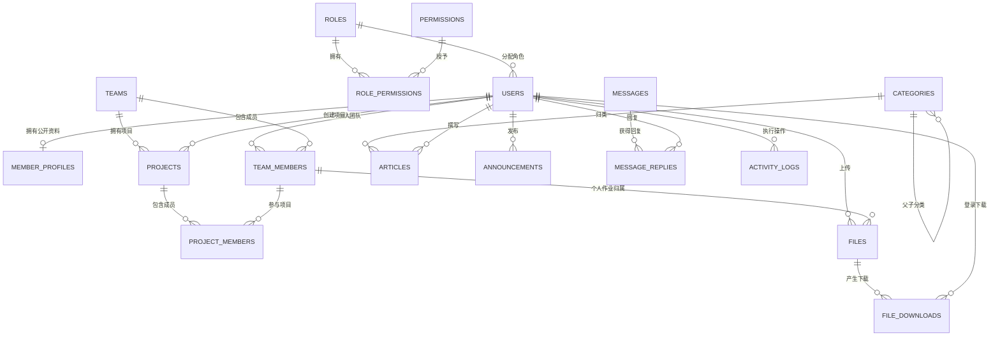

# TechHub 数据库设计文档

| 项目 | 内容 |
| --- | --- |
| 数据库类型 | MySQL 8.0（实际验证版本 8.0.19） |
| 数据库名 | `techhub` |
| 存储引擎 | InnoDB |
| 字符集/排序规则 | `utf8mb4` / `utf8mb4_0900_ai_ci` |
| 表数量 | **17 张业务表** |
| 外键数量 | **21 个** |
| 初始化脚本 | [`data/install.sql`](../data/install.sql) |
| 文档版本 | v1.2（后台管理阶段完成后） |
| 编写日期 | 2026-11-25 |
| 验证状态 | SQL 已在临时新库连续导入两次并通过幂等性检查；后台迁移可重复执行；详细结果见第 9 节 |

> 本文档以实际执行的 `data/install.sql` 为准。所有表、字段、索引和约束均已在 MySQL 8.0.19 中创建验证。文档不包含数据库密码或管理员明文密码。

## 1. 数据库总体说明

### 1.1 设计目标

TechHub 数据库服务于高校技术团队展示与管理平台，覆盖：

- 后台账号、角色与权限；
- 团队资料、团队成员关系与公开成员资料；
- 项目、项目成员与技术成果；
- 文章分类、技术文章；
- 团队公告；
- 访客留言与管理员回复；
- 文件资源、团队/个人作业与下载统计；
- 后台操作审计。

设计重点：

1. **真实关系**：不使用无业务意义的空表；每张表均被页面、查询、权限或审计使用。
2. **引用完整性**：通过主键、唯一键、外键和 CHECK 约束维护数据正确性。
3. **历史保留**：成员离队、项目归档、文章归档、文件隐藏优先使用状态字段，避免误删破坏历史。
4. **查询效率**：针对前台列表、后台筛选、登录和统计聚合建立索引。
5. **可重复部署**：`install.sql` 使用 `CREATE TABLE IF NOT EXISTS` 和幂等种子写入，重复执行不会重复插入演示数据。
6. **权限与审计分离**：账号权限、业务数据、下载统计和后台操作日志分别存储。

### 1.2 实际业务表清单

| 序号 | 表名 | 业务用途 | 设计说明 |
| --- | --- | --- | --- |
| 1 | `roles` | 后台角色 | 支持内置角色和自定义角色 |
| 2 | `permissions` | 权限定义 | 权限码由初始化 SQL 提供，代码按权限码校验 |
| 3 | `role_permissions` | 角色—权限多对多关联 | RBAC 映射表 |
| 4 | `users` | 后台账号 | 保存登录凭据、显示名、账号状态 |
| 5 | `member_profiles` | 公开成员资料 | 与 `users` 构成 1:0..1 关系，管理员可不填公开资料 |
| 6 | `teams` | 团队信息 | 当前界面按单团队使用，表结构保留团队实体 |
| 7 | `team_members` | 团队成员关系 | 团队—用户多对多；带成员职位、在队状态和历史时间 |
| 8 | `categories` | 文章分类 | 支持两级父子分类 |
| 9 | `projects` | 项目成果 | 保存项目状态、可见性和成果链接 |
| 10 | `project_members` | 项目—成员多对多关联 | 保留成员在项目中的角色和退出时间 |
| 11 | `articles` | 技术文章 | 支持草稿、发布、归档和浏览量 |
| 12 | `announcements` | 团队公告 | 支持置顶、有效期和发布状态 |
| 13 | `messages` | 访客留言 | 保存访客信息、审核状态和来源信息 |
| 14 | `message_replies` | 管理员回复 | 一条留言可有多条回复，单独审核/隐藏 |
| 15 | `files` | 文件资源 | 团队作业、个人作业和普通资源 |
| 16 | `file_downloads` | 文件下载记录 | 真实下载计数与趋势统计，**补充表** |
| 17 | `activity_logs` | 后台操作日志 | 追加型审计记录，**对应课程要求的操作日志** |

### 1.3 为什么比建议清单多两张表

用户给定的建议清单包含 15 张表。本设计实际创建 17 张，新增的两张均有明确业务用途：

1. **`member_profiles`**
   - 将“登录账号”和“公开成员资料”分离；
   - 满足一对一关系：一个 `users` 记录最多对应一份公开资料；
   - 系统管理员、内容编辑可以没有公开成员资料；
   - 成员资料可独立更新简介、技能、头像和公开邮箱，不会污染认证数据。

2. **`file_downloads`**
   - 仅靠 `files.download_count` 只能得到累计数，无法生成下载趋势；
   - 后台 ECharts 需要按时间聚合真实下载数据；
   - 下载记录与后台操作日志用途不同，分开存储；
   - 便于定位异常下载行为。

### 1.4 单团队与多团队边界

- 当前前台按单团队展示，种子数据只初始化一个团队。
- `teams`、`team_members` 采用规范实体设计，未来可扩展到多个团队。
- 当前 `projects` 已包含 `team_id`，为项目归属保留明确外键。
- 文章、公告当前作为平台级内容，不按团队隔离；如未来需要多团队内容隔离，需增加对应 `team_id` 和访问范围设计。

## 2. 设计规范

### 2.1 命名规范

| 对象 | 规范 | 示例 |
| --- | --- | --- |
| 表名 | 小写蛇形复数 | `team_members` |
| 字段名 | 小写蛇形 | `created_at` |
| 主键 | `id` | `projects.id` |
| 外键 | `<实体>_id` | `project_id`, `author_id` |
| 唯一索引 | `uk_<表名>_<字段>` | `uk_users_username` |
| 普通索引 | `idx_<表名>_<字段>` | `idx_articles_status_published` |
| 外键约束 | `fk_<表名>_<字段>` | `fk_projects_team` |
| CHECK 约束 | `chk_<表名>_<含义>` | `chk_projects_dates` |

### 2.2 字段类型约定

| 用途 | 类型 |
| --- | --- |
| 主键/外键 | `BIGINT UNSIGNED` |
| 计数 | `INT UNSIGNED` |
| 文件大小 | `BIGINT UNSIGNED` |
| 短文本 | `VARCHAR(50~255)` |
| 长正文 | `TEXT` / `LONGTEXT` |
| 时间 | `DATETIME` |
| 日期 | `DATE` |
| 布尔状态 | `TINYINT(1)` |
| 固定状态 | `ENUM(...)` |

### 2.3 公共时间字段

除关联表、下载记录和日志表按实际需要精简外，业务表包含：

| 字段 | 类型 | 默认值 | 说明 |
| --- | --- | --- | --- |
| `created_at` | DATETIME | `CURRENT_TIMESTAMP` | 创建时间 |
| `updated_at` | DATETIME | `CURRENT_TIMESTAMP ON UPDATE CURRENT_TIMESTAMP` | 最后更新时间 |

应用通过 `config/app.php` 将默认时区设置为 `Asia/Shanghai`。

### 2.4 删除与历史保留策略

| 对象 | 策略 |
| --- | --- |
| 用户账号 | 使用 `status='disabled'` 停用，不随意物理删除 |
| 团队成员关系 | 使用 `status='active'/'alumni'/'removed'` 和 `left_at` 保留历史 |
| 项目成员关系 | 通过 `left_at` 记录退出；`team_members` 外键使用 `RESTRICT`，避免删除成员破坏项目历史 |
| 项目 | 使用状态和可见性控制；归档不删除 |
| 文章 | 使用 `draft/published/archived` 状态 |
| 公告 | 使用状态和过期时间 |
| 留言 | 使用审核状态；回复可通过 `hidden` 隐藏 |
| 文件 | 使用 `status='hidden'` 隐藏，保留元数据 |
| 分类/角色 | 有引用时由外键限制删除 |
| 日志 | 追加写入，不提供普通编辑或删除入口 |
| 下载记录 | 随文件删除而级联清理，正常运行中文件优先隐藏而非物理删除 |

## 3. E-R 关系设计

### 3.1 关系类型汇总

| 关系类型 | 关系 | 实现方式 |
| --- | --- | --- |
| **一对一（1:0..1）** | 用户账号—公开成员资料 | `member_profiles.user_id` 唯一外键 |
| 一对多 | 角色—用户 | `users.role_id` |
| 一对多 | 团队—成员关系 | `team_members.team_id` |
| 一对多 | 团队—项目 | `projects.team_id` |
| 一对多 | 分类—子分类 | `categories.parent_id` 自关联 |
| 一对多 | 分类—文章 | `articles.category_id` |
| 一对多 | 用户—文章/公告/回复/文件/日志 | 各表 `user_id`/`author_id`/`publisher_id` |
| 一对多 | 留言—回复 | `message_replies.message_id` |
| 一对多 | 文件—下载记录 | `file_downloads.file_id` |
| **多对多** | 角色—权限 | `role_permissions` 联合主键 |
| **多对多** | 团队—用户 | `team_members` 联合唯一键 |
| **多对多** | 项目—团队成员 | `project_members` 联合主键 |

### 3.2 关键关系说明

1. **用户与公开资料**：`users` 是登录主体，`member_profiles` 是可选公开资料。两者通过 `user_id` 唯一约束形成 1:0..1。删除账号会级联删除公开资料；实际业务优先停用账号。
2. **团队与用户**：通过 `team_members` 多对多关联。当前 UI 只展示一个团队，但表允许用户拥有不同团队下的成员关系。
3. **项目与成员**：`project_members` 引用 `team_members.id` 而非 `users.id`，因此“项目成员”必须先成为团队历史成员。成员离队时将 `team_members.status` 改为 `alumni/removed`，而不是删除记录；`project_members.team_member_id` 使用 `RESTRICT`，项目历史得以保留。
4. **留言与回复**：拆分为 `messages` 和 `message_replies` 两张表，审核状态与回复内容清晰分离，避免单表自关联审核语义混乱。
5. **文件与成员**：`files.related_member_id` 可为空；只有个人作业才需要指向 `team_members`。
6. **文件与下载**：`files.download_count` 保存累计值，`file_downloads` 保存每次真实下载流水，两者同时更新。

## 4. 数据表结构与数据字典

> 以下字段结构完全对应 `data/install.sql`。公共 `created_at`/`updated_at` 如未重复逐行列出，适用第 2.3 节说明。

### 4.1 `roles` 角色表

**存在意义**：定义后台角色，作为 RBAC 的角色端。

| 字段 | 类型 | 约束/默认 | 说明 |
| --- | --- | --- | --- |
| `id` | BIGINT UNSIGNED | PK, AUTO_INCREMENT | 角色 ID |
| `code` | VARCHAR(50) | NOT NULL, UNIQUE | 角色代码 |
| `name` | VARCHAR(50) | NOT NULL | 角色显示名 |
| `description` | VARCHAR(255) | NULL | 角色说明 |
| `is_system` | TINYINT(1) | NOT NULL DEFAULT 0 | 1=内置角色，禁止删除 |
| `sort_order` | INT | NOT NULL DEFAULT 0 | 排序 |
| `created_at` | DATETIME | NOT NULL DEFAULT CURRENT_TIMESTAMP | 创建时间 |
| `updated_at` | DATETIME | 自动更新时间 | 更新时间 |

**索引**：`uk_roles_code`。
**种子**：`super_admin`、`editor`、`member`。

### 4.2 `permissions` 权限定义表

**存在意义**：保存可授权的权限码，菜单显示和后台路由校验均以它为准。

| 字段 | 类型 | 约束/默认 | 说明 |
| --- | --- | --- | --- |
| `id` | BIGINT UNSIGNED | PK, AUTO_INCREMENT | 权限 ID |
| `code` | VARCHAR(80) | NOT NULL, UNIQUE | 权限码，如 `project.manage` |
| `name` | VARCHAR(80) | NOT NULL | 权限名称 |
| `module` | VARCHAR(50) | NOT NULL | 所属业务模块 |
| `description` | VARCHAR(255) | NULL | 说明 |
| `sort_order` | INT | NOT NULL DEFAULT 0 | 排序 |
| `created_at` | DATETIME | NOT NULL | 创建时间 |
| `updated_at` | DATETIME | 自动更新 | 更新时间 |

**索引**：`uk_permissions_code`、`idx_permissions_module`。
**种子**：14 个权限码，覆盖仪表盘、资料、统计、团队、成员、项目、文章、分类、公告、留言、文件、账号、角色、日志。

### 4.3 `role_permissions` 角色权限关联表

**存在意义**：实现角色与权限的多对多授权。

| 字段 | 类型 | 约束 | 说明 |
| --- | --- | --- | --- |
| `role_id` | BIGINT UNSIGNED | PK, FK→`roles.id`, CASCADE | 角色 |
| `permission_id` | BIGINT UNSIGNED | PK, FK→`permissions.id`, CASCADE | 权限 |
| `created_at` | DATETIME | NOT NULL DEFAULT CURRENT_TIMESTAMP | 授权时间 |

**主键**：`(role_id, permission_id)`。
**索引**：`idx_role_permissions_permission`。
**种子**：25 条授权关系。

### 4.4 `users` 后台用户表

**存在意义**：保存后台登录主体、角色和账号状态；公开资料另表存储。

| 字段 | 类型 | 约束/默认 | 说明 |
| --- | --- | --- | --- |
| `id` | BIGINT UNSIGNED | PK, AUTO_INCREMENT | 用户 ID |
| `username` | VARCHAR(50) | NOT NULL, UNIQUE | 登录名 |
| `password_hash` | VARCHAR(255) | NOT NULL | `password_hash()` 哈希 |
| `display_name` | VARCHAR(50) | NOT NULL | 后台显示名/成员显示名 |
| `email` | VARCHAR(120) | NULL, UNIQUE | 账号邮箱 |
| `role_id` | BIGINT UNSIGNED | NOT NULL, FK→`roles.id`, RESTRICT | 当前角色 |
| `status` | ENUM('active','disabled') | NOT NULL DEFAULT 'active' | 账号状态 |
| `last_login_at` | DATETIME | NULL | 最近登录时间 |
| `last_login_ip` | VARCHAR(45) | NULL | 最近登录 IP |
| `created_at` | DATETIME | NOT NULL | 创建时间 |
| `updated_at` | DATETIME | 自动更新 | 更新时间 |

**索引**：`uk_users_username`、`uk_users_email`、`idx_users_role`、`idx_users_status`。
**种子**：1 个超级管理员、1 个内容编辑、3 个示例团队成员账号。
**安全**：数据库中只保存哈希，不保存明文密码；停用账号禁止登录。

### 4.5 `member_profiles` 公开成员资料表

**存在意义**：将认证账号与公开展示资料分离，形成明确的 1:0..1 关系。

| 字段 | 类型 | 约束/默认 | 说明 |
| --- | --- | --- | --- |
| `id` | BIGINT UNSIGNED | PK, AUTO_INCREMENT | 资料 ID |
| `user_id` | BIGINT UNSIGNED | NOT NULL, UNIQUE, FK→`users.id`, CASCADE | 所属账号 |
| `bio` | TEXT | NULL | 个人简介 |
| `skills` | VARCHAR(255) | NULL | 技术方向（逗号分隔展示） |
| `avatar_path` | VARCHAR(255) | NULL | 头像路径 |
| `public_email` | VARCHAR(120) | NULL | 可公开邮箱 |
| `github_url` | VARCHAR(255) | NULL | GitHub/主页 |
| `created_at` | DATETIME | NOT NULL | 创建时间 |
| `updated_at` | DATETIME | 自动更新 | 更新时间 |

**索引**：`uk_member_profiles_user` 保证一个用户最多一份公开资料。
**种子**：3 份示例成员资料；头像路径指向 `public/assets/images/avatars/` 下的本地静态示例图。

### 4.6 `teams` 团队表

**存在意义**：保存团队公开信息，作为成员关系和项目归属的团队实体。

| 字段 | 类型 | 约束/默认 | 说明 |
| --- | --- | --- | --- |
| `id` | BIGINT UNSIGNED | PK, AUTO_INCREMENT | 团队 ID |
| `name` | VARCHAR(100) | NOT NULL | 团队名称 |
| `slug` | VARCHAR(100) | NOT NULL, UNIQUE | URL 别名 |
| `short_name` | VARCHAR(50) | NULL | 简称 |
| `slogan` | VARCHAR(200) | NULL | 口号 |
| `description` | TEXT | NULL | 团队简介 |
| `research_areas` | VARCHAR(255) | NULL | 研究方向（前台展示） |
| `tech_stack` | VARCHAR(255) | NULL | 团队技术栈（前台展示） |
| `logo_path` | VARCHAR(255) | NULL | Logo 路径 |
| `founded_at` | DATE | NULL | 成立日期 |
| `email` | VARCHAR(120) | NULL | 公开邮箱 |
| `location` | VARCHAR(120) | NULL | 所在地 |
| `github_url` | VARCHAR(255) | NULL | 仓库链接 |
| `website_url` | VARCHAR(255) | NULL | 网站链接 |
| `status` | ENUM('active','archived') | NOT NULL DEFAULT 'active' | 团队状态 |
| `created_at` | DATETIME | NOT NULL | 创建时间 |
| `updated_at` | DATETIME | 自动更新 | 更新时间 |

**索引**：`uk_teams_slug`、`idx_teams_status`。
**种子**：1 个明确标注的示例团队，正式资料待替换；研究方向、技术栈和本地 Logo 路径已为前台页面准备。

### 4.7 `team_members` 团队成员关系表

**存在意义**：建立团队—用户多对多关系，保存职位和成员历史状态。

| 字段 | 类型 | 约束/默认 | 说明 |
| --- | --- | --- | --- |
| `id` | BIGINT UNSIGNED | PK, AUTO_INCREMENT | 成员关系 ID |
| `team_id` | BIGINT UNSIGNED | NOT NULL, FK→`teams.id`, RESTRICT | 团队 |
| `user_id` | BIGINT UNSIGNED | NOT NULL, FK→`users.id`, RESTRICT | 账号 |
| `position_title` | VARCHAR(80) | NULL | 团队职位/方向 |
| `responsibilities` | VARCHAR(255) | NULL | 职责说明 |
| `joined_at` | DATE | NOT NULL | 加入日期 |
| `left_at` | DATE | NULL | 离队日期 |
| `status` | ENUM('active','alumni','removed') | NOT NULL DEFAULT 'active' | 在队/离队/移除 |
| `sort_order` | INT | NOT NULL DEFAULT 0 | 展示排序 |
| `created_at` | DATETIME | NOT NULL | 创建时间 |
| `updated_at` | DATETIME | 自动更新 | 更新时间 |

**索引**：`uk_team_members_team_user`、`idx_team_members_user`、`idx_team_members_status_sort`。
**CHECK**：`left_at IS NULL OR left_at >= joined_at`。
**删除限制**：被 `project_members` 引用时不可删除，应改为离队状态。

### 4.8 `categories` 文章分类表

**存在意义**：提供文章分类树和前台筛选。

| 字段 | 类型 | 约束/默认 | 说明 |
| --- | --- | --- | --- |
| `id` | BIGINT UNSIGNED | PK, AUTO_INCREMENT | 分类 ID |
| `parent_id` | BIGINT UNSIGNED | NULL, FK→`categories.id`, RESTRICT | 父分类 |
| `name` | VARCHAR(80) | NOT NULL | 分类名 |
| `slug` | VARCHAR(100) | NOT NULL, UNIQUE | URL 别名 |
| `description` | VARCHAR(255) | NULL | 分类简介 |
| `sort_order` | INT | NOT NULL DEFAULT 0 | 排序 |
| `status` | ENUM('enabled','disabled') | NOT NULL DEFAULT 'enabled' | 状态 |
| `created_at` | DATETIME | NOT NULL | 创建时间 |
| `updated_at` | DATETIME | 自动更新 | 更新时间 |

**索引**：`uk_categories_slug`、`idx_categories_parent`、`idx_categories_status_sort`。
**约束**：有子分类或有文章时不能删除。自引用和循环判断在应用层完成。
**种子**：3 个示例分类，包含一个父子关系。

### 4.9 `projects` 项目表

**存在意义**：展示团队项目成果，并作为项目成员关系的父实体。

| 字段 | 类型 | 约束/默认 | 说明 |
| --- | --- | --- | --- |
| `id` | BIGINT UNSIGNED | PK, AUTO_INCREMENT | 项目 ID |
| `team_id` | BIGINT UNSIGNED | NOT NULL, FK→`teams.id`, RESTRICT | 所属团队 |
| `title` | VARCHAR(150) | NOT NULL | 项目名称 |
| `slug` | VARCHAR(160) | NOT NULL, UNIQUE | URL 别名 |
| `summary` | VARCHAR(500) | NOT NULL | 摘要 |
| `description` | LONGTEXT | NOT NULL | 详细描述 |
| `outcomes` | TEXT | NULL | 项目成果（前台展示） |
| `cover_path` | VARCHAR(255) | NULL | 封面路径 |
| `tech_stack` | VARCHAR(255) | NULL | 技术栈 |
| `repo_url` | VARCHAR(255) | NULL | 仓库链接 |
| `demo_url` | VARCHAR(255) | NULL | 演示链接 |
| `status` | ENUM('planning','ongoing','completed','archived') | NOT NULL DEFAULT 'ongoing' | 项目阶段 |
| `is_public` | TINYINT(1) | NOT NULL DEFAULT 1 | 是否前台可见 |
| `is_featured` | TINYINT(1) | NOT NULL DEFAULT 0 | 是否推荐 |
| `sort_order` | INT | NOT NULL DEFAULT 0 | 排序 |
| `start_date` | DATE | NULL | 开始日期 |
| `end_date` | DATE | NULL | 结束日期 |
| `created_by` | BIGINT UNSIGNED | NOT NULL, FK→`users.id`, RESTRICT | 创建人 |
| `created_at` | DATETIME | NOT NULL | 创建时间 |
| `updated_at` | DATETIME | 自动更新 | 更新时间 |

**索引**：`uk_projects_slug`、`idx_projects_team_public`、`idx_projects_created_by`、`idx_projects_featured`。
**CHECK**：结束日期不早于开始日期。
**种子**：2 个明确标注的示例项目；`outcomes` 和本地 SVG 封面路径用于前台项目成果展示。

### 4.10 `project_members` 项目成员关联表

**存在意义**：建立项目—团队成员多对多关系，保留项目内角色和离项时间。

| 字段 | 类型 | 约束/默认 | 说明 |
| --- | --- | --- | --- |
| `project_id` | BIGINT UNSIGNED | PK, FK→`projects.id`, CASCADE | 项目 |
| `team_member_id` | BIGINT UNSIGNED | PK, FK→`team_members.id`, RESTRICT | 团队成员关系 |
| `role_in_project` | VARCHAR(80) | NULL | 项目内角色 |
| `joined_at` | DATE | NOT NULL | 加入项目日期 |
| `left_at` | DATE | NULL | 退出日期 |
| `created_at` | DATETIME | NOT NULL | 记录创建时间 |

**主键**：`(project_id, team_member_id)`。
**索引**：`idx_project_members_member`。
**CHECK**：退出日期不早于加入日期。
**历史保护**：`team_member_id` 使用 `RESTRICT`，禁止物理删除有项目历史的成员。

### 4.11 `articles` 技术文章表

**存在意义**：保存技术文章、发布状态、作者、分类和浏览量。

| 字段 | 类型 | 约束/默认 | 说明 |
| --- | --- | --- | --- |
| `id` | BIGINT UNSIGNED | PK, AUTO_INCREMENT | 文章 ID |
| `category_id` | BIGINT UNSIGNED | NOT NULL, FK→`categories.id`, RESTRICT | 分类 |
| `author_id` | BIGINT UNSIGNED | NOT NULL, FK→`users.id`, RESTRICT | 作者 |
| `title` | VARCHAR(200) | NOT NULL | 标题 |
| `slug` | VARCHAR(220) | NOT NULL, UNIQUE | URL 别名 |
| `summary` | VARCHAR(500) | NOT NULL | 摘要 |
| `content` | LONGTEXT | NOT NULL | 正文/受控 Markdown 源文 |
| `cover_path` | VARCHAR(255) | NULL | 封面 |
| `status` | ENUM('draft','published','archived') | NOT NULL DEFAULT 'draft' | 状态 |
| `is_featured` | TINYINT(1) | NOT NULL DEFAULT 0 | 推荐 |
| `view_count` | INT UNSIGNED | NOT NULL DEFAULT 0 | 浏览量 |
| `published_at` | DATETIME | NULL | 发布时间 |
| `created_at` | DATETIME | NOT NULL | 创建时间 |
| `updated_at` | DATETIME | 自动更新 | 更新时间 |

**索引**：`uk_articles_slug`、`idx_articles_status_published`、`idx_articles_category_status`、`idx_articles_author`、`idx_articles_featured`。
**种子**：2 篇已发布文章、1 篇草稿。

### 4.12 `announcements` 团队公告表

**存在意义**：发布团队通知，支持置顶和有效期。

| 字段 | 类型 | 约束/默认 | 说明 |
| --- | --- | --- | --- |
| `id` | BIGINT UNSIGNED | PK, AUTO_INCREMENT | 公告 ID |
| `publisher_id` | BIGINT UNSIGNED | NOT NULL, FK→`users.id`, RESTRICT | 发布人 |
| `title` | VARCHAR(200) | NOT NULL | 标题 |
| `summary` | VARCHAR(500) | NULL | 摘要 |
| `content` | LONGTEXT | NOT NULL | 正文 |
| `type` | ENUM('general','event','recruitment','system') | NOT NULL DEFAULT 'general' | 类型 |
| `is_pinned` | TINYINT(1) | NOT NULL DEFAULT 0 | 是否置顶 |
| `status` | ENUM('draft','published','archived') | NOT NULL DEFAULT 'draft' | 状态 |
| `published_at` | DATETIME | NULL | 发布时间 |
| `expires_at` | DATETIME | NULL | 过期时间 |
| `created_at` | DATETIME | NOT NULL | 创建时间 |
| `updated_at` | DATETIME | 自动更新 | 更新时间 |

**索引**：`idx_announcements_public`、`idx_announcements_expires`、`idx_announcements_publisher`。
**CHECK**：过期时间不早于发布时间。
**种子**：2 条示例公告。

### 4.13 `messages` 访客留言表

**存在意义**：保存访客留言、审核状态和提交来源。

| 字段 | 类型 | 约束/默认 | 说明 |
| --- | --- | --- | --- |
| `id` | BIGINT UNSIGNED | PK, AUTO_INCREMENT | 留言 ID |
| `visitor_name` | VARCHAR(50) | NOT NULL | 访客昵称 |
| `visitor_email` | VARCHAR(120) | NULL | 访客邮箱（不公开） |
| `content` | TEXT | NOT NULL | 留言内容 |
| `status` | ENUM('pending','approved','rejected') | NOT NULL DEFAULT 'pending' | 审核状态 |
| `ip_address` | VARCHAR(45) | NULL | 提交 IP |
| `user_agent` | VARCHAR(500) | NULL | 浏览器标识 |
| `approved_at` | DATETIME | NULL | 审核通过时间 |
| `created_at` | DATETIME | NOT NULL | 创建时间 |
| `updated_at` | DATETIME | 自动更新 | 更新时间 |

**索引**：`idx_messages_status_created`、`idx_messages_email`。
**种子**：1 条已通过留言、1 条待审核留言。

### 4.14 `message_replies` 留言回复表

**存在意义**：保存管理员对留言的回复，可独立隐藏，避免与访客留言混在同一张表。

| 字段 | 类型 | 约束/默认 | 说明 |
| --- | --- | --- | --- |
| `id` | BIGINT UNSIGNED | PK, AUTO_INCREMENT | 回复 ID |
| `message_id` | BIGINT UNSIGNED | NOT NULL, FK→`messages.id`, CASCADE | 所属留言 |
| `admin_user_id` | BIGINT UNSIGNED | NOT NULL, FK→`users.id`, RESTRICT | 回复管理员 |
| `content` | TEXT | NOT NULL | 回复内容 |
| `status` | ENUM('visible','hidden') | NOT NULL DEFAULT 'visible' | 是否公开 |
| `created_at` | DATETIME | NOT NULL | 创建时间 |
| `updated_at` | DATETIME | 自动更新 | 更新时间 |

**索引**：`idx_message_replies_message_status`、`idx_message_replies_admin`。
**种子**：1 条示例回复。

### 4.15 `files` 文件资源表

**存在意义**：保存团队作业、个人作业和普通资源的元数据；课程要求的团队/个人作业下载入口依赖此表。

| 字段 | 类型 | 约束/默认 | 说明 |
| --- | --- | --- | --- |
| `id` | BIGINT UNSIGNED | PK, AUTO_INCREMENT | 文件 ID |
| `uploader_id` | BIGINT UNSIGNED | NOT NULL, FK→`users.id`, RESTRICT | 上传人 |
| `related_member_id` | BIGINT UNSIGNED | NULL, FK→`team_members.id`, SET NULL | 个人作业归属成员 |
| `title` | VARCHAR(200) | NOT NULL | 展示标题 |
| `original_name` | VARCHAR(255) | NOT NULL | 原始文件名 |
| `stored_name` | VARCHAR(120) | NOT NULL, UNIQUE | 随机存储文件名 |
| `file_path` | VARCHAR(255) | NOT NULL | 项目内相对路径 |
| `extension` | VARCHAR(20) | NOT NULL | 规范化扩展名 |
| `mime_type` | VARCHAR(120) | NOT NULL | 服务端检测 MIME |
| `size_bytes` | BIGINT UNSIGNED | NOT NULL | 文件大小 |
| `category` | ENUM('team_assignment','personal_assignment','resource') | NOT NULL | 分类 |
| `description` | VARCHAR(500) | NULL | 描述 |
| `download_count` | INT UNSIGNED | NOT NULL DEFAULT 0 | 累计下载数 |
| `is_public` | TINYINT(1) | NOT NULL DEFAULT 1 | 是否公开 |
| `status` | ENUM('active','hidden') | NOT NULL DEFAULT 'active' | 状态 |
| `created_at` | DATETIME | NOT NULL | 上传时间 |
| `updated_at` | DATETIME | 自动更新 | 更新时间 |

**索引**：`uk_files_stored_name`、`idx_files_category_public`、`idx_files_member`、`idx_files_uploader`、`idx_files_downloads`。
**种子**：1 份团队作业、1 份个人作业，实体文件位于 `data/team`、`data/personal`。
**安全**：文件实体不放在 `public/`，下载时必须校验公开状态和路径。

### 4.16 `file_downloads` 下载记录表（补充）

**存在意义**：记录每次真实下载，用于 ECharts 下载趋势、下载排行和安全排查。

| 字段 | 类型 | 约束/默认 | 说明 |
| --- | --- | --- | --- |
| `id` | BIGINT UNSIGNED | PK, AUTO_INCREMENT | 下载记录 ID |
| `file_id` | BIGINT UNSIGNED | NOT NULL, FK→`files.id`, CASCADE | 文件 |
| `user_id` | BIGINT UNSIGNED | NULL, FK→`users.id`, SET NULL | 登录用户（访客为空） |
| `ip_address` | VARCHAR(45) | NULL | 下载 IP |
| `user_agent` | VARCHAR(500) | NULL | 浏览器标识 |
| `downloaded_at` | DATETIME | NOT NULL DEFAULT CURRENT_TIMESTAMP | 下载时间 |

**索引**：`idx_file_downloads_file_time`、`idx_file_downloads_time`、`idx_file_downloads_user`。
**种子**：1 条示例下载记录。

### 4.17 `activity_logs` 后台操作日志表

**存在意义**：记录后台关键操作，满足操作审计和课程日志模块要求。

| 字段 | 类型 | 约束/默认 | 说明 |
| --- | --- | --- | --- |
| `id` | BIGINT UNSIGNED | PK, AUTO_INCREMENT | 日志 ID |
| `user_id` | BIGINT UNSIGNED | NULL, FK→`users.id`, SET NULL | 操作人（可空） |
| `actor_username` | VARCHAR(50) | NULL | 操作人用户名快照 |
| `module` | VARCHAR(50) | NOT NULL | 业务模块 |
| `action` | VARCHAR(50) | NOT NULL | 操作动作 |
| `target_type` | VARCHAR(50) | NULL | 目标类型（多态，无外键） |
| `target_id` | BIGINT UNSIGNED | NULL | 目标 ID（多态，无外键） |
| `description` | VARCHAR(500) | NULL | 描述 |
| `result` | ENUM('success','failure') | NOT NULL DEFAULT 'success' | 操作结果 |
| `ip_address` | VARCHAR(45) | NULL | 操作 IP |
| `user_agent` | VARCHAR(500) | NULL | 浏览器标识 |
| `created_at` | DATETIME | NOT NULL DEFAULT CURRENT_TIMESTAMP | 操作时间 |

**索引**：`idx_activity_logs_user_time`、`idx_activity_logs_module_time`、`idx_activity_logs_result`、`idx_activity_logs_created`。
**种子**：1 条初始化日志。

## 5. 数据字典：枚举与状态值

| 表.字段 | 可选值 | 业务含义 |
| --- | --- | --- |
| `roles.is_system` | 0/1 | 非内置/内置角色 |
| `users.status` | `active`, `disabled` | 正常/停用 |
| `teams.status` | `active`, `archived` | 正常/归档 |
| `team_members.status` | `active`, `alumni`, `removed` | 在队/校友或离队/移除 |
| `categories.status` | `enabled`, `disabled` | 启用/停用 |
| `projects.status` | `planning`, `ongoing`, `completed`, `archived` | 筹备/进行/完成/归档 |
| `projects.is_public` | 0/1 | 前台隐藏/可见 |
| `articles.status` | `draft`, `published`, `archived` | 草稿/发布/归档 |
| `announcements.type` | `general`, `event`, `recruitment`, `system` | 普通/活动/招募/系统 |
| `announcements.status` | `draft`, `published`, `archived` | 草稿/发布/归档 |
| `messages.status` | `pending`, `approved`, `rejected` | 待审/通过/拒绝 |
| `message_replies.status` | `visible`, `hidden` | 公开/隐藏 |
| `files.category` | `team_assignment`, `personal_assignment`, `resource` | 团队作业/个人作业/资源 |
| `files.status` | `active`, `hidden` | 正常/隐藏 |
| `files.is_public` | 0/1 | 私有/公开 |
| `activity_logs.action` | 自由字符串，实际值：`create`, `update`, `delete`, `status`, `visibility`, `upload`, `reply`, `remove`, `login`, `logout`, `login_failed` 等 | 操作类型 |
| `activity_logs.result` | `success`, `failure` | 操作结果；登录失败等写入 failure |

### 5.1 权限码种子

| ID | 权限码 | 模块 |
| --- | --- | --- |
| 1 | `dashboard.view` | dashboard |
| 2 | `profile.edit` | profile |
| 3 | `stats.view` | stats |
| 4 | `team.edit` | team |
| 5 | `member.manage` | members |
| 6 | `project.manage` | projects |
| 7 | `article.manage` | articles |
| 8 | `category.manage` | categories |
| 9 | `announcement.manage` | announcements |
| 10 | `message.moderate` | messages |
| 11 | `file.manage` | files |
| 12 | `user.manage` | users |
| 13 | `role.manage` | roles |
| 14 | `activity.view` | activity |

**角色映射**：

- 超级管理员：全部 14 个权限；
- 内容编辑：1、2、3、6、7、8、9、10、11；
- 团队成员：1、2。

### 5.2 初始账号与密码处理

- 管理员登录名：`admin`；
- 管理员角色：`super_admin`；
- 初始管理员密码：**不在 SQL 和 Git 中保存明文**；
- SQL 中仅保存 `password_hash()` 生成的哈希（bcrypt，长度 60）；
- 明文仅写入本地、不提交 Git 的环境/凭据文件；`config/database.php` 与 `.env` 不进入仓库；
- `editor` 与三个示例成员账号用于演示结构，密码不公开写入仓库；
- 首次部署后应登录修改管理员密码并配置团队真实信息。

## 6. 表之间的关联关系

### 6.1 关系清单

| 父表 | 子表 | 外键 | 基数 | 删除策略 |
| --- | --- | --- | --- | --- |
| `roles` | `users` | `role_id` | 1:N | RESTRICT |
| `roles` | `role_permissions` | `role_id` | 1:N | CASCADE |
| `permissions` | `role_permissions` | `permission_id` | 1:N | CASCADE |
| `users` | `member_profiles` | `user_id` | 1:0..1 | CASCADE |
| `users` | `team_members` | `user_id` | 1:N | RESTRICT |
| `teams` | `team_members` | `team_id` | 1:N | RESTRICT |
| `teams` | `projects` | `team_id` | 1:N | RESTRICT |
| `users` | `projects` | `created_by` | 1:N | RESTRICT |
| `projects` | `project_members` | `project_id` | 1:N | CASCADE |
| `team_members` | `project_members` | `team_member_id` | 1:N | RESTRICT |
| `categories` | `categories` | `parent_id` | 1:N（自关联） | RESTRICT |
| `categories` | `articles` | `category_id` | 1:N | RESTRICT |
| `users` | `articles` | `author_id` | 1:N | RESTRICT |
| `users` | `announcements` | `publisher_id` | 1:N | RESTRICT |
| `messages` | `message_replies` | `message_id` | 1:N | CASCADE |
| `users` | `message_replies` | `admin_user_id` | 1:N | RESTRICT |
| `users` | `files` | `uploader_id` | 1:N | RESTRICT |
| `team_members` | `files` | `related_member_id` | 1:N | SET NULL |
| `files` | `file_downloads` | `file_id` | 1:N | CASCADE |
| `users` | `file_downloads` | `user_id` | 1:N | SET NULL |
| `users` | `activity_logs` | `user_id` | 1:N | SET NULL |

### 6.2 删除历史保护说明

1. 删除团队成员会先被 `project_members` 的 `RESTRICT` 阻止；
2. 推荐做法是更新 `team_members.status='alumni'` 和 `left_at`；
3. 即使成员离队，项目成员关系和项目本身仍保留；
4. 用户账号同理优先停用，避免文章、公告、项目失去作者信息；
5. 分类和角色受外键限制，不能在有引用时删除；
6. 文件优先隐藏，下载记录会随物理文件删除而级联清除。

## 7. 关键索引设计

| 索引 | 所属表 | 支撑场景 |
| --- | --- | --- |
| `uk_users_username` | users | 登录查询 |
| `uk_users_email` | users | 邮箱唯一性 |
| `uk_team_members_team_user` | team_members | 防止重复加入同一团队 |
| `idx_team_members_status_sort` | team_members | 前台成员列表 |
| `idx_projects_team_public` | projects | 按团队/公开状态筛选项目 |
| `idx_articles_status_published` | articles | 前台已发布文章按时间排序 |
| `idx_articles_category_status` | articles | 分类筛选 |
| `idx_announcements_public` | announcements | 有效公告列表、置顶排序 |
| `idx_messages_status_created` | messages | 待审核列表 |
| `idx_message_replies_message_status` | message_replies | 留言公开回复加载 |
| `idx_files_category_public` | files | 团队/个人作业下载页 |
| `idx_file_downloads_file_time` | file_downloads | 文件下载趋势和排行 |
| `idx_activity_logs_module_time` | activity_logs | 后台日志筛选 |
| `idx_activity_logs_result` | activity_logs | 按成功/失败筛选日志 |

## 8. 数据完整性约束

### 8.1 实体完整性

- 每张表都有主键；
- 关联表使用复合主键或唯一键防止重复关系；
- 自增主键由 InnoDB 维护。

### 8.2 参照完整性

- 21 个外键全部在数据库中创建并通过 `information_schema` 检查；
- 有内容的角色、用户、分类不能随意物理删除；
- 项目成员和文件下载记录通过外键保持父子关系；
- 操作日志的用户外键使用 `SET NULL`，同时保存操作人用户名快照。

### 8.3 域完整性

- `ENUM` 限定状态和分类取值范围；
- 文件大小、浏览量、下载量使用无符号类型；
- 日期范围通过 CHECK 约束限制；
- 用户名、角色代码、分类 slug、项目 slug、文章 slug、文件名唯一；
- 应用层仍必须进行权限、状态机和输入校验。

### 8.4 事务完整性

初始化不涉及跨表业务事务；后续 MVC 阶段将在以下操作中使用事务：

- 项目与项目成员批量保存；
- 角色权限批量替换；
- 用户创建与公开资料创建；
- 留言审核与回复/操作日志；
- 文件元数据与下载计数更新。

## 9. 实际导入与验证结果

### 9.1 环境

| 项目 | 实际值 |
| --- | --- |
| PHP | 8.2.36 NTS（已安装并启用扩展） |
| MySQL | 8.0.19 |
| 数据库实例 | 独立实例，端口 3308（保留现有 3306/3307 实例） |
| 数据库 | `techhub` |
| 应用连接账号 | `techhub_app`，仅授予 SELECT/INSERT/UPDATE/DELETE |

> 数据库安装使用本地 root，应用运行时使用最小权限账号。密码保存在项目之外的本机凭据文件中，未写入 SQL/Git。

### 9.2 执行结果

实际执行：

1. 使用 MySQL 8.0.19 创建 `techhub`；
2. 连续两次执行 `data/install.sql`；
3. 检查表、外键、种子行数；
4. 使用 PHP 8.2 PDO 连接并执行查询；
5. 使用事务插入并回滚验证 DML。

结果：

| 检查项 | 结果 |
| --- | --- |
| 第一次导入 | 成功，17 张表 |
| 第二次导入 | 成功，无重复表或重复种子 |
| 外键数量 | 21 |
| 用户/公开资料 | 5 / 3 |
| 角色/权限/角色权限 | 3 / 14 / 25 |
| 团队/成员关系 | 1 / 3 |
| 分类/项目/项目成员 | 3 / 2 / 5 |
| 文章/公告 | 3 / 2 |
| 留言/回复 | 2 / 1 |
| 文件/下载记录 | 2 / 1 |
| 操作日志 | 1 |
| PDO 连接 | 成功 |
| 管理员密码哈希校验 | 成功 |
| 事务插入后回滚 | 成功，回滚后无残留 |

### 9.3 重复部署说明

- `CREATE TABLE IF NOT EXISTS` 保证重复执行不因表已存在而报错；
- 角色和权限使用 `ON DUPLICATE KEY UPDATE` 更新定义；
- 用户、团队、项目和演示内容使用 `INSERT IGNORE`，不覆盖已经被编辑的密码或内容；
- 如果已存在同名唯一键但不同 ID 的数据，会跳过插入而不是重复；
- 结构变化需要后续迁移脚本，不能依赖 `install.sql` 自动修改已存在的表；
- 不应在有真实用户数据的环境随意执行包含 `DROP DATABASE` 的调试命令。

## 10. 数据层实施进度与后续工作

**已完成（2026-11-25）**：

1. `core/Database.php` 与 PDO 连接已实现；
2. 已有 User、Team、Project、Article、Announcement、Message、FileResource、ActivityLog 等基础 Model；
3. 管理员登录、Session 与 RBAC 权限中间件已实现并验证；
4. 首页和后台仪表盘已接入真实聚合/列表查询；
5. `install.sql` 已完成两次重复导入验证。

**前台开发阶段新增（2026-11-25）**：

- 迁移脚本：`data/migrations/2026-11-25_frontend.sql`，可重复执行；
- `teams` 增加 `research_areas`、`tech_stack` 两个展示字段；
- `projects` 增加 `outcomes` 项目成果字段；
- 示例图片路径写入 `teams.logo_path`、`member_profiles.avatar_path`、`projects.cover_path`、`articles.cover_path`。

**后台管理阶段新增（2026-11-25）**：

- 迁移脚本 `data/migrations/2026-11-25_admin.sql`：`activity_logs` 增加 `result` 字段和 `idx_activity_logs_result` 索引；
- 迁移脚本 `data/migrations/2026-11-25_admin_demo_dates.sql`：只调整明确标记为“示例”的项目、文章日期到 2026 年 6–11 月，让演示窗口内的图表使用真实聚合结果；
- 后台 Role、AdminStats Model 和用户/角色/内容 CRUD 已接入；
- 使用临时新库连续导入两次 `install.sql`，结果仍为 17 表、21 外键，并包含 `activity_logs.result`。

**后续工作**：

1. 在部署文档中写明数据库账号启动、备份与恢复步骤；
2. 真实团队资料替换示例数据后重新核对统计聚合；
3. 如增加权限码或结构变更，继续使用版本化迁移脚本；
4. 对所有外键、索引和种子数据持续回归。

## 11. 变更记录

| 版本 | 日期 | 内容 |
| --- | --- | --- |
| v1.2 | 2026-11-25 | 后台阶段增加 `activity_logs.result` 与索引；新增后台迁移和示例日期迁移；完成后台 CRUD 数据验证 |
| v1.1 | 2026-11-25 | 前台开发补充 `teams.research_areas`、`teams.tech_stack`、`projects.outcomes`；新增幂等迁移脚本并验证 |
| v1.0 | 2026-11-25 | 确定 17 表结构，完成 SQL 并实际导入验证 |
