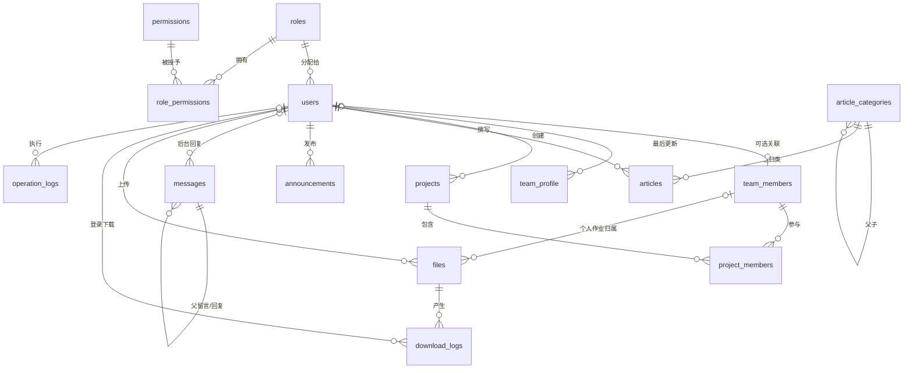

# TechHub 数据库初步设计方案（已被正式设计取代）

> **状态更新（2026-11-25）**
>
> 本文件是第一阶段的历史草案，其中 `team_profile`、`article_categories`、自关联留言、`download_logs`、`operation_logs` 等旧方案已在实施阶段调整。**最终数据库结构、字段、外键和实际导入结果以 [`docs/database-design.md`](database-design.md) 和 [`data/install.sql`](../data/install.sql) 为准。**
>
> 正式表结构为 17 张表：`users`、`member_profiles`、`roles`、`permissions`、`role_permissions`、`teams`、`team_members`、`categories`、`projects`、`project_members`、`articles`、`announcements`、`messages`、`message_replies`、`files`、`file_downloads`、`activity_logs`。

| 项目 | 内容 |
| --- | --- |
| 数据库 | MySQL 8.0 |
| 目标库名 | `techhub`（可配置） |
| 表数量 | 旧草案 15 张；正式实施 17 张 |
| 字符集/排序规则 | `utf8mb4` / `utf8mb4_0900_ai_ci` |
| 存储引擎 | InnoDB |
| SQL 文件 | 已实现：`/data/install.sql`；旧草案不作为建表依据 |
| 文档状态 | 历史方案，已被数据库设计文档取代 |
| 编写日期 | 2026-11-25（历史草案） |

> 本方案中的部分表名、外键和删除策略已被正式实施调整。请勿按本文件旧表名建表。

## 1. 设计目标

1. 用约 15 张表覆盖 12 个功能模块，表之间具有真实业务关系，不创建无用途的“凑数表”。
2. 所有核心内容数据来自 MySQL，不使用 PHP 数组或静态模板冒充数据源。
3. 用主键、唯一约束、外键、索引和事务保证引用完整性与查询效率。
4. 用状态字段支持草稿、隐藏、审核、归档等真实业务状态。
5. 通过操作日志和下载日志支持审计与统计，但不把日志表用于业务展示内容。
6. 支持后续扩展（更多内容类型、时间筛选等），但不为假设中的多租户过度设计。

## 2. 设计约定

### 2.1 命名约定

- 表名：小写蛇形复数，例如 `team_members`、`article_categories`；
- 字段名：小写蛇形，例如 `created_at`、`published_at`；
- 主键：统一 `id`；
- 外键：`<实体>_id`，例如 `role_id`、`project_id`；
- 唯一索引：`uk_<表>_<字段>`；
- 普通索引：`idx_<表>_<字段>`；
- 外键约束：`fk_<表>_<字段>`；
- 时间字段统一使用 `DATETIME`，不使用本地时区字符串；
- 布尔字段使用 `TINYINT(1)`，0/1 表示；
- 金额场景不存在，因此不设计金额字段。

### 2.2 主键、字符集与时间

- 业务主表主键使用 `BIGINT UNSIGNED AUTO_INCREMENT`；
- `team_profile` 为单例表，使用 `TINYINT UNSIGNED PRIMARY KEY`，通过 `CHECK (id = 1)` 限制单条记录；
- 关联表使用复合主键，避免重复关系；
- 字符集 `utf8mb4`，排序规则 `utf8mb4_0900_ai_ci`；
- 时区由应用统一设置为 `Asia/Shanghai`，数据库存储逻辑时间；
- `created_at` 默认 `CURRENT_TIMESTAMP`；可编辑主表增加 `updated_at`，并使用 `ON UPDATE CURRENT_TIMESTAMP`；
- 日志表只保留 `created_at` / `downloaded_at`，不提供更新时间。

### 2.3 状态设计

固定枚举使用 MySQL `ENUM`，在数据库层限制非法状态；应用层仍需做合法状态迁移校验。

| 字段 | 可选值 | 含义 |
| --- | --- | --- |
| `users.status` | `active`, `disabled` | 启用/停用 |
| `team_members.status` | `active`, `alumni`, `hidden` | 在队/离队/隐藏 |
| `projects.status` | `planning`, `ongoing`, `completed`, `archived` | 筹备/进行/完成/归档 |
| `article_categories.status` | `enabled`, `disabled` | 启用/停用 |
| `articles.status` | `draft`, `published`, `archived` | 草稿/已发布/归档 |
| `announcements.status` | `draft`, `published`, `archived` | 草稿/已发布/归档 |
| `announcements.type` | `general`, `event`, `recruitment`, `system` | 普通/活动/招募/系统 |
| `messages.author_type` | `visitor`, `admin` | 访客留言/管理员回复 |
| `messages.status` | `pending`, `approved`, `rejected` | 待审/通过/拒绝 |
| `files.category` | `team_assignment`, `personal_assignment`, `resource` | 团队作业/个人作业/资源 |
| `files.status` | `active`, `hidden` | 正常/隐藏 |
| `roles.is_system` | 0/1 | 是否为内置不可删除角色 |

> 状态值只在应用层写成常量/枚举映射，不散落硬编码字符串。数据库中的数据仍是唯一数据来源。

### 2.4 删除策略

系统原则上使用“停用/隐藏/归档”代替物理删除；只有明确可以安全删除的关联或演示数据才物理删除。

| 外键关系 | ON DELETE | 说明 |
| --- | --- | --- |
| `users.role_id → roles.id` | `RESTRICT` | 有用户使用的角色不能删除 |
| `role_permissions.role_id → roles.id` | `CASCADE` | 删除自定义角色时清理权限关系 |
| `role_permissions.permission_id → permissions.id` | `CASCADE` | 删除权限定义时清理映射 |
| `team_profile.updated_by → users.id` | `SET NULL` | 保留团队记录，记录操作人不因账号变化丢失（另有日志） |
| `team_members.user_id → users.id` | `SET NULL` | 解除档案与账号关联，不删除成员档案 |
| `projects.created_by → users.id` | `RESTRICT` | 有项目记录的账号不得硬删除，应停用 |
| `project_members.project_id → projects.id` | `CASCADE` | 删除项目时清理项目成员关系 |
| `project_members.member_id → team_members.id` | `CASCADE` | 删除成员时清理项目关系 |
| `article_categories.parent_id → article_categories.id` | `RESTRICT` | 有子分类不得删除 |
| `articles.category_id → article_categories.id` | `RESTRICT` | 有文章的分类不得删除 |
| `articles.author_id → users.id` | `RESTRICT` | 有文章的账号不得硬删除 |
| `announcements.publisher_id → users.id` | `RESTRICT` | 有公告的账号不得硬删除 |
| `messages.parent_id → messages.id` | `CASCADE` | 删除顶级留言时清理该线程回复 |
| `messages.user_id → users.id` | `SET NULL` | 保留回复内容，回复人快照由日志记录 |
| `files.uploader_id → users.id` | `SET NULL` | 文件记录保留 |
| `files.related_member_id → team_members.id` | `SET NULL` | 个人作业与成员关联可解除 |
| `download_logs.file_id → files.id` | `CASCADE` | 文件删除时清理下载流水 |
| `download_logs.user_id → users.id` | `SET NULL` | 保留匿名/历史下载记录 |
| `operation_logs.user_id → users.id` | `SET NULL` | 保留审计日志，`actor_username` 保留操作人快照 |

**应用层补充约束**：

- 有内容的账号优先停用而非删除；
- 有子分类或文章的分类不能删除；
- 角色删除前检查是否仍有用户；
- 文件删除前校验数据库记录、磁盘文件、公开状态，并记录失败日志；
- 留言删除需二次确认，删除顶级留言会级联其回复。

### 2.5 通用字段

除日志与关联表外，业务主表包含：

| 字段 | 类型 | 说明 |
| --- | --- | --- |
| `created_at` | DATETIME NOT NULL DEFAULT CURRENT_TIMESTAMP | 创建时间 |
| `updated_at` | DATETIME NOT NULL DEFAULT CURRENT_TIMESTAMP ON UPDATE CURRENT_TIMESTAMP | 最后更新时间 |

## 3. 实体关系总览



### 3.1 关系说明

| 关系 | 基数 | 说明 |
| --- | --- | --- |
| 角色—用户 | 1:N | 一个角色可分配给多个用户；当前一个用户只有一个角色 |
| 角色—权限 | M:N | 通过 `role_permissions` 关联 |
| 用户—成员档案 | 0..1:0..1 | 一个成员档案可选关联一个后台账号 |
| 项目—成员 | M:N | 通过 `project_members`，可记录项目内角色 |
| 分类—文章 | 1:N | 每篇文章属于一个分类 |
| 分类—分类 | 1:N | 最多两级父子分类 |
| 留言—回复 | 1:N | 自关联，应用限制一级回复 |
| 文件—下载记录 | 1:N | 每次成功下载写入一条日志 |
| 用户—操作日志 | 1:N | 记录后台关键行为 |

## 4. 数据表设计

以下列出主要字段。实际建表时统一补充主键、时间字段、字符集、引擎和命名约束。

### 4.1 `roles` 角色表

**用途**：定义后台角色，供用户分配和权限映射。

| 字段 | 类型 | 约束 | 说明 |
| --- | --- | --- | --- |
| `id` | BIGINT UNSIGNED | PK, AUTO_INCREMENT | 角色 ID |
| `code` | VARCHAR(50) | NOT NULL, UNIQUE | 角色代码，如 `super_admin` |
| `name` | VARCHAR(50) | NOT NULL | 显示名称 |
| `description` | VARCHAR(255) | NULL | 说明 |
| `is_system` | TINYINT(1) | NOT NULL DEFAULT 0 | 1=内置角色，禁止删除 |
| `sort_order` | INT | NOT NULL DEFAULT 0 | 展示排序 |
| `created_at` | DATETIME | NOT NULL | 创建时间 |
| `updated_at` | DATETIME | NOT NULL | 更新时间 |

**索引**：`uk_roles_code(code)`。
**关系**：1:N `users`；M:N `permissions`（经 `role_permissions`）。

### 4.2 `permissions` 权限定义表

**用途**：保存后端可识别的权限码，作为菜单和路由授权依据。

| 字段 | 类型 | 约束 | 说明 |
| --- | --- | --- | --- |
| `id` | BIGINT UNSIGNED | PK, AUTO_INCREMENT | 权限 ID |
| `code` | VARCHAR(80) | NOT NULL, UNIQUE | 权限码，如 `article.manage` |
| `name` | VARCHAR(80) | NOT NULL | 权限名称 |
| `module` | VARCHAR(50) | NOT NULL | 所属模块 |
| `description` | VARCHAR(255) | NULL | 说明 |
| `created_at` | DATETIME | NOT NULL | 创建时间 |
| `updated_at` | DATETIME | NOT NULL | 更新时间 |

**索引**：`uk_permissions_code(code)`、`idx_permissions_module(module)`。
**关系**：M:N `roles`（经 `role_permissions`）。
**约束**：权限定义由初始化 SQL 提供，页面只读；代码必须使用已登记权限码。

### 4.3 `role_permissions` 角色权限关联表

**用途**：实现 RBAC 中角色与权限的多对多关系。

| 字段 | 类型 | 约束 | 说明 |
| --- | --- | --- | --- |
| `role_id` | BIGINT UNSIGNED | PK, FK → `roles.id` | 角色 |
| `permission_id` | BIGINT UNSIGNED | PK, FK → `permissions.id` | 权限 |
| `created_at` | DATETIME | NOT NULL | 授权时间 |

**主键**：`(role_id, permission_id)`。
**索引**：`idx_role_permissions_permission(permission_id)`。
**外键删除策略**：均 `CASCADE`。
**用途约束**：角色权限更新在事务中完成；禁止移除最后一个超级管理员所需权限。

### 4.4 `users` 后台用户表

**用途**：登录后台的团队成员、编辑和管理员账号。

| 字段 | 类型 | 约束 | 说明 |
| --- | --- | --- | --- |
| `id` | BIGINT UNSIGNED | PK, AUTO_INCREMENT | 用户 ID |
| `username` | VARCHAR(50) | NOT NULL, UNIQUE | 登录名 |
| `password_hash` | VARCHAR(255) | NOT NULL | 密码哈希 |
| `display_name` | VARCHAR(50) | NOT NULL | 后台显示名 |
| `email` | VARCHAR(120) | NULL, UNIQUE | 邮箱（可为空） |
| `role_id` | BIGINT UNSIGNED | NOT NULL, FK → `roles.id` | 当前角色 |
| `status` | ENUM('active','disabled') | NOT NULL DEFAULT 'active' | 账号状态 |
| `last_login_at` | DATETIME | NULL | 最后登录时间 |
| `last_login_ip` | VARCHAR(45) | NULL | 最后登录 IP |
| `created_at` | DATETIME | NOT NULL | 创建时间 |
| `updated_at` | DATETIME | NOT NULL | 更新时间 |

**索引**：`uk_users_username(username)`、`uk_users_email(email)`、`idx_users_role(role_id)`、`idx_users_status(status)`。
**关系**：N:1 `roles`；0..1:0..1 `team_members`；1:N 文章、公告、项目、文件、日志。
**规则**：密码只存哈希；停用账号不可登录；删除受内容外键约束，优先停用。

### 4.5 `team_profile` 团队信息表

**用途**：保存全站唯一团队资料。

| 字段 | 类型 | 约束 | 说明 |
| --- | --- | --- | --- |
| `id` | TINYINT UNSIGNED | PK, CHECK (id = 1) | 单例主键 |
| `team_name` | VARCHAR(100) | NOT NULL | 团队名称 |
| `short_name` | VARCHAR(50) | NULL | 简称 |
| `slogan` | VARCHAR(200) | NULL | 口号 |
| `introduction` | TEXT | NOT NULL | 团队介绍 |
| `logo_path` | VARCHAR(255) | NULL | Logo 存储相对路径 |
| `founded_date` | DATE | NULL | 成立日期 |
| `email` | VARCHAR(120) | NULL | 公开邮箱 |
| `location` | VARCHAR(120) | NULL | 所在地/实验室位置 |
| `github_url` | VARCHAR(255) | NULL | GitHub/仓库链接 |
| `website_url` | VARCHAR(255) | NULL | 团队网站 |
| `updated_by` | BIGINT UNSIGNED | NULL, FK → `users.id` | 最后更新人 |
| `created_at` | DATETIME | NOT NULL | 创建时间 |
| `updated_at` | DATETIME | NOT NULL | 更新时间 |

**关系**：N:1 `users`（更新人）；系统内只应存在 `id=1` 一行。
**说明**：当前为单团队设计。如果未来要支持多个团队，需要把此表改为 `teams` 并为项目、文章等增加 `team_id`，属于结构性变更。

### 4.6 `team_members` 团队成员档案表

**用途**：保存前台公开展示的成员资料，可与后台账号关联。

| 字段 | 类型 | 约束 | 说明 |
| --- | --- | --- | --- |
| `id` | BIGINT UNSIGNED | PK, AUTO_INCREMENT | 成员 ID |
| `user_id` | BIGINT UNSIGNED | NULL, UNIQUE, FK → `users.id` | 可选关联后台账号 |
| `name` | VARCHAR(50) | NOT NULL | 公开姓名/昵称 |
| `position_title` | VARCHAR(80) | NULL | 团队职位/方向，如队长、后端 |
| `bio` | TEXT | NULL | 个人简介 |
| `avatar_path` | VARCHAR(255) | NULL | 头像路径 |
| `skills` | VARCHAR(255) | NULL | 技术方向（分隔字符串，展示用） |
| `email_public` | VARCHAR(120) | NULL | 可公开邮箱（可选） |
| `github_url` | VARCHAR(255) | NULL | GitHub/主页 |
| `join_date` | DATE | NULL | 加入日期 |
| `sort_order` | INT | NOT NULL DEFAULT 0 | 展示排序 |
| `status` | ENUM('active','alumni','hidden') | NOT NULL DEFAULT 'active' | 在队/离队/隐藏 |
| `created_at` | DATETIME | NOT NULL | 创建时间 |
| `updated_at` | DATETIME | NOT NULL | 更新时间 |

**索引**：`uk_team_members_user(user_id)`、`idx_team_members_status_sort(status, sort_order)`。
**关系**：N:1 `users`（可选）；M:N `projects`（经 `project_members`）；1:N `files`（个人作业归属）。
**规则**：`user_id` 唯一但不强制；隐藏成员不向公众展示；技术方向如需严格结构化，可后续单独建技能表。

### 4.7 `projects` 项目成果表

**用途**：展示团队项目、技术栈、链接和发布状态。

| 字段 | 类型 | 约束 | 说明 |
| --- | --- | --- | --- |
| `id` | BIGINT UNSIGNED | PK, AUTO_INCREMENT | 项目 ID |
| `title` | VARCHAR(150) | NOT NULL | 项目名称 |
| `slug` | VARCHAR(160) | NOT NULL, UNIQUE | URL 别名 |
| `summary` | VARCHAR(500) | NOT NULL | 摘要 |
| `description` | LONGTEXT | NOT NULL | 详细内容 |
| `cover_path` | VARCHAR(255) | NULL | 封面路径 |
| `tech_stack` | VARCHAR(255) | NULL | 技术栈展示文本 |
| `repo_url` | VARCHAR(255) | NULL | 仓库链接 |
| `demo_url` | VARCHAR(255) | NULL | 演示链接 |
| `status` | ENUM('planning','ongoing','completed','archived') | NOT NULL DEFAULT 'ongoing' | 项目阶段 |
| `is_visible` | TINYINT(1) | NOT NULL DEFAULT 1 | 是否前台可见 |
| `is_featured` | TINYINT(1) | NOT NULL DEFAULT 0 | 是否推荐 |
| `sort_order` | INT | NOT NULL DEFAULT 0 | 排序 |
| `start_date` | DATE | NULL | 开始日期 |
| `end_date` | DATE | NULL | 结束日期 |
| `created_by` | BIGINT UNSIGNED | NOT NULL, FK → `users.id` | 创建人 |
| `created_at` | DATETIME | NOT NULL | 创建时间 |
| `updated_at` | DATETIME | NOT NULL | 更新时间 |

**索引**：`uk_projects_slug(slug)`、`idx_projects_public(is_visible, status, sort_order)`、`idx_projects_featured(is_featured)`、`idx_projects_created_by(created_by)`。
**关系**：N:1 `users`；M:N `team_members`（经 `project_members`）。
**规则**：前台只展示 `is_visible=1`；`start_date`、`end_date` 由应用校验先后关系。

### 4.8 `project_members` 项目成员关联表

**用途**：建立项目与团队成员的多对多关系，记录项目内职责。

| 字段 | 类型 | 约束 | 说明 |
| --- | --- | --- | --- |
| `project_id` | BIGINT UNSIGNED | PK, FK → `projects.id` | 项目 |
| `member_id` | BIGINT UNSIGNED | PK, FK → `team_members.id` | 成员 |
| `role_in_project` | VARCHAR(80) | NULL | 项目内角色 |
| `sort_order` | INT | NOT NULL DEFAULT 0 | 展示排序 |
| `created_at` | DATETIME | NOT NULL | 关联创建时间 |

**主键**：`(project_id, member_id)`。
**索引**：`idx_project_members_member(member_id)`。
**外键删除策略**：均 `CASCADE`。
**规则**：项目成员保存使用事务（先删除旧关联再批量插入或差量更新）。

### 4.9 `article_categories` 文章分类表

**用途**：文章分类树，支持前台筛选和后台管理。

| 字段 | 类型 | 约束 | 说明 |
| --- | --- | --- | --- |
| `id` | BIGINT UNSIGNED | PK, AUTO_INCREMENT | 分类 ID |
| `parent_id` | BIGINT UNSIGNED | NULL, FK → 自身 `id` | 父分类 |
| `name` | VARCHAR(80) | NOT NULL | 分类名称 |
| `slug` | VARCHAR(100) | NOT NULL, UNIQUE | URL 别名 |
| `description` | VARCHAR(255) | NULL | 简介 |
| `sort_order` | INT | NOT NULL DEFAULT 0 | 排序 |
| `status` | ENUM('enabled','disabled') | NOT NULL DEFAULT 'enabled' | 状态 |
| `created_at` | DATETIME | NOT NULL | 创建时间 |
| `updated_at` | DATETIME | NOT NULL | 更新时间 |

**索引**：`uk_article_categories_slug(slug)`、`idx_article_categories_parent(parent_id)`、`idx_article_categories_status_sort(status, sort_order)`。
**关系**：自关联 1:N；1:N `articles`。
**规则**：最多两级；应用层禁止自己作为父级和循环引用；存在子分类或文章时禁止删除。

### 4.10 `articles` 技术文章表

**用途**：保存文章内容、分类、作者、发布状态和浏览量。

| 字段 | 类型 | 约束 | 说明 |
| --- | --- | --- | --- |
| `id` | BIGINT UNSIGNED | PK, AUTO_INCREMENT | 文章 ID |
| `category_id` | BIGINT UNSIGNED | NOT NULL, FK → `article_categories.id` | 分类 |
| `author_id` | BIGINT UNSIGNED | NOT NULL, FK → `users.id` | 作者 |
| `title` | VARCHAR(200) | NOT NULL | 标题 |
| `slug` | VARCHAR(220) | NOT NULL, UNIQUE | URL 别名 |
| `summary` | VARCHAR(500) | NOT NULL | 摘要 |
| `content` | LONGTEXT | NOT NULL | 正文（Markdown/纯文本源文） |
| `cover_path` | VARCHAR(255) | NULL | 封面路径 |
| `status` | ENUM('draft','published','archived') | NOT NULL DEFAULT 'draft' | 发布状态 |
| `is_featured` | TINYINT(1) | NOT NULL DEFAULT 0 | 是否推荐 |
| `view_count` | INT UNSIGNED | NOT NULL DEFAULT 0 | 浏览量 |
| `published_at` | DATETIME | NULL | 发布时间 |
| `created_at` | DATETIME | NOT NULL | 创建时间 |
| `updated_at` | DATETIME | NOT NULL | 更新时间 |

**索引**：`uk_articles_slug(slug)`、`idx_articles_status_published(status, published_at)`、`idx_articles_category_status(category_id, status)`、`idx_articles_author(author_id)`、`idx_articles_featured(is_featured)`。
**关系**：N:1 分类；N:1 作者。
**规则**：前台只展示 `published`；发布时设置 `published_at`；浏览量使用数据库原子自增；正文不直接输出未过滤 HTML。

### 4.11 `announcements` 团队公告表

**用途**：保存公告、置顶状态和有效期。

| 字段 | 类型 | 约束 | 说明 |
| --- | --- | --- | --- |
| `id` | BIGINT UNSIGNED | PK, AUTO_INCREMENT | 公告 ID |
| `title` | VARCHAR(200) | NOT NULL | 标题 |
| `summary` | VARCHAR(500) | NULL | 摘要 |
| `content` | LONGTEXT | NOT NULL | 正文 |
| `type` | ENUM('general','event','recruitment','system') | NOT NULL DEFAULT 'general' | 公告类型 |
| `is_pinned` | TINYINT(1) | NOT NULL DEFAULT 0 | 是否置顶 |
| `status` | ENUM('draft','published','archived') | NOT NULL DEFAULT 'draft' | 状态 |
| `publisher_id` | BIGINT UNSIGNED | NOT NULL, FK → `users.id` | 发布人/创建人 |
| `published_at` | DATETIME | NULL | 发布时间 |
| `expires_at` | DATETIME | NULL | 过期时间 |
| `created_at` | DATETIME | NOT NULL | 创建时间 |
| `updated_at` | DATETIME | NOT NULL | 更新时间 |

**索引**：`idx_announcements_public(status, is_pinned, published_at)`、`idx_announcements_expires(expires_at)`、`idx_announcements_publisher(publisher_id)`。
**关系**：N:1 发布人。
**规则**：前台公开条件为 `status='published'` 且未过期；置顶优先排序；过期时间不得早于发布时间。

### 4.12 `messages` 留言与回复表

**用途**：保存访客留言和管理员回复，实现审核与线程关系。

| 字段 | 类型 | 约束 | 说明 |
| --- | --- | --- | --- |
| `id` | BIGINT UNSIGNED | PK, AUTO_INCREMENT | 留言/回复 ID |
| `parent_id` | BIGINT UNSIGNED | NULL, FK → 自身 `id` | 父留言；NULL 表示顶级留言 |
| `user_id` | BIGINT UNSIGNED | NULL, FK → `users.id` | 管理员回复人；访客为空 |
| `author_type` | ENUM('visitor','admin') | NOT NULL | 作者类型 |
| `visitor_name` | VARCHAR(50) | NULL | 访客昵称 |
| `visitor_email` | VARCHAR(120) | NULL | 访客邮箱（不公开） |
| `content` | TEXT | NOT NULL | 留言/回复内容 |
| `status` | ENUM('pending','approved','rejected') | NOT NULL DEFAULT 'pending' | 审核状态 |
| `ip_address` | VARCHAR(45) | NULL | 提交 IP（IPv4/IPv6） |
| `user_agent` | VARCHAR(500) | NULL | 浏览器标识（截断保存） |
| `approved_at` | DATETIME | NULL | 审核通过时间 |
| `created_at` | DATETIME | NOT NULL | 创建时间 |
| `updated_at` | DATETIME | NOT NULL | 更新时间 |

**索引**：`idx_messages_parent(parent_id)`、`idx_messages_status_created(status, created_at)`、`idx_messages_user(user_id)`。
**关系**：自关联（顶级留言 1:N 回复）；N:1 管理员用户。
**规则**：

- 新访客留言 `author_type=visitor`, `status=pending`；
- 管理员回复 `author_type=admin`, `parent_id` 指向顶级留言，`status=approved`；
- 前台只显示 `approved` 的顶级留言及其 `approved` 回复；
- 界面只允许一级回复；
- 删除顶级留言级联回复；
- 邮箱不参与公开输出。

### 4.13 `files` 文件资源表

**用途**：保存上传文件的元数据、公开状态、下载次数和归属。

| 字段 | 类型 | 约束 | 说明 |
| --- | --- | --- | --- |
| `id` | BIGINT UNSIGNED | PK, AUTO_INCREMENT | 文件 ID |
| `title` | VARCHAR(200) | NOT NULL | 展示标题 |
| `original_name` | VARCHAR(255) | NOT NULL | 原始文件名（仅展示/记录） |
| `stored_name` | VARCHAR(120) | NOT NULL, UNIQUE | 随机存储文件名 |
| `file_path` | VARCHAR(255) | NOT NULL | 相对存储根目录的路径 |
| `extension` | VARCHAR(20) | NOT NULL | 规范化扩展名 |
| `mime_type` | VARCHAR(120) | NOT NULL | 服务端检测的 MIME |
| `size_bytes` | BIGINT UNSIGNED | NOT NULL | 文件大小 |
| `category` | ENUM('team_assignment','personal_assignment','resource') | NOT NULL | 文件分类 |
| `description` | VARCHAR(500) | NULL | 描述 |
| `download_count` | INT UNSIGNED | NOT NULL DEFAULT 0 | 下载次数 |
| `is_public` | TINYINT(1) | NOT NULL DEFAULT 1 | 是否公开可下载 |
| `related_member_id` | BIGINT UNSIGNED | NULL, FK → `team_members.id` | 个人作业归属成员 |
| `uploader_id` | BIGINT UNSIGNED | NULL, FK → `users.id` | 上传人 |
| `status` | ENUM('active','hidden') | NOT NULL DEFAULT 'active' | 文件状态 |
| `created_at` | DATETIME | NOT NULL | 创建时间 |
| `updated_at` | DATETIME | NOT NULL | 更新时间 |

**索引**：`uk_files_stored_name(stored_name)`、`idx_files_category_public(category, is_public, status)`、`idx_files_member(related_member_id)`、`idx_files_uploader(uploader_id)`、`idx_files_downloads(download_count)`。
**关系**：N:1 成员（可选）；N:1 上传人；1:N `download_logs`。
**规则**：

- 文件实体存放在 Web 根目录外的 `storage/uploads/`；
- 数据库不保存可直接 URL 访问的公开路径；
- 扩展名、MIME、大小在写入前校验；
- 团队作业/个人作业用于课程要求的下载入口；
- 下载前校验 `status='active' AND is_public=1`；
- 删除文件需处理元数据和物理文件，并记录操作日志。

### 4.14 `download_logs` 文件下载日志表

**用途**：记录每次真实下载，供下载次数复核、趋势统计和安全排查。

| 字段 | 类型 | 约束 | 说明 |
| --- | --- | --- | --- |
| `id` | BIGINT UNSIGNED | PK, AUTO_INCREMENT | 日志 ID |
| `file_id` | BIGINT UNSIGNED | NOT NULL, FK → `files.id` | 文件 |
| `user_id` | BIGINT UNSIGNED | NULL, FK → `users.id` | 登录用户（访客可空） |
| `ip_address` | VARCHAR(45) | NULL | 下载 IP |
| `user_agent` | VARCHAR(500) | NULL | 浏览器标识 |
| `downloaded_at` | DATETIME | NOT NULL DEFAULT CURRENT_TIMESTAMP | 下载时间 |

**索引**：`idx_download_logs_file_time(file_id, downloaded_at)`、`idx_download_logs_time(downloaded_at)`、`idx_download_logs_user(user_id)`。
**关系**：N:1 文件；N:1 用户（可选）。
**用途限制**：用于统计和排查，不作为操作审计日志；内容可能含 IP，仅管理员查看。

### 4.15 `operation_logs` 操作日志表

**用途**：记录后台关键操作，支持审计与筛选。

| 字段 | 类型 | 约束 | 说明 |
| --- | --- | --- | --- |
| `id` | BIGINT UNSIGNED | PK, AUTO_INCREMENT | 日志 ID |
| `user_id` | BIGINT UNSIGNED | NULL, FK → `users.id` | 操作人；登录失败等可为空 |
| `actor_username` | VARCHAR(50) | NULL | 操作人用户名快照 |
| `module` | VARCHAR(50) | NOT NULL | 模块，如 `article` |
| `action` | VARCHAR(50) | NOT NULL | 动作，如 `create`、`update`、`delete`、`login` |
| `target_type` | VARCHAR(50) | NULL | 目标类型，如 `article` |
| `target_id` | BIGINT UNSIGNED | NULL | 目标 ID（多态，无外键） |
| `description` | VARCHAR(500) | NULL | 简短描述 |
| `ip_address` | VARCHAR(45) | NULL | 操作 IP |
| `user_agent` | VARCHAR(500) | NULL | 浏览器标识 |
| `created_at` | DATETIME | NOT NULL DEFAULT CURRENT_TIMESTAMP | 操作时间 |

**索引**：`idx_operation_logs_user_time(user_id, created_at)`、`idx_operation_logs_module_time(module, created_at)`、`idx_operation_logs_created(created_at)`。
**关系**：N:1 用户（可选）。
**规则**：

- 日志只追加，普通后台页面不提供编辑/删除；
- 不写明文密码、Token、完整敏感内容；
- `target_type`/`target_id` 为多态引用，不设置外键；
- 关键写操作与登录事件必须记录。

## 5. 表数量核对

| 序号 | 表名 | 用途 | 是否核心业务表 |
| --- | --- | --- | --- |
| 1 | `roles` | 角色 | 是 |
| 2 | `permissions` | 权限定义 | 是 |
| 3 | `role_permissions` | 角色权限关系 | 是 |
| 4 | `users` | 后台用户 | 是 |
| 5 | `team_profile` | 团队资料 | 是 |
| 6 | `team_members` | 成员档案 | 是 |
| 7 | `projects` | 项目 | 是 |
| 8 | `project_members` | 项目成员关系 | 是 |
| 9 | `article_categories` | 文章分类 | 是 |
| 10 | `articles` | 文章 | 是 |
| 11 | `announcements` | 公告 | 是 |
| 12 | `messages` | 留言/回复 | 是 |
| 13 | `files` | 文件资源 | 是 |
| 14 | `download_logs` | 下载记录 | 是 |
| 15 | `operation_logs` | 操作日志 | 是 |

合计 15 张，满足“大于 10 张、约 15 张”的课程要求。每张表均对应实际页面、查询、权限或审计需求，不设置无业务意义的空表。

## 6. 索引与查询设计

### 6.1 关键列表查询

| 场景 | 主要条件 | 支撑索引 |
| --- | --- | --- |
| 前台文章列表 | `status='published' ORDER BY published_at DESC` | `idx_articles_status_published` |
| 分类文章列表 | `category_id=? AND status='published'` | `idx_articles_category_status` |
| 前台项目列表 | `is_visible=1 ORDER BY sort_order, id DESC` | `idx_projects_public` |
| 可见成员列表 | `status IN ('active','alumni') ORDER BY sort_order` | `idx_team_members_status_sort` |
| 公告列表 | `status='published' AND (expires_at IS NULL OR expires_at>NOW()) ORDER BY is_pinned DESC, published_at DESC` | `idx_announcements_public` + `idx_announcements_expires` |
| 待审核留言 | `status='pending' ORDER BY created_at` | `idx_messages_status_created` |
| 文件下载页 | `category=? AND is_public=1 AND status='active'` | `idx_files_category_public` |
| 登录查询 | `username=?` | `uk_users_username` |
| 日志筛选 | `module=? ORDER BY created_at DESC` | `idx_operation_logs_module_time` |

### 6.2 统计聚合查询（设计示例，非执行结果）

统计图表应直接在 Model 中执行等价聚合查询，不允许前端硬编码：

```sql
-- 项目状态分布
SELECT status, COUNT(*) AS total
FROM projects
GROUP BY status;

-- 近 12 个月文章发布趋势（时间范围由应用参数绑定）
SELECT DATE_FORMAT(published_at, '%Y-%m') AS month, COUNT(*) AS total
FROM articles
WHERE status = 'published'
  AND published_at >= DATE_SUB(CURDATE(), INTERVAL 12 MONTH)
GROUP BY month
ORDER BY month;

-- 文件下载趋势
SELECT DATE_FORMAT(downloaded_at, '%Y-%m') AS month, COUNT(*) AS total
FROM download_logs
WHERE downloaded_at >= DATE_SUB(CURDATE(), INTERVAL 12 MONTH)
GROUP BY month
ORDER BY month;

-- 文件下载排行
SELECT title, download_count
FROM files
WHERE status = 'active' AND is_public = 1
ORDER BY download_count DESC, id ASC
LIMIT 10;
```

> 以上 SQL 仅说明预期查询方式，尚未在任何数据库执行，不能作为测试结果引用。

## 7. 数据一致性、事务与并发

1. **项目成员保存**：校验项目和成员后，在事务内更新 `projects` 与 `project_members`；异常回滚。
2. **角色权限保存**：在事务内删除旧 `role_permissions` 并插入新权限集合；保存后清理权限缓存（如有）。
3. **用户创建/编辑**：在事务内写 `users` 和必要关联；密码重置单独处理并记录日志。
4. **文件上传**：先完成临时文件校验与安全移动，再写 `files`；数据库写入失败时删除已落盘文件或标记清理。
5. **文件下载**：在输出前读取公开状态；下载完成后更新 `download_count` 并插入 `download_logs`。计数更新使用 `download_count = download_count + 1`，避免读改写竞态。
6. **文章浏览量**：使用 `UPDATE articles SET view_count = view_count + 1 WHERE id=?`。
7. **留言审核**：更新 `messages.status` 和 `approved_at`，同一事务内写操作日志。
8. **删除**：应用层先检查关联，再执行受控删除；受外键约束保护。

## 8. 初始化 SQL 规划

### 8.1 文件位置

最终数据库初始化 SQL 必须位于：

```text
data/install.sql
```

当前第一阶段**尚未创建**该文件，后续编码阶段按本方案生成并实际导入测试。

### 8.2 内容组成

`install.sql` 计划包含：

1. 设置字符集、时区和外键检查；
2. `CREATE DATABASE IF NOT EXISTS techhub` 与 `USE techhub`（数据库名按部署配置调整）；
3. 按父表到子表顺序创建 15 张表；
4. 主键、唯一约束、外键、索引、`CHECK` 约束；
5. 初始化三个内置角色；
6. 初始化权限定义及超级管理员角色权限映射；
7. 写入单条团队占位记录（明确标记为占位，待替换）；
8. 不写入明文密码、数据库密码或密钥；
9. 不在安装脚本中静默删除已有真实数据。

### 8.3 管理员账号与演示数据

- 初始超级管理员账号不采用“提交默认明文密码”的方式写入仓库；
- 计划提供一次性 CLI 脚本（后续实现）用于交互式创建管理员并生成密码哈希；
- 可提供独立的 `data/demo_seed.sql`，写入明确标记为“示例”的项目、文章、公告、留言和文件元数据；
- 真实团队资料由用户提供后替换占位数据；
- 演示数据必须来自数据库，前端不得硬编码；
- 任何示例成员/团队名称均应标注“示例”，不得伪装为真实人物或组织。

### 8.4 安装与重置原则

- `install.sql` 面向空数据库安装，创建结构而非覆盖已有业务数据；
- 课程演示如需要重建数据库，应单独使用有明确警告和备份步骤的重置流程；
- 后续表结构变更需同步维护 SQL（可在开发阶段增加版本化迁移文件），不能只改 PHP Model；
- 导入后需验证 15 张表、外键、索引和种子权限数量。

## 9. 数据安全与隐私

1. `users.password_hash` 只存官方哈希结果，禁止明文；日志不得记录密码。
2. 访客 `visitor_email` 只在后台可见，公开查询不得选取该字段。
3. 文件真实路径不暴露给前台 URL，使用随机存储名和受控下载控制器。
4. 操作日志的 IP 和 User-Agent 仅管理员可见。
5. 数据库配置不提交密码；使用环境变量或本地忽略配置。
6. 备份文件包含数据库与上传目录，必须视为敏感数据，不提交到 Git。
7. 数据导出、下载、日志查看均受角色权限控制。

## 10. 数据规模与扩展评估

| 数据对象 | 课程演示预期规模 | 说明 |
| --- | --- | --- |
| 后台用户 | 10 以内 | 小规模团队 |
| 成员档案 | 100 以内 | 含已毕业成员 |
| 项目 | 100 以内 | 分页查询 |
| 分类 | 20 以内 | 两级 |
| 文章 | 1,000 以内 | 分页与索引 |
| 公告 | 200 以内 | 有效期过滤 |
| 留言 | 10,000 以内 | 审核状态索引 |
| 文件 | 500 以内 | 磁盘容量为主要约束 |
| 下载日志 | 100,000 以内 | 时间索引 |
| 操作日志 | 100,000 以内 | 时间/模块索引 |

如果后续规模增大，可引入缓存、全文索引、日志归档和对象存储；当前课程范围不做过度设计。

## 11. 待确认的数据库问题

1. 是否坚持单团队模型；若要支持多个团队/实验室，需要新增 `teams` 并给多个内容表增加 `team_id`。
2. 一个用户是否可能拥有多个角色；当前采用 `users.role_id` 单角色。
3. 成员公开字段范围，尤其是公开邮箱、真实姓名、GitHub。
4. 文章分类是否严格限制两级。
5. 文件分类是否还需要“课程文档”“图片素材”等自定义分类；当前三类是否满足课程提交。
6. 单文件大小上限（暂定 20 MB）和扩展名白名单。
7. 是否需要保留已删除文章的审计副本；当前使用归档状态，不做回收站。
8. 演示数据由团队提供还是允许生成带“示例”标记的数据。
9. 是否接受初始化 SQL 不包含默认管理员密码，改用一次性创建脚本。
