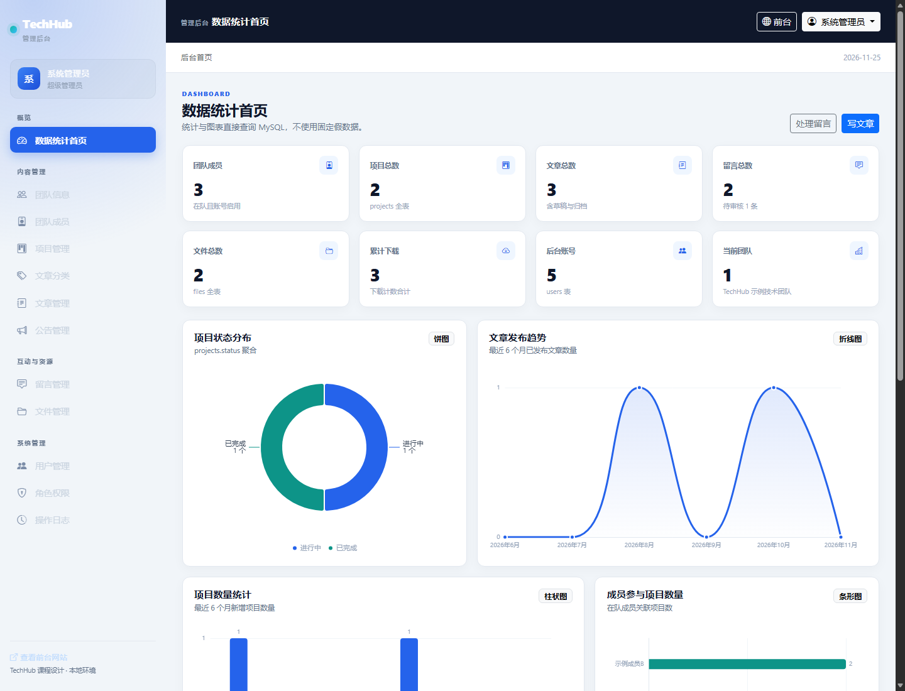

# 实现文档

## 1. 开发环境

| 项目 | 实际环境 |
| --- | --- |
| 操作系统 | Windows 11 Home China（10.0.26200） |
| PHP | PHP 8.2.36 NTS |
| PHP 扩展 | `pdo_mysql`、`fileinfo`、`mbstring`、`openssl`、`curl`、`zip`、`mysqli` |
| 数据库 | MySQL 8.0.19，独立实例，端口 3308 |
| 数据库名 | `techhub` |
| 字符集/引擎 | `utf8mb4_0900_ai_ci` / InnoDB |
| Web 运行 | PHP 内置服务器 `http://127.0.0.1:8090` |
| Apache | Apache 2.4.39 仍使用 PHP 7.3.4，**未切换** |
| 浏览器 | Microsoft Edge |
| 版本控制 | Git 2.49.0，本地 `main` 分支，远程 `origin` 已配置，**尚无提交** |
| 第三方依赖 | 无 Composer 运行时依赖 |

### 1.1 实际验证的启动命令

```bat
D:\XiaoPiMianBan\phpstudy_pro\Extensions\php\php8.2.36nts\php.exe ^
  -S 127.0.0.1:8090 -t public public/router.php
```

MySQL 独立实例：

```bat
"C:\Program Files\MySQL\MySQL Server 8.0\bin\mysqld.exe" ^
  --defaults-file="D:\XiaoPiMianBan\phpstudy_pro\Extensions\MySQL8TechHub\my.ini" ^
  --console
```

## 2. 开发工具

| 工具 | 用途 |
| --- | --- |
| VS Code | 编辑源码、查看文件 |
| PHP CLI | 语法检查、数据层测试、启动开发服务器 |
| MySQL CLI | 查询结构、验证数据、执行迁移 |
| Edge DevTools / Headless | 页面渲染、ECharts、移动端设备仿真 |
| Git | 仓库和远程配置；当前未提交 |
| 命令行（Git Bash） | 执行测试、导入 SQL、抓取 HTTP 页面 |

## 3. 项目目录

```text
TechHub/
├─ app/
│  ├─ Controllers/
│  │  ├─ Admin/                 # 12 个后台控制器
│  │  ├─ HomeController.php
│  │  ├─ TeamController.php
│  │  ├─ MemberController.php
│  │  ├─ ProjectController.php
│  │  ├─ ArticleController.php
│  │  ├─ AnnouncementController.php
│  │  ├─ MessageController.php
│  │  ├─ DownloadController.php
│  │  ├─ ProfileController.php
│  │  └─ AuthController.php
│  ├─ Middleware/               # Auth / Guest / Permission / CSRF
│  ├─ Models/                   # 17 表对应的查询与写入
│  ├─ Support/                  # Markdown / DownloadPath / ImageUpload / Slugger
│  └─ Views/                    # 前台、后台、布局、错误页、partials
├─ bootstrap/app.php            # 自动加载、配置、Session、异常
├─ config/                      # app / database / routes
├─ core/                        # Router、Model、Database、Auth、Session、CSRF、Upload 等
├─ data/
│  ├─ install.sql               # 17 表、21 外键、种子数据
│  ├─ migrations/               # 前台、后台、演示日期迁移
│  ├─ team/                     # 团队作业文件
│  ├─ personal/                 # 个人作业文件
│  └─ resources/                # 通用资源
├─ docs/                        # 课程文档、截图、证据、交付源文件
├─ public/
│  ├─ index.php                 # 统一入口
│  ├─ router.php                # 开发服务器路由
│  ├─ .htaccess                 # Apache 重写
│  ├─ assets/                   # Bootstrap、Icons、ECharts、CSS/JS/图片
│  └─ uploads/                  # 用户上传图片，禁止脚本执行
├─ storage/                     # Session、应用日志
├─ tests/                       # 14 + 34 + 79 项测试
├─ .env.example
├─ .gitignore
└─ README.md
```

## 4. 数据库实现

### 4.1 表结构

实际创建 17 张业务表、21 个外键：

`roles`、`permissions`、`role_permissions`、`users`、`member_profiles`、`teams`、`team_members`、`categories`、`projects`、`project_members`、`articles`、`announcements`、`messages`、`message_replies`、`files`、`file_downloads`、`activity_logs`。

完整数据字典见设计文档第 7 节。数据库设计文档与实际 `install.sql` 一致。

### 4.2 安装与迁移

```text
data/install.sql
data/migrations/2026-11-25_frontend.sql
data/migrations/2026-11-25_admin.sql
data/migrations/2026-11-25_admin_demo_dates.sql
```

- `install.sql` 在临时新库连续导入两次，结果仍为 17 表、21 外键；
- `admin.sql` 增加 `activity_logs.result` 和结果索引，连续执行两次成功；
- `admin_demo_dates.sql` 只调整明确标记为示例的项目/文章时间，让统计图在演示窗口内有真实数据；
- 数据库账号 `techhub_app` 只授予业务所需的 SELECT/INSERT/UPDATE/DELETE，结构变更使用独立管理账号。

### 4.3 初始化数据

- 3 个角色：超级管理员、内容编辑、团队成员；
- 14 个权限码；
- 25 条角色权限映射；
- 5 个账号：管理员、编辑器、示例成员 A/B/C；
- 1 个示例团队、3 个成员关系；
- 2 个示例项目、5 个项目成员关系；
- 3 个分类、3 篇文章；
- 2 条公告、2 条留言、1 条回复；
- 2 个示例作业文件、3 条下载流水；
- 操作日志由实际运行产生，不作伪。

## 5. MVC 实现

### 5.1 统一入口与路由

浏览器所有动态请求进入 `public/index.php`，由 `bootstrap/app.php` 初始化，再由 `core/Router.php` 匹配。路由声明示例：

```php
$router->get('/admin/members', [AdminMemberController::class, 'index'], [
    'auth' => true,
    'permission' => 'member.manage',
]);

$router->post('/admin/members/{id}/edit', [AdminMemberController::class, 'update'], [
    'auth' => true,
    'permission' => 'member.manage',
    'csrf' => true,
]);
```

中间件顺序：`guest → auth → csrf → permission → Controller`。权限判断在 Controller 调用之前执行。

### 5.2 Model 与 PDO

所有 Model 继承 `Core\Model`。连接配置使用原生 PDO，禁用模拟预处理：

```php
self::$connection = new PDO($dsn, $username, $password, [
    PDO::ATTR_ERRMODE => PDO::ERRMODE_EXCEPTION,
    PDO::ATTR_DEFAULT_FETCH_MODE => PDO::FETCH_ASSOC,
    PDO::ATTR_EMULATE_PREPARES => false,
    PDO::ATTR_STRINGIFY_FETCHES => false,
]);
```

搜索条件使用独立命名参数，避免原生 PDO 同一 SQL 重复占位符错误。

### 5.3 View

`core/View.php` 校验模板名白名单，`extract($data, EXTR_SKIP)` 注入数据。页面动态文本统一使用：

```php
<?= e($member['display_name']) ?>
```

### 5.4 后台基类

`App\Controllers\Admin\AdminController` 统一提供：

- 后台页面渲染与面包屑；
- 一次性表单错误/旧值（PRG）；
- Flash 成功/错误；
- `requireSuperAdmin()`；
- 字符串、整数、复选框、日期、URL 输入读取；
- `logAction()` 操作日志写入。

## 6. 前台功能实现

| 页面 | 主要实现 |
| --- | --- |
| 首页 | `HomeController` 聚合团队、成员、项目、文章、公告和文件统计 |
| 团队介绍 | `TeamController` 与 `Team` Model；研究方向和技术栈来自数据库 |
| 成员列表/详情 | 搜索、分页、头像、职位、技能和参与项目 |
| 项目列表/详情 | 状态筛选、搜索、分页、成员、成果和链接 |
| 文章列表/详情 | 分类筛选、搜索、分页、安全 Markdown、浏览量原子自增 |
| 公告列表/详情 | 置顶排序、有效期过滤 |
| 留言板 | 提交校验、CSRF、蜜罐、Session 频率限制、待审核隔离 |
| 留言详情 | 仅展示已审核留言和 `visible` 回复，不公开邮箱 |
| 下载页 | 团队/个人分类、分页、公开文件 |
| 受控下载 | `DownloadPath` 校验、计数、`file_downloads` 流水 |
| 登录/资料 | 前台登录、退出、只读资料；不开放注册 |

## 7. 后台功能实现

| 模块 | Controller | 主要能力 |
| --- | --- | --- |
| 统计首页 | `Admin\DashboardController` | 统计卡片、4 张图表、最近日志 |
| 用户管理 | `Admin\UserController` | 搜索、新增、编辑、角色、启停、安全删除 |
| 角色权限 | `Admin\RoleController` | 角色 CRUD、权限矩阵、系统角色保护 |
| 团队信息 | `Admin\TeamController` | 团队资料、Logo、展示状态 |
| 团队成员 | `Admin\MemberController` | 成员关系、公开资料、头像、离队、删除保护 |
| 项目管理 | `Admin\ProjectController` | 项目 CRUD、封面、状态、发布、成员事务 |
| 分类管理 | `Admin\CategoryController` | 分类 CRUD、循环检测、启停、删除保护 |
| 文章管理 | `Admin\ArticleController` | 文章 CRUD、封面、草稿/发布/归档 |
| 公告管理 | `Admin\AnnouncementController` | 公告 CRUD、类型、置顶、有效期、上下线 |
| 留言管理 | `Admin\MessageController` | 搜索、审核、回复、删除 |
| 文件管理 | `Admin\FileController` | 上传、编辑、公开/隐藏、下载、物理删除 |
| 操作日志 | `Admin\ActivityController` | 操作结果、模块、关键词筛选和分页 |

后台所有删除均使用 POST + CSRF + 二次确认；所有写操作记录日志。

## 8. 数据可视化实现

统计页 `GET /admin`，数据接口 `GET /admin/api/stats`，需要登录和 `stats.view` 权限。`AdminStats` 执行真实 SQL 聚合：

| 图表 | 数据来源 |
| --- | --- |
| 项目状态分布饼图 | `projects.status GROUP BY` |
| 文章发布趋势折线图 | 最近 6 个月 `articles.published_at` |
| 项目数量统计柱状图 | 最近 6 个月 `projects.created_at` |
| 成员参与项目数量条形图 | `team_members LEFT JOIN project_members` |

前端 `admin-charts.js` 使用同源 `fetch` 获取 JSON，ECharts 5.5.1 初始化 4 个 canvas。数据库无数据时显示 0，不使用硬编码业务数据。



## 9. 核心代码说明

### 9.1 登录与密码校验

`core/Auth.php` 使用 Session 限流、`password_verify()`、账号状态检查和 Session 重建：

```php
$valid = $user !== null
    && $user['status'] === 'active'
    && password_verify($password, (string) $user['password_hash']);

if (!$valid) {
    self::recordFailedAttempt();
    self::logEvent($request, [
        'module' => 'auth',
        'action' => 'login_failed',
        'result' => 'failure',
        'description' => '登录失败：凭据错误或账号不可用',
    ]);
    return false;
}

Session::regenerate();
Session::put(self::SESSION_USER, (int) $user['id']);
Csrf::rotate();
```

### 9.2 项目成员事务

`App\Models\Project::syncMembers()` 在事务中读取现有成员、校验团队成员、删除并重建关联：

```php
public function syncMembers(int $projectId, array $memberIds, array $roles, ?string $joinedAt = null): void
{
    $this->transaction(function () use ($projectId, $memberIds, $roles, $joinedAt): void {
        // 读取已有 joined_at，删除旧关联，只插入合法团队成员
        $this->execute('DELETE FROM project_members WHERE project_id = :project_id', [
            'project_id' => $projectId,
        ]);
        // INSERT project_members ...
    });
}
```

### 9.3 受控下载路径

`App\Support\DownloadPath::resolve()` 拒绝绝对路径、盘符、空字节和 `..`，再用 `realpath` 校验目录前缀：

```php
if ($relativePath === '' || str_contains($relativePath, "\0")
    || str_starts_with($relativePath, '/')
    || preg_match('/^[A-Za-z]:/', $relativePath)
    || preg_match('#(^|/)\.\.(/|$)#', $relativePath)) {
    return null;
}
$root = realpath($projectRoot . '/' . $allowedSubdirectory);
$file = realpath($projectRoot . '/' . $relativePath);
return str_starts_with(str_replace('\\', '/', $file), rtrim(str_replace('\\', '/', $root), '/') . '/')
    ? $file : null;
```

### 9.4 上传校验

`Core\Upload::inspect()` 校验错误码、大小、扩展名、`finfo` MIME 和图片内容；`store()` 使用随机文件名：

```php
$finfo = new \finfo(FILEINFO_MIME_TYPE);
$mime = $finfo->file($tmpName);
$allowedMimes = self::MIME_MAP[$extension] ?? [];
if (!in_array($mime, $allowedMimes, true)) {
    throw new \RuntimeException('文件 MIME 类型与扩展名不匹配。');
}
$storedName = bin2hex(random_bytes(16)) . '.' . $info['extension'];
```

### 9.5 后台操作日志

`AdminController::logAction()` 写入操作人、模块、动作、目标、结果、IP 和 UA；日志写入失败不阻断主业务，但写系统日志：

```php
(new ActivityLog())->record([
    'user_id' => Auth::id(),
    'actor_username' => $user['username'] ?? null,
    'module' => $module,
    'action' => $action,
    'target_type' => $targetType,
    'target_id' => $targetId,
    'description' => $description,
    'result' => $result === 'failure' ? 'failure' : 'success',
    'ip_address' => $this->request->ip(),
    'user_agent' => $this->request->userAgent(),
]);
```

## 10. Git 提交记录

截至文档生成时，仓库状态如下（实际命令输出）：

```text
$ git remote -v
origin  https://github.com/west-ice-g/TechHub.git (fetch)
origin  https://github.com/west-ice-g/TechHub.git (push)

$ git log --oneline
fatal: your current branch 'main' does not have any commits yet
```

因此：

- 本文档**不列出任何提交哈希、提交信息或提交时间**；
- 不把当前文件存在等同于某个成员已经完成 Git 提交；
- 真实提交记录需团队后续在 `main` 或分支上创建，再补充到本文档和 PPT；
- 当前远程仓库已配置，但没有执行推送。

## 11. 团队任务分工

> 分工内容来自团队提供的真实成员名单和任务说明。工作量比例按团队任务包统计：刚栋冰 30%、罗清 20%、成钧翔 30%、王毅豪 20%。Git 提交记录不作为本次分工比例的依据。

### 11.1 成员名单

| 姓名 | 学号 | 团队角色 | 负责模块 |
| --- | --- | --- | --- |
| 刚栋冰 | 2412888 | 组长 | 系统架构、核心框架、数据库整合、用户与权限 |
| 罗清 | 2413238 | 前台业务负责人 | 首页、团队与成员展示、前台 UI |
| 成钧翔 | 2411259 | 项目与内容负责人 | 项目、文章、分类、公告 |
| 王毅豪 | 2412509 | 互动与后台负责人 | 留言、文件、统计、测试与手册 |

### 11.2 任务包与工作量记录

#### 刚栋冰（组长，2412888）

- 数据库表：`users`、`roles`、`permissions`、`role_permissions`、`teams`（5 张）。
- 核心代码：`core/Router.php`、`core/Database.php`、`core/Auth.php`、`app/Models/User.php`、`Role.php`、`Team.php`、`Admin/UserController.php`、`RoleController.php`、`TeamController.php`。
- 必做 MVC 对应：Model `User.php`；View `admin/users/index.php`；Controller `Admin/UserController.php`。
- 文档：需求文档、设计文档架构与权限章节、SQL 统筹。
- 工作量占比：30%（5 张表；3 个必做 MVC 层 + 核心框架；2 份文档）。

#### 罗清（前台业务负责人，2413238）

- 数据库表：`team_members`、`files`（头像/文件协作，2 张，其中 1 张与王毅豪协作）。
- 核心代码：`app/Models/Member.php`、`app/Controllers/MemberController.php`、`Admin/MemberController.php`、`TeamController.php`、首页/团队/成员及后台成员 View、`public/assets/css/frontend.css`。
- 必做 MVC 对应：Model `Member.php`；View `member/index.php`；Controller `MemberController.php`。
- 文档：用户手册前台章节、前台页面说明。
- 工作量占比：20%（2 张表；3 个必做 MVC 层 + 前台 UI；1 份文档）。

#### 成钧翔（项目与内容负责人，2411259）

- 数据库表：`projects`、`project_members`、`articles`、`categories`、`announcements`（5 张）。
- 核心代码：`app/Models/Project.php`、`Article.php`、`Category.php`、`Announcement.php`，以及项目、文章、分类、公告的前后台 Controller 与 View。
- 必做 MVC 对应：Model `Project.php`；View `project/index.php`；Controller `ProjectController.php`。
- 文档：设计文档数据库与内容模块章节、实现文档内容模块。
- 工作量占比：30%（5 张表；3 个必做 MVC 层 + 内容 CRUD；1 份文档）。

#### 王毅豪（互动与后台负责人，2412509）

- 数据库表：`messages`、`message_replies`、`activity_logs`、`files`（文件协作，4 张，其中 1 张与罗清协作）。
- 核心代码：`app/Models/Message.php`、`FileResource.php`、`FileDownload.php`、`ActivityLog.php`、`AdminStats.php`，对应前后台 Controller、`admin-charts.js`、`admin.css`。
- 必做 MVC 对应：Model `Message.php`；View `message/index.php`；Controller `MessageController.php`。
- 文档：实现文档统计与测试章节、用户手册后台章节、部署文档。
- 工作量占比：20%（4 张表；3 个必做 MVC 层 + 统计与测试；3 份文档）。

### 11.3 课程要求文件与实际文件对照

团队提供的必做文件名与项目实际文件存在命名差异，实际代码为准：

| 成员 | 课程任务中写的文件 | 项目实际文件 |
| --- | --- | --- |
| 刚栋冰 | `User.php`、`user/list.php`、`UserController.php` | `app/Models/User.php`、`app/Views/admin/users/index.php`、`app/Controllers/Admin/UserController.php` |
| 罗清 | `TeamMember.php`、`team/member-list.php`、`TeamMemberController.php` | `app/Models/Member.php`、`app/Views/member/index.php`、`app/Controllers/MemberController.php` |
| 成钧翔 | `Project.php`、`project/list.php`、`ProjectController.php` | `app/Models/Project.php`、`app/Views/project/index.php`、`app/Controllers/ProjectController.php` |
| 王毅豪 | `Message.php`、`message/list.php`、`MessageController.php` | `app/Models/Message.php`、`app/Views/message/index.php`、`app/Controllers/MessageController.php` |

### 11.4 分工真实性说明

- 四位成员的姓名和学号由用户提供；
- 任务包按用户提供的模块负责关系整理；
- 工作量比例按团队确认的任务包统计，不把 Git 提交记录作为工作量依据；
- 课程任务中的 MVC 命名与项目实际文件路径见 11.3 对照表；
- 如需形成逐人代码证据，由团队按实际文件归档和审查。

## 12. 实际测试结果

### 12.1 PHP 语法检查

```text
Files checked: 123
Failures: 0
```

原始结果：`docs/evidence/php-lint-2026-11-25.txt`

### 12.2 三套测试

| 测试 | 命令 | 实际结果 |
| --- | --- | --- |
| 基础测试 | `php tests/smoke.php` | **14 passed, 0 failed** |
| 前台数据测试 | `php tests/frontend_smoke.php` | **34 passed, 0 failed** |
| 后台 HTTP 集成测试 | `php tests/admin_smoke.php` | **79 passed, 0 failed**，连续两次一致 |

后台测试覆盖：登录、RBAC、CSRF、用户/角色/分类/项目/文章/公告/成员/文件/留言 CRUD、上传、下载、审核回复、操作日志、ECharts 接口、团队编辑和安全保护。

### 12.3 页面与浏览器

| 验证 | 结果 |
| --- | --- |
| 后台 30 个 GET 页面/接口 | 全部 HTTP 200 |
| 未登录后台 | 302 到 `/admin/login` |
| 缺 CSRF 的后台 POST | 403（避免 Apache 对 419 返回 500） |
| 编辑账号访问用户/角色 | 403 |
| 普通成员访问项目/统计 | 403 |
| 超级管理员自我降级/删除 | 被拒绝，数据库未变化 |
| 超级管理员角色降权 | 被拒绝，仍为 14 项权限 |
| ECharts | 4 个 canvas 正常渲染 |
| 390px 后台页面 | 16 个页面无横向溢出，抽屉菜单可打开 |
| `.php` 上传 | 被拒绝，无数据库记录 |
| 伪装 JPG 头像 | 被拒绝，原头像保留 |
| 后台静态资源 | 全部 200，本地加载 |

原始证据：`docs/evidence/admin-smoke-2026-11-25.txt`、`docs/evidence/browser-admin-2026-11-25.txt`、`docs/evidence/admin-assets-2026-11-25.txt`。

### 12.4 数据库安装与迁移

| 验证 | 结果 |
| --- | --- |
| 临时新库导入 `install.sql` | 17 表、21 外键 |
| 连续第二次导入 | 成功，无重复种子 |
| `activity_logs.result` | 字段和索引存在 |
| 后台迁移连续执行两次 | 成功 |
| 示例日期迁移连续执行两次 | 成功 |

原始证据：`docs/evidence/install-2026-11-25.txt`、`docs/evidence/migrations-2026-11-25.txt`。

## 13. 已知限制

1. Apache PHP 8.2 虚拟主机未切换；
2. Git 无提交记录；
3. 修改本人资料/密码未实现；
4. 项目仅使用当前主团队，多团队切换未实现；
5. 示例数据仍为演示内容；
6. 没有 Docker Compose 配置；
7. 真实移动设备、性能压测、备份恢复尚未执行；
8. 用户手册和 PPT 中的截图使用当前示例数据，正式资料替换后需重拍。
