# 用户手册

## 1. 系统访问

### 1.1 访问地址

本地开发环境：

```text
http://127.0.0.1:8090
```

正式部署后应使用学校或团队分配的域名。当前项目使用 PHP 内置服务器验证，Apache PHP 8.2 虚拟主机尚未切换。

### 1.2 浏览器建议

建议使用 Microsoft Edge、Chrome 或 Firefox 的近期版本。页面使用 Bootstrap 5 响应式布局，桌面和手机浏览器均可访问。

### 1.3 前台首页

打开访问地址后进入首页，可以看到：

- 顶部导航：首页、团队、成员、项目、文章、公告、留言、下载；
- 团队介绍和核心数据；
- 优秀项目；
- 团队成员；
- 最新文章和公告；
- 团队作业/个人作业入口；
- 登录入口和页脚。

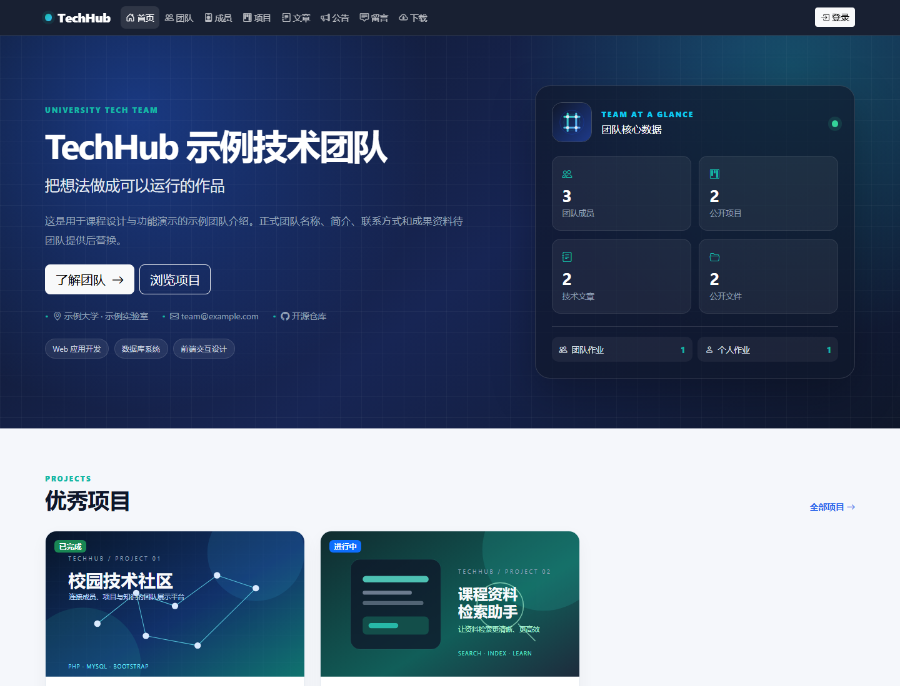

> 当前截图使用示例团队和示例成员数据；正式团队资料替换后，页面内容会同步变化。

## 2. 普通用户操作

### 2.1 查看团队信息

1. 点击顶部导航“团队”；
2. 查看团队名称、口号、成立时间、研究方向、技术栈和联系方式；
3. 查看团队 Logo、成员数量和公开统计数据；
4. 如页面显示示例标识，说明当前仍是课程演示数据。

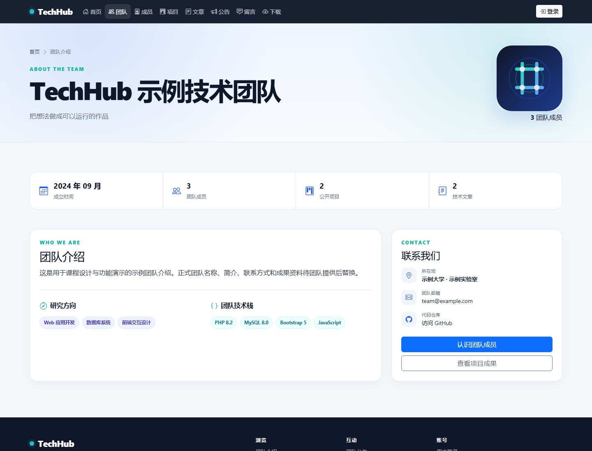

### 2.2 查看成员列表和详情

1. 点击顶部导航“成员”；
2. 可输入姓名、职位或技能关键词搜索；
3. 使用分页查看不同页成员；
4. 点击成员卡片进入详情，查看头像、职位、技能、简介和参与项目。

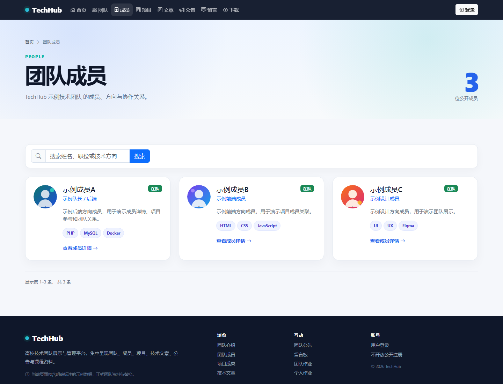

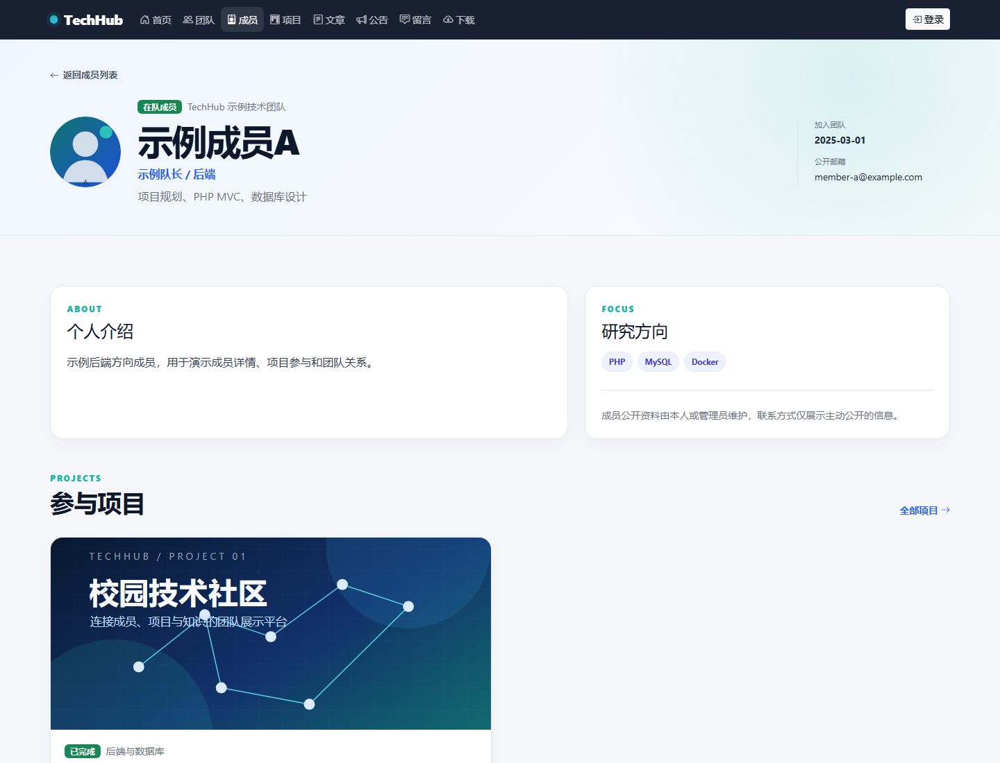

### 2.3 浏览项目

1. 点击顶部导航“项目”；
2. 使用状态下拉框筛选规划中、进行中、已完成或已归档项目；
3. 在搜索框输入项目名称、摘要或技术栈关键词；
4. 点击项目卡片进入详情；
5. 详情页展示项目介绍、技术栈、成员、成果、代码仓库或演示地址。

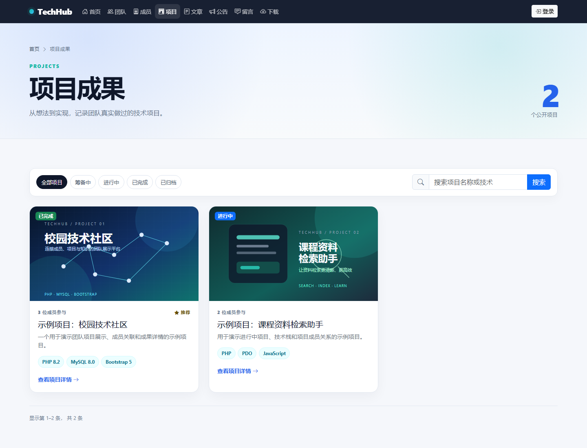

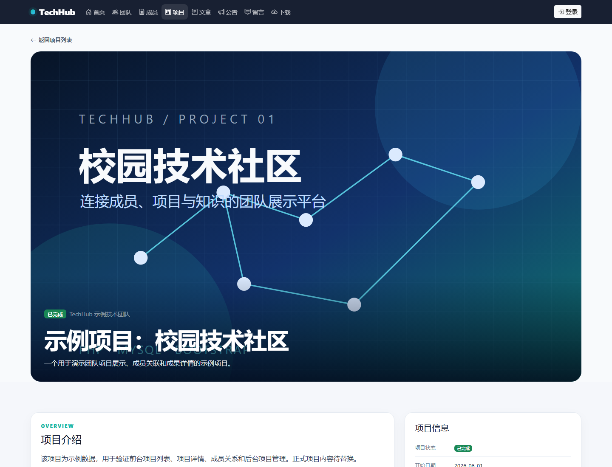

### 2.4 阅读文章

1. 点击顶部导航“文章”；
2. 可按分类筛选，也可输入关键词搜索；
3. 列表显示标题、摘要、分类、作者、发布时间和浏览量；
4. 点击文章卡片或标题打开详情；
5. 详情页正文使用安全 Markdown 渲染，原始 HTML 会被转义；
6. 每次打开已发布文章，浏览量会在数据库中增加。

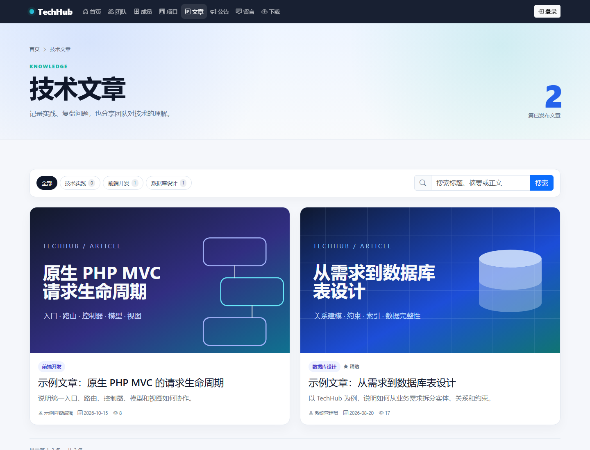

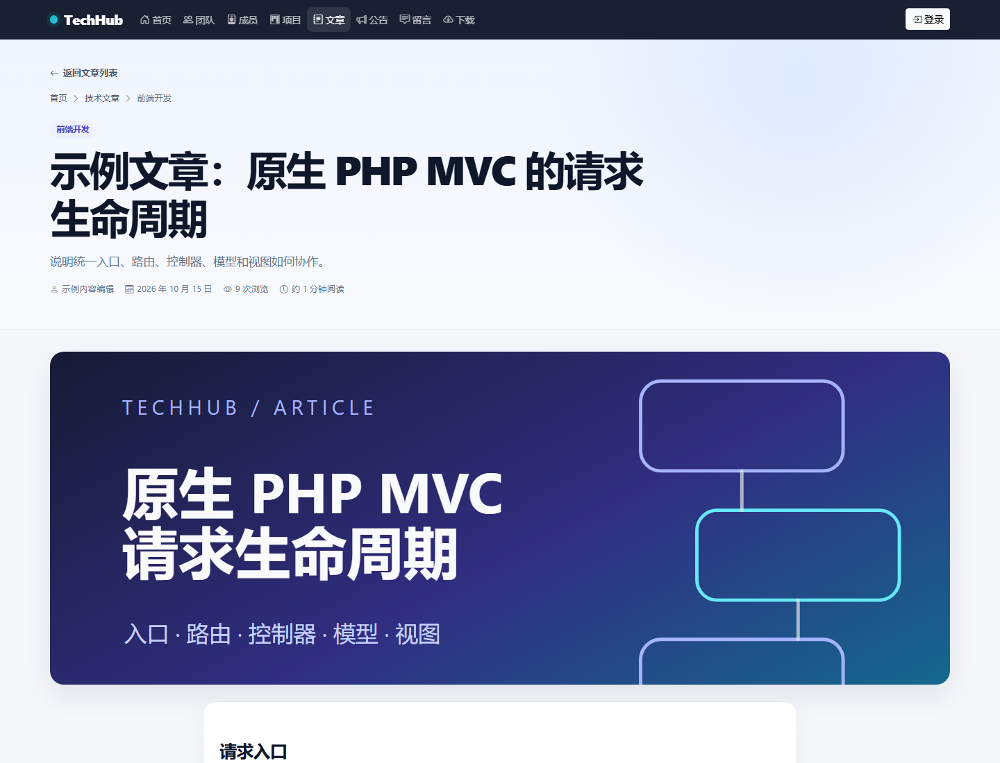

### 2.5 查看公告

1. 点击顶部导航“公告”；
2. 公告按置顶和发布时间排序；
3. 点击公告进入详情；
4. 过期或已下线的公告不会在前台显示。

### 2.6 使用留言板

1. 点击顶部导航“留言”；
2. 在表单填写昵称、邮箱（选填）和留言内容；
3. 点击“提交留言”；
4. 系统提示“留言已提交，审核通过后会显示”；
5. 留言在后台审核通过前不会出现在公开列表；
6. 审核通过后，可在留言详情查看管理员公开回复。

提交要求：

- 昵称 2～50 个字符；
- 内容 5～2000 个字符；
- 邮箱如填写必须格式有效；
- 同一 Session 有提交频率限制；
- 表单包含 CSRF 和蜜罐防护。

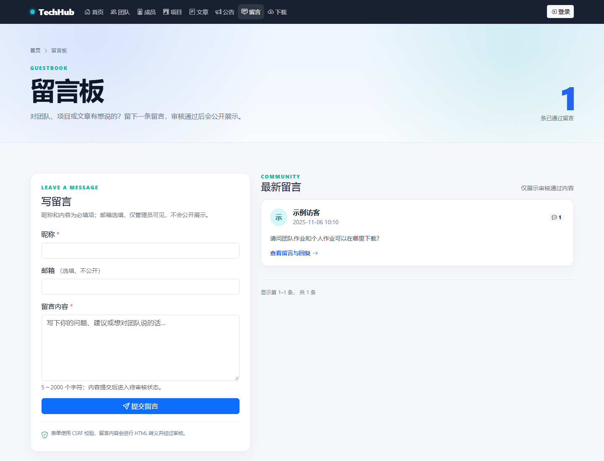

### 2.7 下载课程资料

1. 点击顶部导航或页脚“下载”；
2. 在下载页切换“团队作业”和“个人作业”；
3. 查看文件标题、原始文件名、大小、上传时间和下载次数；
4. 点击下载按钮；
5. 系统校验文件公开状态和路径后输出文件，并记录下载流水。

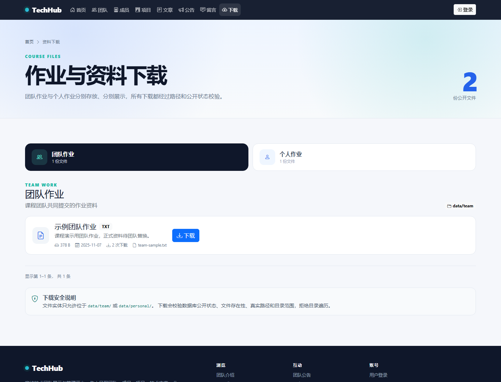

### 2.8 前台登录

1. 点击导航右侧“登录”；
2. 输入超级管理员分配的账号和密码；
3. 登录成功后按账号角色跳转到个人资料或后台；
4. 前台个人资料页显示账号、成员资料和参与项目；
5. 点击“退出登录”结束会话。

系统不开放公开注册，账号由超级管理员创建。

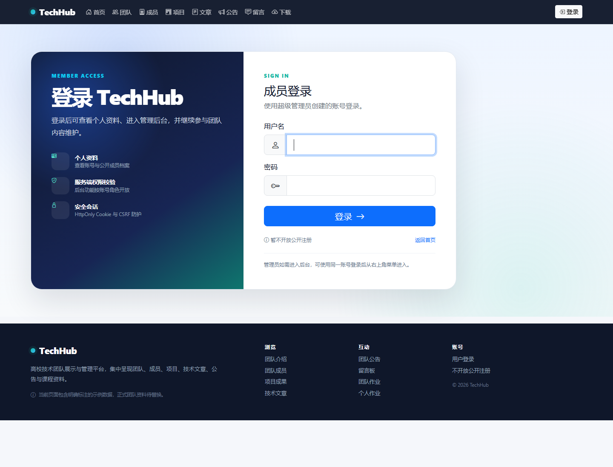

> 当前个人资料页只读，修改本人资料/密码尚未实现。

## 3. 管理员操作

### 3.1 进入后台

1. 访问 `/admin/login`，或在首页登录后从账号菜单进入“管理后台”；
2. 输入后台账号和密码；
3. 登录成功后进入数据统计首页；
4. 左侧菜单只显示当前角色有权限的模块；
5. 右上角可查看前台、个人资料或退出。

后台登录页：

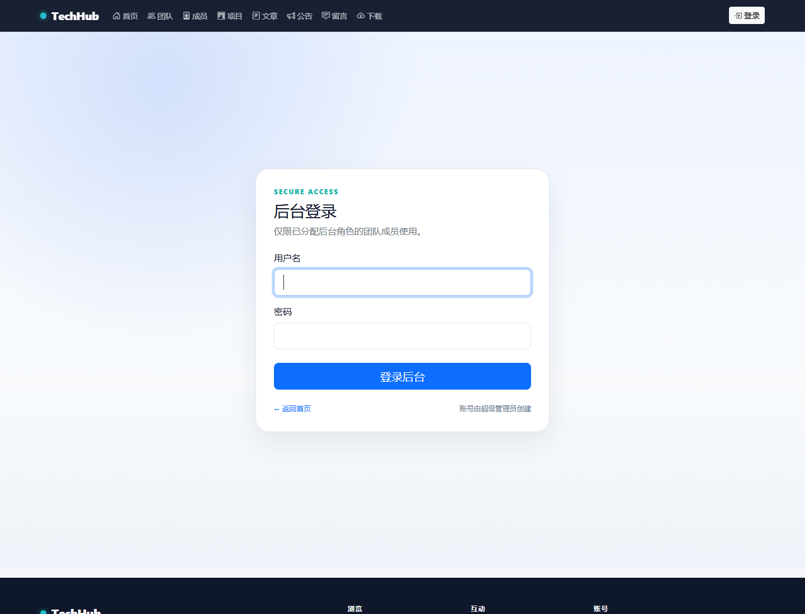

### 3.2 数据统计首页

后台首页展示：

- 团队成员、项目、文章、留言、文件、累计下载、后台账号、当前团队；
- 项目状态分布饼图；
- 最近 6 个月文章发布趋势；
- 最近 6 个月项目新增柱状图；
- 成员参与项目数量条形图；
- 最近操作日志。

操作步骤：

1. 登录后台，默认进入 `/admin`；
2. 查看统计卡片；
3. 向下滚动查看 4 张 ECharts 图表；
4. 点击“处理留言”或“写文章”进入对应模块；
5. 数据变化后刷新页面，图表按 MySQL 聚合结果更新。

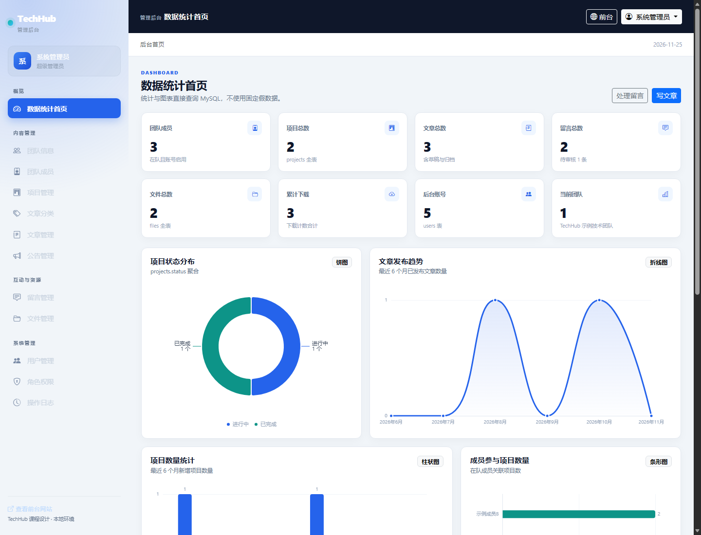

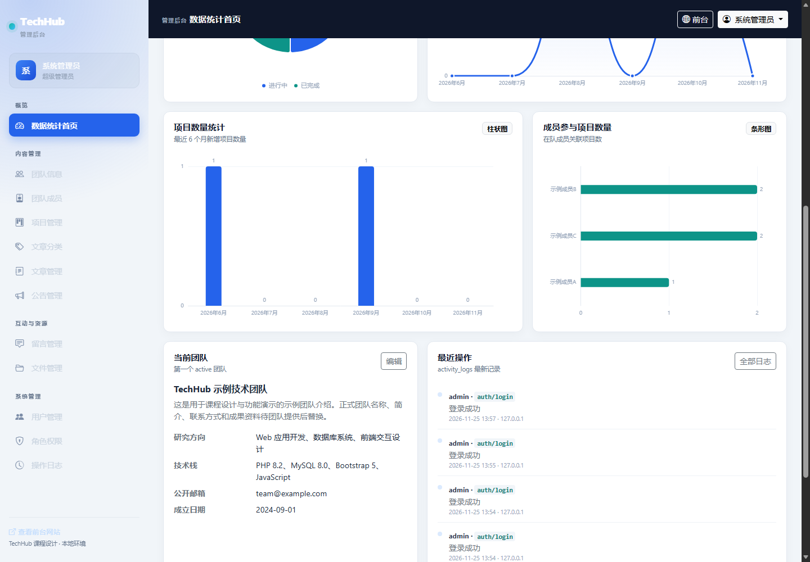

> 无 `stats.view` 权限的普通成员不会加载统计图表和统计接口。

### 3.3 成员管理

1. 左侧菜单进入“团队成员”；
2. 使用姓名、账号、职位或技能搜索；
3. 使用状态下拉框筛选在队、已毕业或已移除；
4. 点击“添加成员”；
5. 选择尚未加入当前团队的启用账号；
6. 填写职位、职责、加入日期、状态、排序、成员介绍、技能、公开邮箱和 GitHub；
7. 可上传 JPG/PNG/WebP/GIF 头像，最大 4MB；
8. 保存后前台成员页读取最新资料；
9. “离队”会保留项目历史；无项目引用的成员关系可删除。

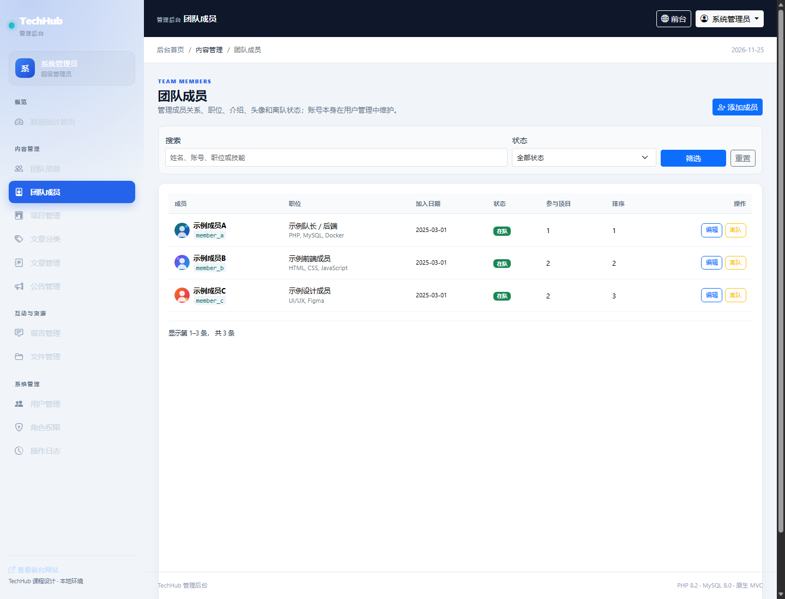

### 3.4 项目管理

1. 左侧菜单进入“项目管理”；
2. 按状态、发布状态和关键词筛选；
3. 点击“新增项目”或某项目的“编辑”；
4. 填写标题、URL 别名、摘要、介绍、成果、技术栈、开始/结束日期和排序；
5. 上传项目封面（最大 5MB）；
6. 勾选项目成员并填写项目内角色；
7. 设置“发布到前台”和“首页推荐”；
8. 保存后项目列表和详情页同步更新；
9. “下线”切换 `is_public`，前台立即不可见；
10. 删除项目会级联删除项目成员关联并清理后台上传封面。

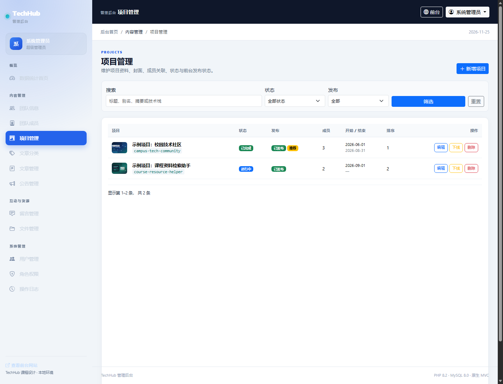

### 3.5 文章管理

1. 左侧菜单进入“文章管理”；
2. 按分类、状态和关键词筛选；
3. 点击“新增文章”；
4. 填写标题、URL 别名、分类、摘要和正文；
5. 可上传文章封面、设置首页推荐；
6. 状态选择“草稿”“发布”或“归档”；
7. 草稿前台 404，发布后前台可见；
8. 列表可执行“发布”“转草稿”“归档”“删除”。

正文支持标题、列表、引用、代码块、粗体、斜体、行内代码和 http(s) 链接；原始 HTML 会转义。

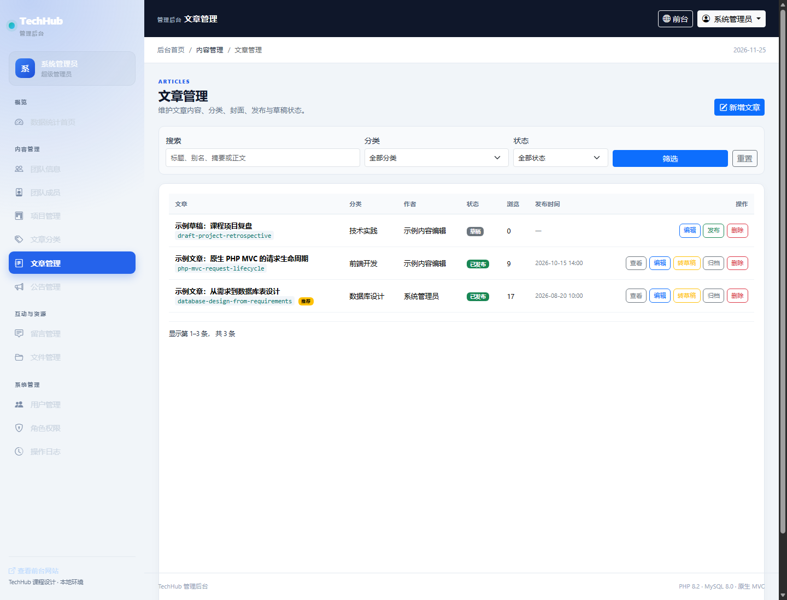

### 3.6 公告管理

1. 左侧菜单进入“公告管理”；
2. 按类型、状态和关键词筛选；
3. 新增公告，填写标题、摘要、正文、类型、过期日期和是否置顶；
4. 发布后前台公告列表可见；
5. 过期公告自动隐藏；
6. “下线”将公告归档，不再出现在前台。

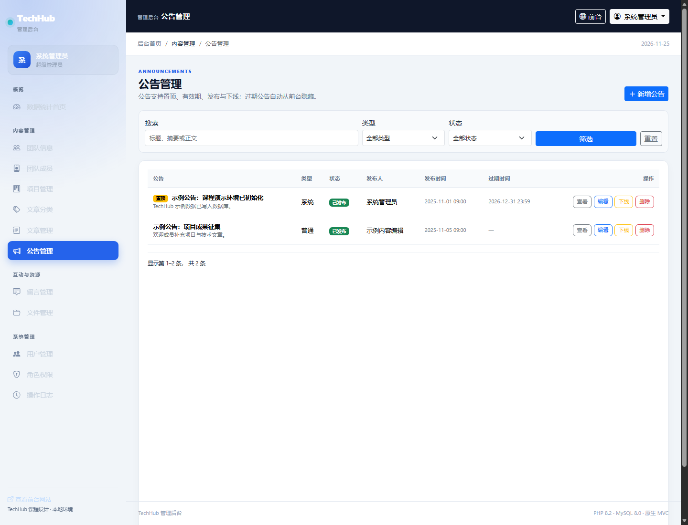

### 3.7 文件管理

1. 左侧菜单进入“文件管理”；
2. 按团队作业、个人作业、通用资源和状态筛选；
3. 点击“上传文件”；
4. 填写标题、分类、说明和关联成员；
5. 选择 PDF/DOC/DOCX/PPT/PPTX/ZIP/TXT，单文件不超过 20MB；
6. 设置“允许前台下载”和启用状态；
7. 团队作业保存到 `data/team`，个人作业保存到 `data/personal`；
8. 可编辑文件信息、公开/隐藏、下载或删除；
9. 删除同时删除物理文件和下载记录。

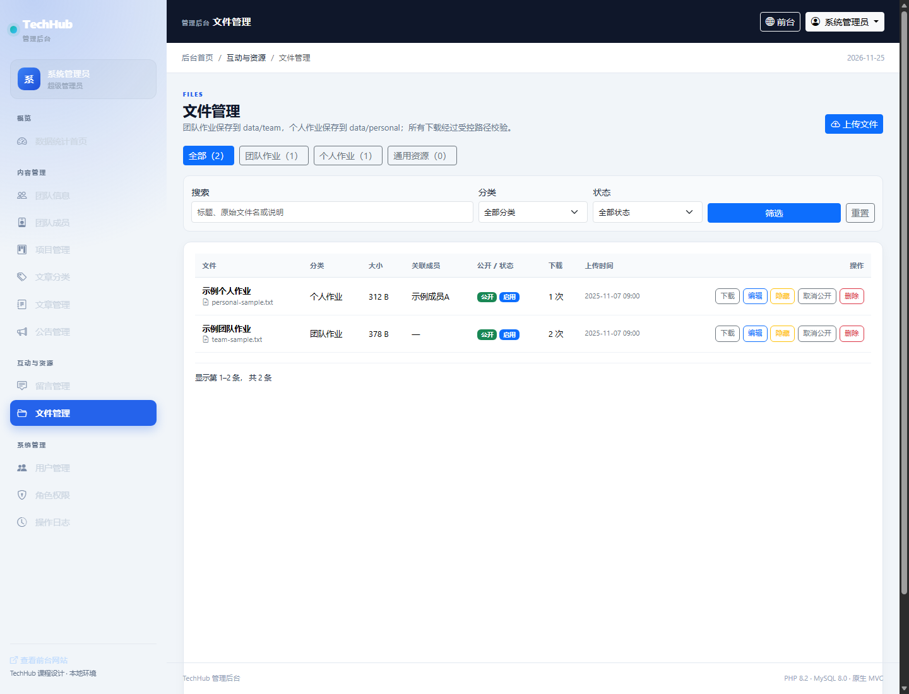

### 3.8 留言管理

1. 左侧菜单进入“留言管理”；
2. 按状态和关键词搜索；
3. 点击留言进入详情，查看访客、邮箱、内容、IP 和 UA；
4. 点击“通过审核”后留言出现在前台；
5. 填写回复内容，选择“公开显示”或“仅后台可见”；
6. 可拒绝或删除留言，删除会级联删除回复；
7. 访客邮箱不会在前台公开。

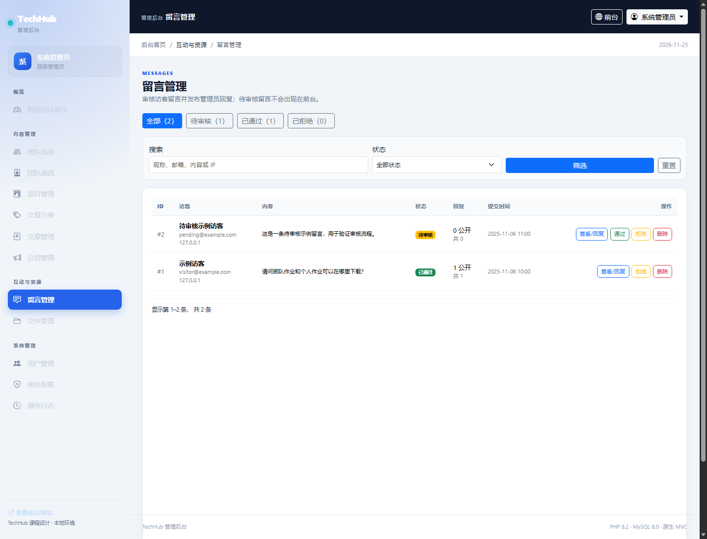

### 3.9 用户与角色权限

超级管理员可以：

- 新增账号、编辑显示名/邮箱、分配角色、启用或停用；
- 重置密码：编辑账号时填写新密码，留空则不修改；
- 删除无业务引用的账号；有引用的账号只能停用；
- 管理角色、说明和排序；
- 在权限矩阵中勾选角色可访问的模块；
- 系统角色不可删除，超级管理员角色不可在界面降权；
- 不能停用、删除或降级当前登录的超级管理员；
- 系统至少保留一个启用的超级管理员。

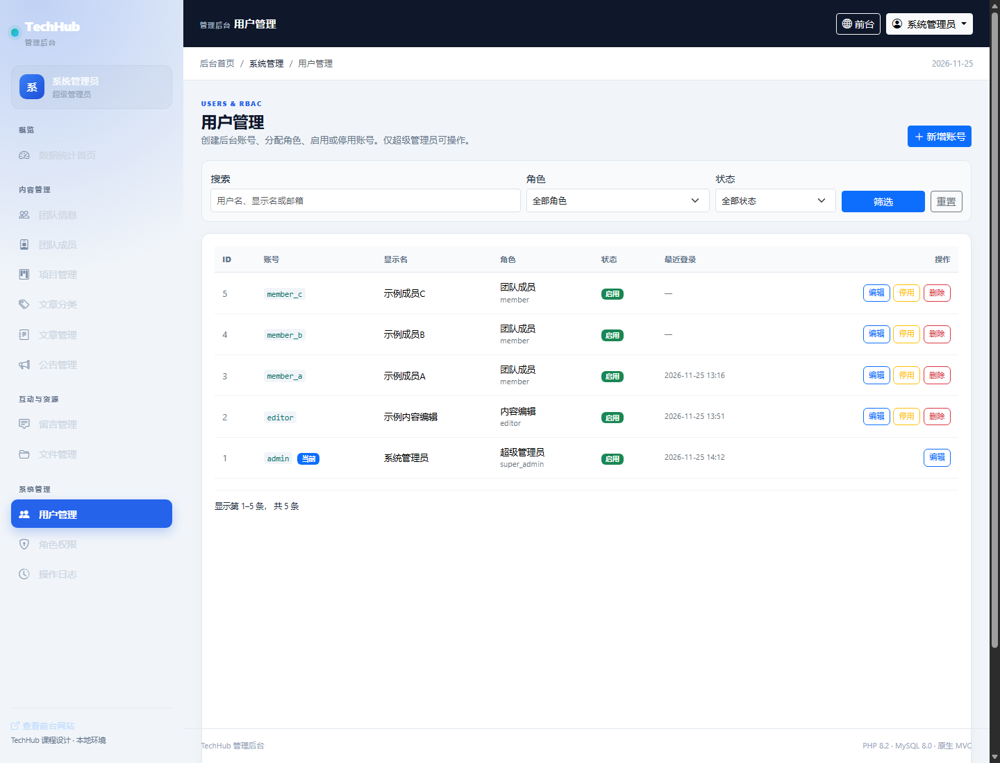

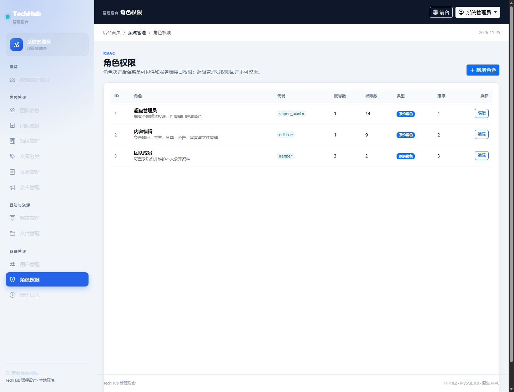

## 4. 常见提示与处理

| 提示 | 原因 | 处理 |
| --- | --- | --- |
| 请先登录后再访问该页面 | 未登录或 Session 失效 | 重新登录 |
| 403 请求被拒绝 | CSRF Token 失效或权限不足 | 刷新页面后重新提交；如仍失败请联系管理员 |
| 403 无权访问 | 当前角色没有权限 | 联系超级管理员分配权限 |
| 用户名或密码错误 | 账号不存在、密码错误或账号停用 | 检查凭据或联系管理员 |
| 登录尝试次数过多 | 触发登录限流 | 等待限制时间结束后重试 |
| 文件不存在或未公开 | 文件被隐藏、删除或路径不合法 | 联系管理员 |
| 文件 MIME 类型与扩展名不匹配 | 文件内容与扩展名不符 | 使用真实文件重新上传 |
| 不能删除/停用当前账号 | 超级管理员保护 | 使用其他超级管理员操作 |
| 该分类仍有文章或子分类 | 删除保护 | 先迁移文章或删除子分类 |
| 该成员已关联项目 | 历史保护 | 使用“离队”而不是删除 |

## 5. 数据与隐私说明

- 前台展示的团队、成员、项目、文章和公告均来自 MySQL；
- 当前页面使用明确标注的示例数据；
- 访客留言在审核前不公开；
- 访客邮箱只在后台可见；
- 密码只保存哈希，任何页面不显示密码；
- 操作日志保留后台操作结果，便于审计；
- 删除操作会要求二次确认，但物理删除不可恢复。

## 6. 使用限制

1. 当前不开放公开注册；
2. 个人资料只读，修改本人资料/密码未完成；
3. 项目编辑使用当前主团队，未提供多团队切换；
4. 正式团队资料替换前，页面中的示例名称和示例成员仍会出现；
5. 当前部署验证使用 PHP 内置服务器，Apache PHP 8.2 待配置。
