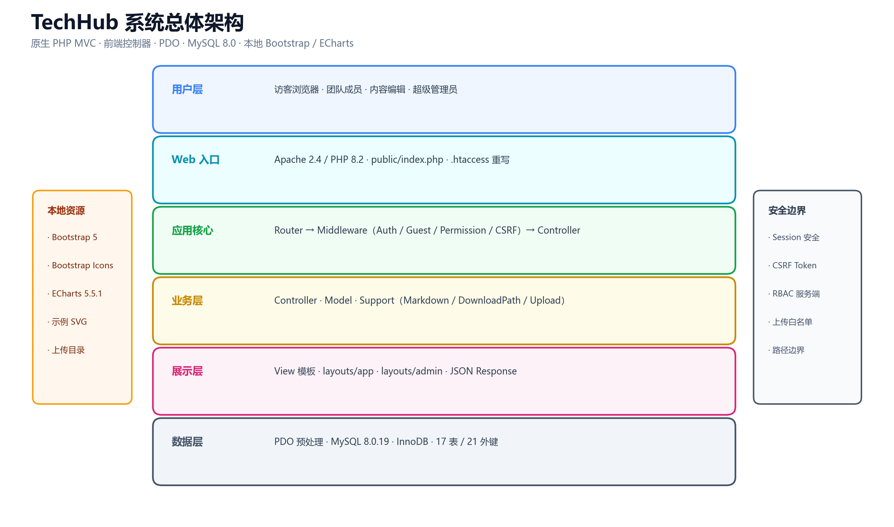
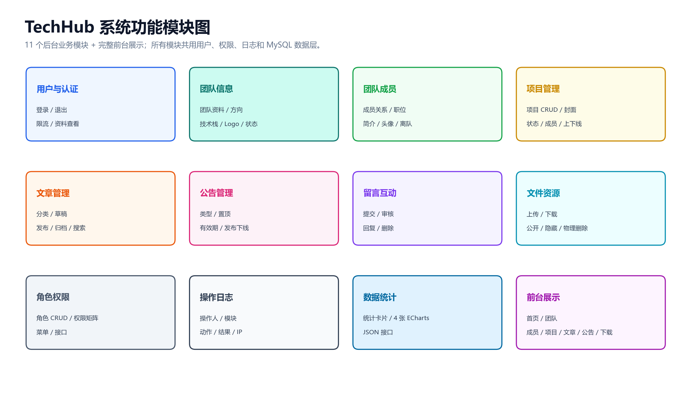
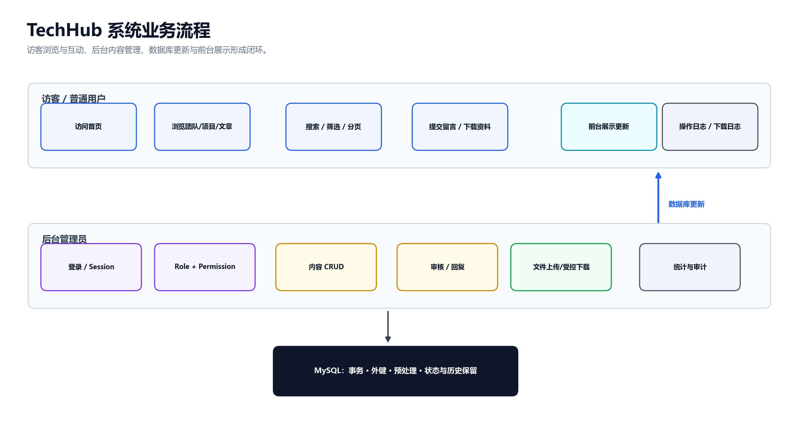
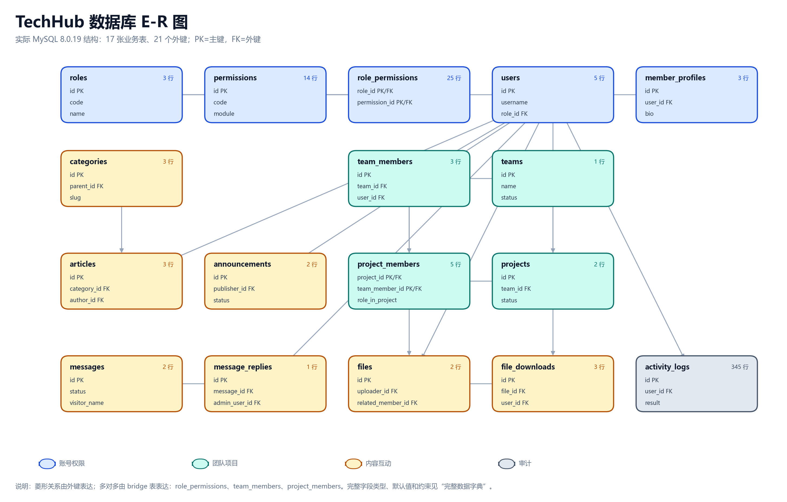
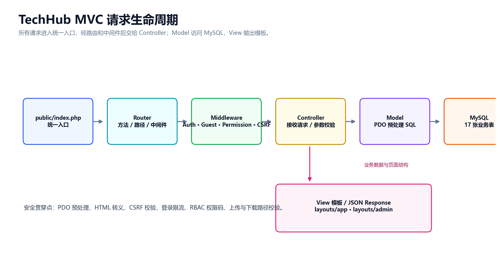

# 设计文档

## 1. 系统总体架构

TechHub 采用“浏览器 → 统一 PHP 入口 → 路由与中间件 → Controller → Model → MySQL / View”的原生 MVC 架构。项目不依赖 Laravel、ThinkPHP 等框架，也不使用 ORM 隐藏 SQL。



### 1.1 分层职责

| 层 | 主要文件/目录 | 职责 |
| --- | --- | --- |
| 用户层 | 浏览器、Bootstrap 页面、ECharts | 展示页面、提交表单、加载图表 |
| Web 入口 | `public/index.php`、`public/router.php`、`.htaccess` | 统一入口、静态文件、URL 重写 |
| 路由与中间件 | `core/Router.php`、`app/Middleware/` | 方法/路径匹配、登录、游客、权限、CSRF |
| Controller | `app/Controllers/`、`app/Controllers/Admin/` | 接收请求、校验、调用 Model、选择 View/Response |
| Model | `app/Models/` | PDO 查询、事务、业务数据聚合 |
| View | `app/Views/` | 原生 PHP 模板，统一转义输出 |
| 数据层 | MySQL 8.0.19、InnoDB、PDO | 17 张业务表、21 个外键 |
| 支撑层 | `app/Support/` | 安全 Markdown、下载路径、图片上传、Slug |
| 文件存储 | `data/team`、`data/personal`、`data/resources`、`public/uploads` | 作业文件位于 Web 根之外；图片上传目录禁执行脚本 |
| 审计 | `activity_logs`、`file_downloads` | 操作日志和下载流水 |

### 1.2 部署结构

当前实际验证环境：

```text
Windows 11
  ├─ PHP 8.2.36 NTS（CLI / 内置服务器 127.0.0.1:8090）
  ├─ MySQL 8.0.19（独立实例，127.0.0.1:3308）
  ├─ Apache 2.4.39（仍加载 PHP 7.3.4，未切换）
  └─ Edge 浏览器（页面、ECharts、移动端仿真检查）
```

Apache 的 PHP 8.2 虚拟主机配置尚未执行，因此当前不能宣称 Apache 部署完成。

## 2. 技术架构

| 层次 | 技术选择 | 版本/说明 |
| --- | --- | --- |
| 语言 | PHP | 8.2.36 NTS |
| 数据库 | MySQL | 8.0.19，InnoDB，`utf8mb4_0900_ai_ci` |
| 数据访问 | PDO 原生预处理 | `ATTR_EMULATE_PREPARES=false` |
| Web 入口 | 前端控制器 | `public/index.php` |
| 路由 | 自定义 Router | GET/POST、路径参数、中间件 |
| 模板 | 原生 PHP View | 布局 + partial |
| 前端 UI | Bootstrap | 5.3.3，本地 CSS/JS |
| 图标 | Bootstrap Icons | 1.11.3，本地字体 |
| 图表 | Apache ECharts | 5.5.1，本地 JS |
| 交互 | 原生 JavaScript | 导航、确认框、图表请求 |
| Web 服务器 | PHP 内置服务器（已验证）；Apache 2.4（待切换） | 统一入口和 `.htaccess` 已提供 |
| 版本控制 | Git | 本地仓库和远程 `origin` 已配置；当前无提交 |
| 第三方依赖 | 无 Composer 运行时依赖 | 静态资源随项目提供 |

### 2.1 技术决策

1. **不使用框架**：课程要求原生 MVC，框架会隐藏路由、数据库和模板实现。
2. **PDO 预处理**：所有业务查询使用命名参数，搜索时避免重复占位符。
3. **Bootstrap 本地化**：答辩现场无网络时仍能正常显示。
4. **ECharts 本地化**：统计页不依赖 CDN。
5. **作业文件放在 Web 根外**：只能通过 Controller 校验后下载。
6. **统一日志**：关键操作写入 `activity_logs`，与业务数据分开。

## 3. 功能模块图



模块与数据表的对应关系见需求文档第 6 节。后台 11 个模块共用 `AdminController` 的视图、面包屑、表单错误、Flash 和日志能力。

## 4. 系统业务流程图



### 4.1 核心业务闭环

1. 访客浏览前台内容，数据由 MySQL 查询；
2. 访客提交留言或下载资料，写入 `messages` 或 `file_downloads`；
3. 管理员登录后台，通过角色权限进入对应模块；
4. 后台新增/编辑内容并写入 MySQL；
5. 前台下一次访问读取最新数据；
6. 关键后台操作写入 `activity_logs`，可按结果、模块和关键词筛选；
7. 文章浏览量、文件下载计数按真实访问原子更新。

## 5. 数据库 E-R 图



### 5.1 关系说明

| 关系 | 基数 | 实现 |
| --- | --- | --- |
| 角色—用户 | 1:N | `users.role_id` |
| 角色—权限 | N:M | `role_permissions` |
| 用户—公开资料 | 1:0..1 | `member_profiles.user_id` 唯一 |
| 团队—用户 | N:M | `team_members` |
| 团队—项目 | 1:N | `projects.team_id` |
| 项目—团队成员 | N:M | `project_members` |
| 分类—文章 | 1:N | `articles.category_id` |
| 用户—文章 | 1:N | `articles.author_id` |
| 用户—公告 | 1:N | `announcements.publisher_id` |
| 留言—回复 | 1:N | `message_replies.message_id` |
| 文件—下载 | 1:N | `file_downloads.file_id` |
| 用户—操作日志 | 1:N，可空 | `activity_logs.user_id` |

### 5.2 全部外键

以下 21 个外键来自实际 `information_schema`：

1. `role_permissions.role_id → roles.id`
2. `role_permissions.permission_id → permissions.id`
3. `users.role_id → roles.id`
4. `member_profiles.user_id → users.id`
5. `team_members.team_id → teams.id`
6. `team_members.user_id → users.id`
7. `categories.parent_id → categories.id`（自关联）
8. `projects.team_id → teams.id`
9. `projects.created_by → users.id`
10. `project_members.project_id → projects.id`
11. `project_members.team_member_id → team_members.id`
12. `articles.category_id → categories.id`
13. `articles.author_id → users.id`
14. `announcements.publisher_id → users.id`
15. `message_replies.message_id → messages.id`
16. `message_replies.admin_user_id → users.id`
17. `files.uploader_id → users.id`
18. `files.related_member_id → team_members.id`
19. `file_downloads.file_id → files.id`
20. `file_downloads.user_id → users.id`
21. `activity_logs.user_id → users.id`

### 5.3 删除与历史策略

- 留言删除级联删除回复；
- 项目删除级联删除项目成员关联；
- 文件删除级联删除下载流水；
- 角色被用户引用时禁止删除；
- 分类有文章或子分类时禁止删除；
- 成员离队优先使用 `removed` 状态，保留项目历史；
- 用户有业务引用时要求停用而非物理删除；
- 操作日志不提供普通编辑或删除入口。

## 6. 数据库表结构

| 序号 | 表名 | 业务用途 | 字段数 | 主键 | 外键数 | 实际行数 |
| --- | --- | --- | --- | --- | --- | --- |
| 1 | `roles` | 后台角色 | 8 | `id` | 0 | 3 |
| 2 | `permissions` | 权限码 | 8 | `id` | 0 | 14 |
| 3 | `role_permissions` | 角色权限映射 | 3 | `role_id, permission_id` | 2 | 25 |
| 4 | `users` | 后台账号 | 11 | `id` | 1 | 5 |
| 5 | `member_profiles` | 公开成员资料 | 9 | `id` | 1 | 3 |
| 6 | `teams` | 团队 | 17 | `id` | 0 | 1 |
| 7 | `team_members` | 团队成员关系 | 11 | `id` | 2 | 3 |
| 8 | `categories` | 文章分类 | 9 | `id` | 1 | 3 |
| 9 | `projects` | 项目 | 20 | `id` | 2 | 2 |
| 10 | `project_members` | 项目成员 | 6 | `project_id, team_member_id` | 2 | 5 |
| 11 | `articles` | 技术文章 | 14 | `id` | 2 | 3 |
| 12 | `announcements` | 公告 | 12 | `id` | 1 | 2 |
| 13 | `messages` | 访客留言 | 10 | `id` | 0 | 2 |
| 14 | `message_replies` | 留言回复 | 7 | `id` | 2 | 1 |
| 15 | `files` | 文件资源 | 17 | `id` | 2 | 2 |
| 16 | `file_downloads` | 下载流水 | 6 | `id` | 2 | 3 |
| 17 | `activity_logs` | 操作日志 | 12 | `id` | 1 | 345 |

### 6.1 设计特点

1. **真实关系**：17 张表均有业务用途，不是占位空表。
2. **外键完整性**：21 个外键维护角色、用户、团队、项目、内容、文件和日志关系。
3. **多对多桥接**：`role_permissions`、`team_members`、`project_members`。
4. **历史保留**：成员离队、文章归档、公告下线、文件隐藏使用状态字段。
5. **审计分离**：业务数据、下载流水和后台操作日志分开存储。
6. **可重复部署**：`install.sql` 使用 `CREATE TABLE IF NOT EXISTS` 和幂等种子；结构变更使用独立迁移。

## 7. 完整数据字典

以下数据字典由实际 MySQL 8.0.19 `information_schema` 生成，包含字段类型、可空性、默认值、键、额外属性、外键、索引和生成时实际行数。实际 SQL 未设置列注释，因此不生成空的“说明”列。

- 数据库：`techhub`
- MySQL：`8.0.19`
- 生成时间：2026-11-25T14:13:25+08:00
- 表数量：17
- 说明：以下字段类型、可空性、默认值、主键/索引和外键均读取自 `information_schema`；行数为生成时实际计数。
- 实际 SQL 未设置列注释，因此字典不生成空“说明”列；字段业务含义由表说明、字段名和上下文表达。

### 表清单

| 序号 | 表名 | 业务用途 | 实际行数 |
| --- | --- | --- | --- |
| 1 | `roles` | 后台角色定义，内置超级管理员、内容编辑、团队成员。 | 3 |
| 2 | `permissions` | 权限码定义，由初始化 SQL 提供，代码按权限码校验。 | 14 |
| 3 | `role_permissions` | 角色与权限多对多映射。 | 25 |
| 4 | `users` | 后台登录账号、角色、状态和登录信息。 | 5 |
| 5 | `member_profiles` | 与账号一对一的公开成员资料。 | 3 |
| 6 | `teams` | 团队实体、研究方向、技术栈、联系方式和展示状态。 | 1 |
| 7 | `team_members` | 团队与用户多对多成员关系及历史状态。 | 3 |
| 8 | `categories` | 文章分类，支持父子层级。 | 3 |
| 9 | `projects` | 项目资料、状态、发布、封面和成果。 | 2 |
| 10 | `project_members` | 项目与团队成员多对多关联及项目角色。 | 5 |
| 11 | `articles` | 技术文章、草稿/发布/归档和浏览量。 | 3 |
| 12 | `announcements` | 团队公告、类型、置顶和有效期。 | 2 |
| 13 | `messages` | 访客留言、审核状态和来源信息。 | 2 |
| 14 | `message_replies` | 管理员对留言的回复，可公开或隐藏。 | 1 |
| 15 | `files` | 团队作业、个人作业和通用资源文件。 | 2 |
| 16 | `file_downloads` | 真实文件下载流水。 | 3 |
| 17 | `activity_logs` | 后台操作审计，记录操作结果。 | 345 |

### 账号与权限

#### `roles`

后台角色定义，内置超级管理员、内容编辑、团队成员。

| 字段 | 类型 | 可空 | 默认值 | 键 | 附加 |
| --- | --- | --- | --- | --- | --- |
| `id` | `bigint unsigned` | NO | NULL | PRI | auto_increment |  |
| `code` | `varchar(50)` | NO | NULL | UNI |  |  |
| `name` | `varchar(50)` | NO | NULL |  |  |  |
| `description` | `varchar(255)` | YES | NULL |  |  |  |
| `is_system` | `tinyint(1)` | NO | 0 |  |  |  |
| `sort_order` | `int` | NO | 0 |  |  |  |
| `created_at` | `datetime` | NO | CURRENT_TIMESTAMP |  | DEFAULT_GENERATED |  |
| `updated_at` | `datetime` | NO | CURRENT_TIMESTAMP |  | DEFAULT_GENERATED on update CURRENT_TIMESTAMP |  |

**外键**：无

**索引**：`PRIMARY`（唯一：id）；`uk_roles_code`（唯一：code）

**生成时实际行数**：3

#### `permissions`

权限码定义，由初始化 SQL 提供，代码按权限码校验。

| 字段 | 类型 | 可空 | 默认值 | 键 | 附加 |
| --- | --- | --- | --- | --- | --- |
| `id` | `bigint unsigned` | NO | NULL | PRI | auto_increment |  |
| `code` | `varchar(80)` | NO | NULL | UNI |  |  |
| `name` | `varchar(80)` | NO | NULL |  |  |  |
| `module` | `varchar(50)` | NO | NULL | MUL |  |  |
| `description` | `varchar(255)` | YES | NULL |  |  |  |
| `sort_order` | `int` | NO | 0 |  |  |  |
| `created_at` | `datetime` | NO | CURRENT_TIMESTAMP |  | DEFAULT_GENERATED |  |
| `updated_at` | `datetime` | NO | CURRENT_TIMESTAMP |  | DEFAULT_GENERATED on update CURRENT_TIMESTAMP |  |

**外键**：无

**索引**：`idx_permissions_module`（普通：module）；`PRIMARY`（唯一：id）；`uk_permissions_code`（唯一：code）

**生成时实际行数**：14

#### `role_permissions`

角色与权限多对多映射。

| 字段 | 类型 | 可空 | 默认值 | 键 | 附加 |
| --- | --- | --- | --- | --- | --- |
| `role_id` | `bigint unsigned` | NO | NULL | PRI |  |  |
| `permission_id` | `bigint unsigned` | NO | NULL | PRI |  |  |
| `created_at` | `datetime` | NO | CURRENT_TIMESTAMP |  | DEFAULT_GENERATED |  |

**外键**：`permission_id` → `permissions.id`；`role_id` → `roles.id`

**索引**：`idx_role_permissions_permission`（普通：permission_id）；`PRIMARY`（唯一：role_id,permission_id）

**生成时实际行数**：25

#### `users`

后台登录账号、角色、状态和登录信息。

| 字段 | 类型 | 可空 | 默认值 | 键 | 附加 |
| --- | --- | --- | --- | --- | --- |
| `id` | `bigint unsigned` | NO | NULL | PRI | auto_increment |  |
| `username` | `varchar(50)` | NO | NULL | UNI |  |  |
| `password_hash` | `varchar(255)` | NO | NULL |  |  |  |
| `display_name` | `varchar(50)` | NO | NULL |  |  |  |
| `email` | `varchar(120)` | YES | NULL | UNI |  |  |
| `role_id` | `bigint unsigned` | NO | NULL | MUL |  |  |
| `status` | `enum('active','disabled')` | NO | active | MUL |  |  |
| `last_login_at` | `datetime` | YES | NULL |  |  |  |
| `last_login_ip` | `varchar(45)` | YES | NULL |  |  |  |
| `created_at` | `datetime` | NO | CURRENT_TIMESTAMP |  | DEFAULT_GENERATED |  |
| `updated_at` | `datetime` | NO | CURRENT_TIMESTAMP |  | DEFAULT_GENERATED on update CURRENT_TIMESTAMP |  |

**外键**：`role_id` → `roles.id`

**索引**：`idx_users_role`（普通：role_id）；`idx_users_status`（普通：status）；`PRIMARY`（唯一：id）；`uk_users_email`（唯一：email）；`uk_users_username`（唯一：username）

**生成时实际行数**：5

#### `member_profiles`

与账号一对一的公开成员资料。

| 字段 | 类型 | 可空 | 默认值 | 键 | 附加 |
| --- | --- | --- | --- | --- | --- |
| `id` | `bigint unsigned` | NO | NULL | PRI | auto_increment |  |
| `user_id` | `bigint unsigned` | NO | NULL | UNI |  |  |
| `bio` | `text` | YES | NULL |  |  |  |
| `skills` | `varchar(255)` | YES | NULL |  |  |  |
| `avatar_path` | `varchar(255)` | YES | NULL |  |  |  |
| `public_email` | `varchar(120)` | YES | NULL |  |  |  |
| `github_url` | `varchar(255)` | YES | NULL |  |  |  |
| `created_at` | `datetime` | NO | CURRENT_TIMESTAMP |  | DEFAULT_GENERATED |  |
| `updated_at` | `datetime` | NO | CURRENT_TIMESTAMP |  | DEFAULT_GENERATED on update CURRENT_TIMESTAMP |  |

**外键**：`user_id` → `users.id`

**索引**：`PRIMARY`（唯一：id）；`uk_member_profiles_user`（唯一：user_id）

**生成时实际行数**：3

### 团队与项目

#### `teams`

团队实体、研究方向、技术栈、联系方式和展示状态。

| 字段 | 类型 | 可空 | 默认值 | 键 | 附加 |
| --- | --- | --- | --- | --- | --- |
| `id` | `bigint unsigned` | NO | NULL | PRI | auto_increment |  |
| `name` | `varchar(100)` | NO | NULL |  |  |  |
| `slug` | `varchar(100)` | NO | NULL | UNI |  |  |
| `short_name` | `varchar(50)` | YES | NULL |  |  |  |
| `slogan` | `varchar(200)` | YES | NULL |  |  |  |
| `description` | `text` | YES | NULL |  |  |  |
| `research_areas` | `varchar(255)` | YES | NULL |  |  |  |
| `tech_stack` | `varchar(255)` | YES | NULL |  |  |  |
| `logo_path` | `varchar(255)` | YES | NULL |  |  |  |
| `founded_at` | `date` | YES | NULL |  |  |  |
| `email` | `varchar(120)` | YES | NULL |  |  |  |
| `location` | `varchar(120)` | YES | NULL |  |  |  |
| `github_url` | `varchar(255)` | YES | NULL |  |  |  |
| `website_url` | `varchar(255)` | YES | NULL |  |  |  |
| `status` | `enum('active','archived')` | NO | active | MUL |  |  |
| `created_at` | `datetime` | NO | CURRENT_TIMESTAMP |  | DEFAULT_GENERATED |  |
| `updated_at` | `datetime` | NO | CURRENT_TIMESTAMP |  | DEFAULT_GENERATED on update CURRENT_TIMESTAMP |  |

**外键**：无

**索引**：`idx_teams_status`（普通：status）；`PRIMARY`（唯一：id）；`uk_teams_slug`（唯一：slug）

**生成时实际行数**：1

#### `team_members`

团队与用户多对多成员关系及历史状态。

| 字段 | 类型 | 可空 | 默认值 | 键 | 附加 |
| --- | --- | --- | --- | --- | --- |
| `id` | `bigint unsigned` | NO | NULL | PRI | auto_increment |  |
| `team_id` | `bigint unsigned` | NO | NULL | MUL |  |  |
| `user_id` | `bigint unsigned` | NO | NULL | MUL |  |  |
| `position_title` | `varchar(80)` | YES | NULL |  |  |  |
| `responsibilities` | `varchar(255)` | YES | NULL |  |  |  |
| `joined_at` | `date` | NO | NULL |  |  |  |
| `left_at` | `date` | YES | NULL |  |  |  |
| `status` | `enum('active','alumni','removed')` | NO | active | MUL |  |  |
| `sort_order` | `int` | NO | 0 |  |  |  |
| `created_at` | `datetime` | NO | CURRENT_TIMESTAMP |  | DEFAULT_GENERATED |  |
| `updated_at` | `datetime` | NO | CURRENT_TIMESTAMP |  | DEFAULT_GENERATED on update CURRENT_TIMESTAMP |  |

**外键**：`team_id` → `teams.id`；`user_id` → `users.id`

**索引**：`idx_team_members_status_sort`（普通：status,sort_order）；`idx_team_members_user`（普通：user_id）；`PRIMARY`（唯一：id）；`uk_team_members_team_user`（唯一：team_id,user_id）

**生成时实际行数**：3

### 内容管理

#### `categories`

文章分类，支持父子层级。

| 字段 | 类型 | 可空 | 默认值 | 键 | 附加 |
| --- | --- | --- | --- | --- | --- |
| `id` | `bigint unsigned` | NO | NULL | PRI | auto_increment |  |
| `parent_id` | `bigint unsigned` | YES | NULL | MUL |  |  |
| `name` | `varchar(80)` | NO | NULL |  |  |  |
| `slug` | `varchar(100)` | NO | NULL | UNI |  |  |
| `description` | `varchar(255)` | YES | NULL |  |  |  |
| `sort_order` | `int` | NO | 0 |  |  |  |
| `status` | `enum('enabled','disabled')` | NO | enabled | MUL |  |  |
| `created_at` | `datetime` | NO | CURRENT_TIMESTAMP |  | DEFAULT_GENERATED |  |
| `updated_at` | `datetime` | NO | CURRENT_TIMESTAMP |  | DEFAULT_GENERATED on update CURRENT_TIMESTAMP |  |

**外键**：`parent_id` → `categories.id`

**索引**：`idx_categories_parent`（普通：parent_id）；`idx_categories_status_sort`（普通：status,sort_order）；`PRIMARY`（唯一：id）；`uk_categories_slug`（唯一：slug）

**生成时实际行数**：3

### 团队与项目

#### `projects`

项目资料、状态、发布、封面和成果。

| 字段 | 类型 | 可空 | 默认值 | 键 | 附加 |
| --- | --- | --- | --- | --- | --- |
| `id` | `bigint unsigned` | NO | NULL | PRI | auto_increment |  |
| `team_id` | `bigint unsigned` | NO | NULL | MUL |  |  |
| `title` | `varchar(150)` | NO | NULL |  |  |  |
| `slug` | `varchar(160)` | NO | NULL | UNI |  |  |
| `summary` | `varchar(500)` | NO | NULL |  |  |  |
| `description` | `longtext` | NO | NULL |  |  |  |
| `outcomes` | `text` | YES | NULL |  |  |  |
| `cover_path` | `varchar(255)` | YES | NULL |  |  |  |
| `tech_stack` | `varchar(255)` | YES | NULL |  |  |  |
| `repo_url` | `varchar(255)` | YES | NULL |  |  |  |
| `demo_url` | `varchar(255)` | YES | NULL |  |  |  |
| `status` | `enum('planning','ongoing','completed','archived')` | NO | ongoing |  |  |  |
| `is_public` | `tinyint(1)` | NO | 1 |  |  |  |
| `is_featured` | `tinyint(1)` | NO | 0 | MUL |  |  |
| `sort_order` | `int` | NO | 0 |  |  |  |
| `start_date` | `date` | YES | NULL |  |  |  |
| `end_date` | `date` | YES | NULL |  |  |  |
| `created_by` | `bigint unsigned` | NO | NULL | MUL |  |  |
| `created_at` | `datetime` | NO | CURRENT_TIMESTAMP |  | DEFAULT_GENERATED |  |
| `updated_at` | `datetime` | NO | CURRENT_TIMESTAMP |  | DEFAULT_GENERATED on update CURRENT_TIMESTAMP |  |

**外键**：`created_by` → `users.id`；`team_id` → `teams.id`

**索引**：`idx_projects_created_by`（普通：created_by）；`idx_projects_featured`（普通：is_featured,sort_order）；`idx_projects_team_public`（普通：team_id,is_public,status）；`PRIMARY`（唯一：id）；`uk_projects_slug`（唯一：slug）

**生成时实际行数**：2

#### `project_members`

项目与团队成员多对多关联及项目角色。

| 字段 | 类型 | 可空 | 默认值 | 键 | 附加 |
| --- | --- | --- | --- | --- | --- |
| `project_id` | `bigint unsigned` | NO | NULL | PRI |  |  |
| `team_member_id` | `bigint unsigned` | NO | NULL | PRI |  |  |
| `role_in_project` | `varchar(80)` | YES | NULL |  |  |  |
| `joined_at` | `date` | NO | NULL |  |  |  |
| `left_at` | `date` | YES | NULL |  |  |  |
| `created_at` | `datetime` | NO | CURRENT_TIMESTAMP |  | DEFAULT_GENERATED |  |

**外键**：`team_member_id` → `team_members.id`；`project_id` → `projects.id`

**索引**：`idx_project_members_member`（普通：team_member_id）；`PRIMARY`（唯一：project_id,team_member_id）

**生成时实际行数**：5

### 内容管理

#### `articles`

技术文章、草稿/发布/归档和浏览量。

| 字段 | 类型 | 可空 | 默认值 | 键 | 附加 |
| --- | --- | --- | --- | --- | --- |
| `id` | `bigint unsigned` | NO | NULL | PRI | auto_increment |  |
| `category_id` | `bigint unsigned` | NO | NULL | MUL |  |  |
| `author_id` | `bigint unsigned` | NO | NULL | MUL |  |  |
| `title` | `varchar(200)` | NO | NULL |  |  |  |
| `slug` | `varchar(220)` | NO | NULL | UNI |  |  |
| `summary` | `varchar(500)` | NO | NULL |  |  |  |
| `content` | `longtext` | NO | NULL |  |  |  |
| `cover_path` | `varchar(255)` | YES | NULL |  |  |  |
| `status` | `enum('draft','published','archived')` | NO | draft | MUL |  |  |
| `is_featured` | `tinyint(1)` | NO | 0 | MUL |  |  |
| `view_count` | `int unsigned` | NO | 0 |  |  |  |
| `published_at` | `datetime` | YES | NULL |  |  |  |
| `created_at` | `datetime` | NO | CURRENT_TIMESTAMP |  | DEFAULT_GENERATED |  |
| `updated_at` | `datetime` | NO | CURRENT_TIMESTAMP |  | DEFAULT_GENERATED on update CURRENT_TIMESTAMP |  |

**外键**：`author_id` → `users.id`；`category_id` → `categories.id`

**索引**：`idx_articles_author`（普通：author_id）；`idx_articles_category_status`（普通：category_id,status）；`idx_articles_featured`（普通：is_featured,published_at）；`idx_articles_status_published`（普通：status,published_at）；`PRIMARY`（唯一：id）；`uk_articles_slug`（唯一：slug）

**生成时实际行数**：3

#### `announcements`

团队公告、类型、置顶和有效期。

| 字段 | 类型 | 可空 | 默认值 | 键 | 附加 |
| --- | --- | --- | --- | --- | --- |
| `id` | `bigint unsigned` | NO | NULL | PRI | auto_increment |  |
| `publisher_id` | `bigint unsigned` | NO | NULL | MUL |  |  |
| `title` | `varchar(200)` | NO | NULL |  |  |  |
| `summary` | `varchar(500)` | YES | NULL |  |  |  |
| `content` | `longtext` | NO | NULL |  |  |  |
| `type` | `enum('general','event','recruitment','system')` | NO | general |  |  |  |
| `is_pinned` | `tinyint(1)` | NO | 0 |  |  |  |
| `status` | `enum('draft','published','archived')` | NO | draft | MUL |  |  |
| `published_at` | `datetime` | YES | NULL |  |  |  |
| `expires_at` | `datetime` | YES | NULL | MUL |  |  |
| `created_at` | `datetime` | NO | CURRENT_TIMESTAMP |  | DEFAULT_GENERATED |  |
| `updated_at` | `datetime` | NO | CURRENT_TIMESTAMP |  | DEFAULT_GENERATED on update CURRENT_TIMESTAMP |  |

**外键**：`publisher_id` → `users.id`

**索引**：`idx_announcements_expires`（普通：expires_at）；`idx_announcements_public`（普通：status,is_pinned,published_at）；`idx_announcements_publisher`（普通：publisher_id）；`PRIMARY`（唯一：id）

**生成时实际行数**：2

### 留言与文件

#### `messages`

访客留言、审核状态和来源信息。

| 字段 | 类型 | 可空 | 默认值 | 键 | 附加 |
| --- | --- | --- | --- | --- | --- |
| `id` | `bigint unsigned` | NO | NULL | PRI | auto_increment |  |
| `visitor_name` | `varchar(50)` | NO | NULL |  |  |  |
| `visitor_email` | `varchar(120)` | YES | NULL | MUL |  |  |
| `content` | `text` | NO | NULL |  |  |  |
| `status` | `enum('pending','approved','rejected')` | NO | pending | MUL |  |  |
| `ip_address` | `varchar(45)` | YES | NULL |  |  |  |
| `user_agent` | `varchar(500)` | YES | NULL |  |  |  |
| `approved_at` | `datetime` | YES | NULL |  |  |  |
| `created_at` | `datetime` | NO | CURRENT_TIMESTAMP |  | DEFAULT_GENERATED |  |
| `updated_at` | `datetime` | NO | CURRENT_TIMESTAMP |  | DEFAULT_GENERATED on update CURRENT_TIMESTAMP |  |

**外键**：无

**索引**：`idx_messages_email`（普通：visitor_email）；`idx_messages_status_created`（普通：status,created_at）；`PRIMARY`（唯一：id）

**生成时实际行数**：2

#### `message_replies`

管理员对留言的回复，可公开或隐藏。

| 字段 | 类型 | 可空 | 默认值 | 键 | 附加 |
| --- | --- | --- | --- | --- | --- |
| `id` | `bigint unsigned` | NO | NULL | PRI | auto_increment |  |
| `message_id` | `bigint unsigned` | NO | NULL | MUL |  |  |
| `admin_user_id` | `bigint unsigned` | NO | NULL | MUL |  |  |
| `content` | `text` | NO | NULL |  |  |  |
| `status` | `enum('visible','hidden')` | NO | visible |  |  |  |
| `created_at` | `datetime` | NO | CURRENT_TIMESTAMP |  | DEFAULT_GENERATED |  |
| `updated_at` | `datetime` | NO | CURRENT_TIMESTAMP |  | DEFAULT_GENERATED on update CURRENT_TIMESTAMP |  |

**外键**：`admin_user_id` → `users.id`；`message_id` → `messages.id`

**索引**：`idx_message_replies_admin`（普通：admin_user_id）；`idx_message_replies_message_status`（普通：message_id,status）；`PRIMARY`（唯一：id）

**生成时实际行数**：1

#### `files`

团队作业、个人作业和通用资源文件。

| 字段 | 类型 | 可空 | 默认值 | 键 | 附加 |
| --- | --- | --- | --- | --- | --- |
| `id` | `bigint unsigned` | NO | NULL | PRI | auto_increment |  |
| `uploader_id` | `bigint unsigned` | NO | NULL | MUL |  |  |
| `related_member_id` | `bigint unsigned` | YES | NULL | MUL |  |  |
| `title` | `varchar(200)` | NO | NULL |  |  |  |
| `original_name` | `varchar(255)` | NO | NULL |  |  |  |
| `stored_name` | `varchar(120)` | NO | NULL | UNI |  |  |
| `file_path` | `varchar(255)` | NO | NULL |  |  |  |
| `extension` | `varchar(20)` | NO | NULL |  |  |  |
| `mime_type` | `varchar(120)` | NO | NULL |  |  |  |
| `size_bytes` | `bigint unsigned` | NO | NULL |  |  |  |
| `category` | `enum('team_assignment','personal_assignment','resource')` | NO | NULL | MUL |  |  |
| `description` | `varchar(500)` | YES | NULL |  |  |  |
| `download_count` | `int unsigned` | NO | 0 | MUL |  |  |
| `is_public` | `tinyint(1)` | NO | 1 |  |  |  |
| `status` | `enum('active','hidden')` | NO | active |  |  |  |
| `created_at` | `datetime` | NO | CURRENT_TIMESTAMP |  | DEFAULT_GENERATED |  |
| `updated_at` | `datetime` | NO | CURRENT_TIMESTAMP |  | DEFAULT_GENERATED on update CURRENT_TIMESTAMP |  |

**外键**：`related_member_id` → `team_members.id`；`uploader_id` → `users.id`

**索引**：`idx_files_category_public`（普通：category,is_public,status）；`idx_files_downloads`（普通：download_count）；`idx_files_member`（普通：related_member_id）；`idx_files_uploader`（普通：uploader_id）；`PRIMARY`（唯一：id）；`uk_files_stored_name`（唯一：stored_name）

**生成时实际行数**：2

#### `file_downloads`

真实文件下载流水。

| 字段 | 类型 | 可空 | 默认值 | 键 | 附加 |
| --- | --- | --- | --- | --- | --- |
| `id` | `bigint unsigned` | NO | NULL | PRI | auto_increment |  |
| `file_id` | `bigint unsigned` | NO | NULL | MUL |  |  |
| `user_id` | `bigint unsigned` | YES | NULL | MUL |  |  |
| `ip_address` | `varchar(45)` | YES | NULL |  |  |  |
| `user_agent` | `varchar(500)` | YES | NULL |  |  |  |
| `downloaded_at` | `datetime` | NO | CURRENT_TIMESTAMP | MUL | DEFAULT_GENERATED |  |

**外键**：`file_id` → `files.id`；`user_id` → `users.id`

**索引**：`idx_file_downloads_file_time`（普通：file_id,downloaded_at）；`idx_file_downloads_time`（普通：downloaded_at）；`idx_file_downloads_user`（普通：user_id）；`PRIMARY`（唯一：id）

**生成时实际行数**：3

### 审计

#### `activity_logs`

后台操作审计，记录操作结果。

| 字段 | 类型 | 可空 | 默认值 | 键 | 附加 |
| --- | --- | --- | --- | --- | --- |
| `id` | `bigint unsigned` | NO | NULL | PRI | auto_increment |  |
| `user_id` | `bigint unsigned` | YES | NULL | MUL |  |  |
| `actor_username` | `varchar(50)` | YES | NULL |  |  |  |
| `module` | `varchar(50)` | NO | NULL | MUL |  |  |
| `action` | `varchar(50)` | NO | NULL |  |  |  |
| `target_type` | `varchar(50)` | YES | NULL |  |  |  |
| `target_id` | `bigint unsigned` | YES | NULL |  |  |  |
| `description` | `varchar(500)` | YES | NULL |  |  |  |
| `result` | `enum('success','failure')` | NO | success | MUL |  |  |
| `ip_address` | `varchar(45)` | YES | NULL |  |  |  |
| `user_agent` | `varchar(500)` | YES | NULL |  |  |  |
| `created_at` | `datetime` | NO | CURRENT_TIMESTAMP | MUL | DEFAULT_GENERATED |  |

**外键**：`user_id` → `users.id`

**索引**：`idx_activity_logs_created`（普通：created_at）；`idx_activity_logs_module_time`（普通：module,created_at）；`idx_activity_logs_result`（普通：result,created_at）；`idx_activity_logs_user_time`（普通：user_id,created_at）；`PRIMARY`（唯一：id）

**生成时实际行数**：345

## 8. MVC 架构设计



### 8.1 统一入口

`public/index.php` 加载 `bootstrap/app.php`，完成：

- 定义 `BASE_PATH`；
- PSR-4 风格自动加载 `App\` 与 `Core\`；
- 加载 `.env` 和配置；
- 启动安全 Session；
- 注册异常处理；
- 捕获 `Request`，交给 Router。

### 8.2 路由

`core/Router.php` 支持：

- `GET`/`POST`；
- `{id}` 仅匹配数字，`{slug}` 匹配安全字符；
- 路由中间件：`guest`、`auth`、`csrf`、`permission`；
- 405 时返回 `Allow` 头；
- `HEAD` 请求复用 GET 路由并清空响应体；
- 404/403/405 统一错误页。

### 8.3 中间件

| 中间件 | 职责 |
| --- | --- |
| `AuthMiddleware` | 未登录跳转前台或后台登录页 |
| `GuestMiddleware` | 已登录用户访问登录页时跳转 |
| `PermissionMiddleware` | 按权限码返回 403 |
| `CsrfMiddleware` | 校验 POST Token，失败返回 403 |

### 8.4 Controller

- 前台控制器负责页面聚合、搜索、筛选、分页、留言和下载；
- 后台控制器继承 `AdminController`；
- `AdminController` 统一注入当前用户、权限、面包屑、表单错误、旧输入和 Flash；
- `requireSuperAdmin()` 对用户和角色模块做第二层保护；
- 写操作成功后使用 PRG 重定向。

### 8.5 Model

- 全部继承 `Core\Model`；
- 提供 `query`、`fetchAll`、`fetchOne`、`fetchValue`、`insert`、`execute`、`transaction`；
- 业务查询使用命名参数；
- 搜索条件使用 `q_title/q_summary/q_content` 等独立参数，避免原生 PDO 重复占位符错误；
- 项目成员同步、角色权限同步使用事务。

### 8.6 View

- 使用原生 PHP 模板；
- `View::render()` 对模板名做白名单校验；
- 所有动态文本通过 `e()` 转义；
- 前台、后台和错误页分别使用 `layouts/app.php`、`layouts/admin.php`、`layouts/error.php`；
- 列表统一使用分页 partial，后台使用表单错误和页头 partial。

## 9. 安全设计

### 9.1 认证与会话

- 密码使用 `password_hash()` 保存，`password_verify()` 校验；
- 登录成功后 `session_regenerate_id(true)` 并轮换 CSRF Token；
- Session Cookie：HttpOnly、SameSite=Lax、严格模式；
- 登录失败使用 Session 限流，统一错误提示；
- 停用账号后续请求立即失效；
- 退出使用 POST + CSRF。

### 9.2 RBAC

- `roles`、`permissions`、`role_permissions` 三表维护权限；
- 后台菜单按权限码显示；
- 每个后台路由声明 `permission`；
- 用户与角色模块额外要求 `super_admin`；
- 超级管理员不能停用、删除或降级自己；
- 系统至少保留一个启用的超级管理员；
- 超级管理员角色权限不能在界面降权。

### 9.3 输入与输出

- PDO 预处理，禁止拼接用户输入；
- 视图统一 `e()`；
- 富文本使用受控 Markdown，先转义再生成白名单标签；
- 用户输入校验 UTF-8、长度、邮箱、日期、URL 和枚举值；
- 分页 `LIMIT/OFFSET` 只使用整数；
- 搜索参数分开命名，避免重复占位符。

### 9.4 CSRF

- 所有 POST 路由声明 `csrf`；
- 表单使用 `csrf_field()`；
- 校验失败返回 403，并写安全日志；
- 登录成功后轮换 Token。

### 9.5 文件上传

- 图片上传限制 JPG/JPEG/PNG/WebP/GIF；
- 文档上传限制 PDF/DOC/DOCX/PPT/PPTX/ZIP/TXT；
- 校验扩展名、`finfo` 真实 MIME、大小和图片内容；
- 使用随机存储名，保留原始文件名用于下载显示；
- 上传目录 `public/uploads` 禁止脚本执行；
- 作业文件保存到 `data/team`、`data/personal`、`data/resources`，不位于 Web 根。

### 9.6 下载与物理删除

- 校验文件公开状态和启用状态；
- `team_assignment` 只允许 `data/team`，`personal_assignment` 只允许 `data/personal`；
- 拒绝绝对路径、盘符、空字节、`..` 和跨目录；
- 使用 `realpath` 校验文件真实路径；
- 物理删除前重新校验目录边界；
- 下载成功更新计数并写入 `file_downloads`。

### 9.7 日志与隐私

- `activity_logs` 记录操作人快照、模块、动作、目标、结果、IP、UA、时间；
- 登录失败记录 `failure`；
- 不记录密码和完整敏感正文；
- 访客邮箱只在后台显示，前台留言详情不公开；
- 错误页不输出堆栈，详细异常写入服务器日志。

## 10. 设计约束与未完成项

1. 当前按单团队使用，`teams` 表保留扩展为多团队的能力，但后台项目编辑默认归属第一个团队；
2. 权限码由初始化 SQL 固定提供，不提供新增权限码界面；
3. 个人资料只读，修改本人资料/密码页面未实现；
4. Apache PHP 8.2 虚拟主机未正式接入；
5. 当前 Git 无提交记录，代码归属以团队提供的分工说明和后续真实提交为准；
6. 网站仍使用示例团队和示例成员，正式资料替换后需重拍用户手册截图。
