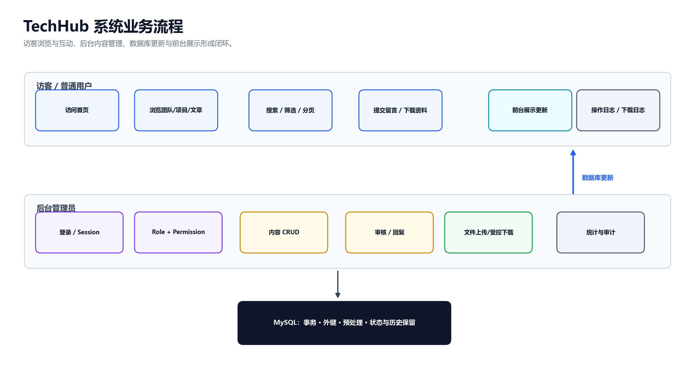

# 需求文档

## 1. 项目背景

高校技术团队通常通过聊天群、在线文档、个人仓库和临时网盘发布团队介绍、项目成果、课程文章与作业资料。信息分散会带来三个直接问题：团队外部人员难以了解团队和项目，成员之间缺少统一的内容维护入口，课程作业文件也缺少可追溯的下载与权限管理。

TechHub 是面向单支高校技术团队的展示与管理平台，采用原生 PHP MVC 与 MySQL 实现。平台把团队资料、成员关系、项目、技术文章、公告、留言和课程文件集中在一个站点中，并为不同身份提供不同的后台管理能力。

本项目的实际数据与样例数据均在页面中明确标注。当前站点仍使用“TechHub 示例技术团队”等示例内容，正式团队资料需要在交付前替换。本文档中的团队名称、成员姓名和学号来自团队提供的真实资料；示例页面中的人名、项目名和文章名不代表真实团队成员或真实项目成果。

## 2. 项目目标

### 2.1 总体目标

建设一个可运行、可演示、可维护的技术团队展示与管理平台，满足课程对数据库设计、原生 PHP MVC、增删改查、权限控制、文件上传下载、数据可视化和操作审计的要求。

### 2.2 具体目标

1. 前台集中展示团队、成员、项目、文章、公告、课程资料；
2. 后台支持团队、成员、项目、分类、文章、公告、留言、文件、用户、角色和日志管理；
3. 所有核心业务数据来自 MySQL，不使用静态数组冒充业务数据；
4. 后台页面执行服务端登录和权限校验，不能只依赖隐藏按钮；
5. 文件上传校验扩展名、MIME 和大小，作业文件存放在 Web 根目录之外，下载经过受控路径；
6. 使用 ECharts 展示来自 SQL 聚合的统计结果；
7. 记录后台关键操作，包含操作人、模块、动作、目标、结果、IP 和时间；
8. 通过可重复执行的 `data/install.sql` 与版本化迁移脚本完成数据库部署；
9. 通过自动化测试和真实 HTTP 请求验证主要功能。

### 2.3 当前实现边界

本文档描述的系统功能中，团队、成员、项目、文章、分类、公告、留言、文件、用户、角色、操作日志、ECharts 和前台展示已实现并完成实际测试。Apache PHP 8.2 生产部署、Git 提交记录、真实内容替换和修改本人密码页面尚未完成，具体状态见第 9 节和文末“待补充事项”。

## 3. 用户角色

系统不开放公开注册。访客无需账号即可浏览公开内容；后台账号由超级管理员创建并分配角色。

| 角色 | 是否登录 | 主要权限 | 说明 |
| --- | --- | --- | --- |
| 访客 Visitor | 否 | 浏览首页、团队、成员、项目、文章、公告；提交留言；下载公开文件 | 不需要账号，不占用 `users` 记录 |
| 团队成员 Member | 是 | 访问后台首页；查看本人资料；访问被授权的页面 | 默认不能管理项目、用户和角色 |
| 内容编辑 Editor | 是 | 项目、文章、分类、公告、留言、文件管理；查看统计 | 不能管理用户和角色 |
| 超级管理员 Super Admin | 是 | 全部后台功能，包括团队、成员、用户、角色和操作日志 | 拥有全部权限，角色权限不可在界面降级 |

### 3.1 权限码

权限定义保存在 `permissions` 表，角色与权限通过 `role_permissions` 关联。页面菜单和服务端路由均使用同一权限码。

| 权限码 | 名称 | 主要角色 |
| --- | --- | --- |
| `dashboard.view` | 访问后台首页 | 全部后台角色 |
| `profile.edit` | 修改本人公开资料 | 团队成员、内容编辑、超级管理员 |
| `stats.view` | 查看统计数据和图表接口 | 内容编辑、超级管理员 |
| `team.edit` | 编辑团队信息 | 超级管理员 |
| `member.manage` | 管理团队成员 | 超级管理员 |
| `project.manage` | 管理项目及成员 | 内容编辑、超级管理员 |
| `article.manage` | 管理文章 | 内容编辑、超级管理员 |
| `category.manage` | 管理文章分类 | 内容编辑、超级管理员 |
| `announcement.manage` | 管理公告 | 内容编辑、超级管理员 |
| `message.moderate` | 审核、回复、删除留言 | 内容编辑、超级管理员 |
| `file.manage` | 上传、编辑、隐藏、删除文件 | 内容编辑、超级管理员 |
| `user.manage` | 管理后台账号 | 超级管理员 |
| `role.manage` | 管理角色与权限 | 超级管理员 |
| `activity.view` | 查看操作日志 | 超级管理员 |

`profile.edit` 已在权限表定义，但当前个人资料页面仍为只读，修改本人资料/密码尚未实现，不能把该权限表述为完整可用功能。

## 4. 功能需求

### 4.1 前台展示与互动

| 编号 | 需求 | 实现状态 |
| --- | --- | --- |
| FR-FRONT-01 | 首页展示团队、核心数据、优秀项目、成员、最新文章、公告和下载入口 | 已实现 |
| FR-FRONT-02 | 团队页展示团队介绍、成立时间、研究方向、技术栈和联系方式 | 已实现 |
| FR-FRONT-03 | 成员列表支持搜索和分页，详情展示头像、职位、方向、技能和参与项目 | 已实现 |
| FR-FRONT-04 | 项目列表支持状态筛选、关键词搜索和分页，详情展示技术栈、成员和成果 | 已实现 |
| FR-FRONT-05 | 文章列表支持分类筛选、关键词搜索、分页和详情浏览量自增 | 已实现 |
| FR-FRONT-06 | 公告列表展示置顶和有效期内的公告，详情显示正文 | 已实现 |
| FR-FRONT-07 | 留言支持昵称、邮箱、内容校验、CSRF、蜜罐和频率限制 | 已实现 |
| FR-FRONT-08 | 已审核留言公开展示，管理员回复可见；待审核留言不公开 | 已实现 |
| FR-FRONT-09 | 团队作业和个人作业使用专门下载页，文件路径和公开状态受控 | 已实现 |
| FR-FRONT-10 | 前台登录、退出和只读个人资料 | 已实现；本人资料编辑未实现 |

### 4.2 后台业务管理

| 编号 | 需求 | 实现状态 |
| --- | --- | --- |
| FR-ADMIN-01 | 后台登录、退出、登录限流、Session 重建和登录日志 | 已实现 |
| FR-ADMIN-02 | 团队资料编辑、Logo、研究方向、技术栈和展示状态 | 已实现 |
| FR-ADMIN-03 | 团队成员新增、编辑、职位、介绍、头像、离队和引用保护 | 已实现 |
| FR-ADMIN-04 | 项目增删改查、封面、状态、发布/下线、推荐和项目成员 | 已实现 |
| FR-ADMIN-05 | 文章增删改查、分类、封面、草稿/发布/归档 | 已实现 |
| FR-ADMIN-06 | 文章分类增删改查、父子关系、循环检测和启停 | 已实现 |
| FR-ADMIN-07 | 公告增删改查、类型、置顶、有效期和发布/下线 | 已实现 |
| FR-ADMIN-08 | 留言搜索、审核、通过/拒绝、回复和删除 | 已实现 |
| FR-ADMIN-09 | 文件上传、信息编辑、公开/隐藏、受控下载和物理删除 | 已实现 |
| FR-ADMIN-10 | 用户新增、编辑、角色分配、停用和安全删除 | 已实现 |
| FR-ADMIN-11 | 角色增删改查、权限矩阵和超级管理员保护 | 已实现 |
| FR-ADMIN-12 | 操作日志记录操作人、模块、动作、目标、结果、IP、UA 和时间 | 已实现 |
| FR-ADMIN-13 | 统计卡片和 ECharts 图表从 MySQL 聚合数据生成 | 已实现 |
| FR-ADMIN-14 | 后台分页、搜索、筛选、空状态和统一错误提示 | 已实现 |

### 4.3 权限与安全需求

1. 所有后台页面必须验证登录状态；
2. 所有后台写操作必须检查权限码；
3. 所有 POST 必须校验 CSRF Token；
4. 用户输入进入数据库使用 PDO 预处理；
5. 动态输出必须 HTML 转义；
6. 密码只保存 `password_hash()` 结果；
7. 上传文件必须校验扩展名、真实 MIME 和大小；
8. 下载文件和删除物理文件必须经过受控目录边界检查；
9. 不能仅靠隐藏菜单实现权限控制；
10. 操作日志不得保存密码或完整敏感正文。

## 5. 非功能需求

| 类别 | 要求 | 当前情况 |
| --- | --- | --- |
| 安全性 | 防止 SQL 注入、XSS、CSRF、越权、恶意上传和路径穿越 | 已实现并完成针对性测试 |
| 数据一致性 | 使用 InnoDB、外键、事务和状态字段维护关系 | 已实现 |
| 可维护性 | 原生 MVC 分层，公共逻辑集中在 `core/` 与 `app/Support/` | 已实现 |
| 可用性 | 前台和后台使用统一 Bootstrap 5 视觉体系 | 已实现 |
| 响应式 | 移动端可访问，无明显横向溢出 | 已做 390px 设备仿真 |
| 性能 | 查询有索引、分页有边界、统计使用聚合 SQL | 未做正式性能压测，不能声称达到固定响应时间 |
| 兼容性 | 目标 PHP 8.2、MySQL 8.0、现代浏览器 | PHP/MySQL 已验证；Apache 8.2 未切换 |
| 可部署性 | 提供安装 SQL、迁移脚本和环境配置说明 | 已提供；正式 Apache 部署待完成 |
| 可测试性 | 提供 CLI/HTTP 测试脚本和证据文件 | 已提供并通过 |
| 可审计性 | 关键后台操作写入 `activity_logs` | 已实现 |
| 课程边界 | 不使用 Laravel、ThinkPHP、Vue、React、ORM 隐藏 SQL | 已遵守 |
| 真实数据 | 核心页面必须读取 MySQL | 已实现 |
| 真实性 | 不伪造进度、测试、Git 记录和分工 | 文档如实标注未完成项 |

## 6. 系统功能模块

系统按前台展示、内容管理、互动资源、权限审计和统计五类组织，共 12 个功能模块。

| 编号 | 模块 | 前台能力 | 后台能力 | 数据表 |
| --- | --- | --- | --- | --- |
| M01 | 用户与身份认证 | 登录、退出、只读资料 | 登录、用户管理、角色分配 | `users`, `roles`, `permissions`, `role_permissions` |
| M02 | 团队信息 | 团队介绍 | 团队资料、方向、技术栈、Logo、状态 | `teams` |
| M03 | 团队成员 | 成员列表、详情、参与项目 | 成员关系、职位、介绍、头像、离队 | `team_members`, `member_profiles` |
| M04 | 项目成果 | 项目列表、筛选、搜索、详情 | 项目 CRUD、封面、成员、发布/下线 | `projects`, `project_members` |
| M05 | 技术文章 | 文章列表、分类、搜索、详情 | 文章 CRUD、封面、草稿/发布/归档 | `articles` |
| M06 | 文章分类 | 前台分类筛选 | 分类 CRUD、父子关系、启停 | `categories` |
| M07 | 团队公告 | 公告列表、详情 | 公告 CRUD、置顶、有效期、发布/下线 | `announcements` |
| M08 | 留言与回复 | 提交留言、查看已审核留言 | 搜索、审核、回复、删除 | `messages`, `message_replies` |
| M09 | 文件资源 | 团队/个人作业下载 | 上传、编辑、公开/隐藏、下载、删除 | `files`, `file_downloads` |
| M10 | 数据统计 | 无 | 统计卡片和 4 张 ECharts 图表 | 多表聚合 |
| M11 | 角色权限 | 无 | 角色 CRUD、权限矩阵、超级管理员保护 | `roles`, `permissions`, `role_permissions` |
| M12 | 操作日志 | 无 | 日志筛选、分页、操作结果 | `activity_logs` |

## 7. 用户使用场景

### 7.1 访客了解团队

访客进入首页，查看团队定位、核心数据、推荐项目、成员和最新文章；进入团队页了解研究方向和技术栈；进入成员列表查看每位成员的职位、技能和参与项目；进入项目列表按状态筛选并打开项目详情。

### 7.2 访客阅读与下载

访客进入文章列表，按分类筛选或搜索关键词，打开文章详情并查看发布时间、作者和浏览量；进入公告页查看置顶公告；进入下载页切换团队作业/个人作业并下载公开文件。

### 7.3 访客提交留言

访客填写昵称、邮箱和留言内容。系统执行 UTF-8 编码、长度、邮箱格式、CSRF、蜜罐和 Session 频率限制。提交成功后留言状态为 `pending`，前台不显示；管理员审核通过后才出现在留言板。

### 7.4 团队成员登录

团队成员使用超级管理员分配的账号登录后台，只能看到数据统计首页和被授权的菜单。当前普通团队成员默认只有 `dashboard.view` 和 `profile.edit`，不能访问项目、用户或角色管理。

### 7.5 内容编辑维护内容

内容编辑登录后维护项目、文章、分类、公告、留言和文件。项目可关联团队成员并控制前台发布状态；文章支持草稿、发布和归档；留言通过审核后才能公开；文件上传后可按公开状态和启用状态决定前台是否可下载。

### 7.6 超级管理员管理系统

超级管理员维护团队、成员、账号和角色权限，查看操作日志和数据统计。系统禁止超级管理员停用、删除或降级自己，禁止把超级管理员角色通过界面降权，并要求系统至少保留一个启用的超级管理员。

## 8. 业务流程

### 8.1 前台内容访问流程

1. 浏览器请求统一入口 `public/index.php`；
2. Router 匹配前台路由；
3. Controller 调用 Model 查询 MySQL；
4. View 渲染页面，动态内容统一转义；
5. 列表页应用搜索、筛选和分页；
6. 文章详情按需原子增加浏览量；
7. 文件下载先校验 `is_public`、`status`、分类目录和 `realpath`，再流式输出并记录下载流水。

### 8.2 后台内容管理流程

1. 管理员访问 `/admin/login`，提交用户名、密码和 CSRF Token；
2. Auth 校验密码哈希、账号状态和登录限流；
3. 登录成功后重建 Session ID，并写入登录日志；
4. Router 对后台路由执行 `auth`、`csrf` 和权限码检查；
5. Controller 读取表单、执行服务端校验、调用 Model；
6. 写操作使用 PDO 预处理，关联操作使用事务；
7. 成功后写入 `activity_logs`，使用 PRG 重定向并显示 Flash；
8. 前台下一次查询读取到最新状态。

### 8.3 留言审核流程

访客提交 → `pending` → 后台通过或拒绝 → 通过后写入 `approved_at` → 前台列表可见 → 管理员回复 → 前台详情仅展示 `visible` 回复 → 删除留言时级联删除回复。

## 9. 开发范围

### 9.1 已实现范围

- 17 张业务表、21 个外键、可重复安装 SQL 和版本化迁移；
- 原生 PHP MVC 核心、路由、中间件、视图和 PDO 数据访问；
- 前台首页、团队、成员、项目、文章、公告、留言、下载、登录、个人资料；
- 后台 11 个业务模块的真实 CRUD、RBAC、上传、审核、日志和统计；
- 4 张 ECharts 图表和受权限保护的 JSON 接口；
- 三套自动化测试、安装/迁移校验和浏览器检查；
- 课程需求文档、设计文档、实现文档、用户手册、部署文档和展示 PPT 的源文件与导出文件。

### 9.2 未包含或仍需补充

- Apache 2.4 切换到 PHP 8.2 的正式虚拟主机部署；
- Git 提交/推送记录和逐人代码归属证明；
- 修改本人资料和修改密码页面；
- 真实团队名称、成员照片、项目和文章内容替换；
- 六份文档的学校指定模板适配、PPT 美化定稿和真实答辩彩排；
- 真实移动设备测试、性能压测和备份恢复演练；
- 自定义权限码管理界面；
- Docker Compose 一键部署（项目当前未提供 Docker 配置，未验证）。

### 9.3 课程约束

1. 使用原生 PHP 8.2，不引入 Laravel、ThinkPHP、Symfony 等框架；
2. 使用 PDO 原生 SQL，不使用 ORM 隐藏数据库设计；
3. 使用 Bootstrap 5 和本地静态资源，不依赖 CDN；
4. 数据库使用 MySQL 8.0、InnoDB、utf8mb4；
5. 所有业务数据来自 MySQL；
6. 文档、测试和 Git 记录只写实际结果。

## 10. 待补充事项

| 事项 | 当前情况 | 交付影响 |
| --- | --- | --- |
| 队名与成员 | 已提供：冰冰冰队；刚栋冰、成钧翔、罗清、王毅豪 | 已写入封面和分工页 |
| 工作量百分比 | 团队未提供百分比 | 文档按负责表数量、核心 MVC 文件和文档任务记录，不填虚构比例 |
| Git 提交记录 | `main` 分支无任何提交，仅配置远程 `origin` | 实现文档如实写“无提交记录” |
| 正式团队资料 | 页面仍为示例团队和示例成员 | 用户手册截图含示例数据，需替换后重拍 |
| Apache 部署 | 当前 PHP 内置服务器验证，Apache 仍为 PHP 7.3.4 | 部署文档提供待执行配置，不声称已部署 |
| 课程模板 | 未提供学校模板 | 当前采用统一 A4 版式，可在模板提供后替换 |
