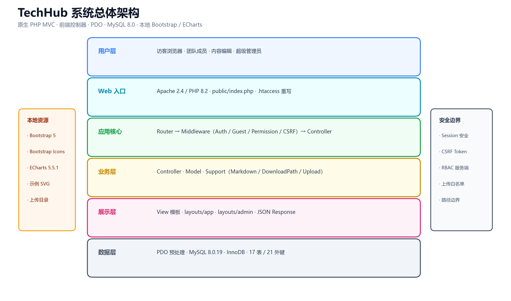
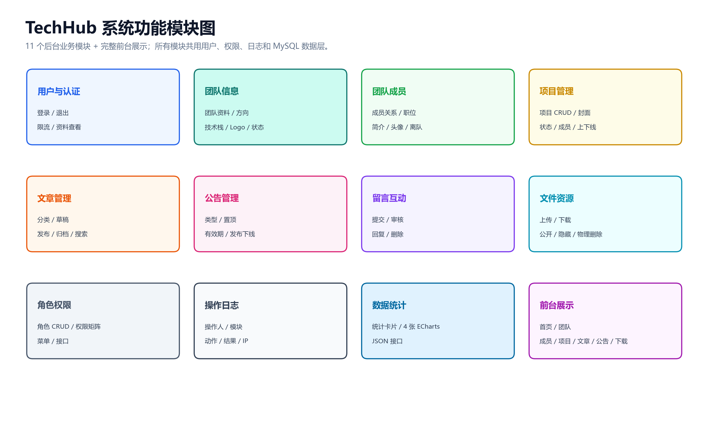
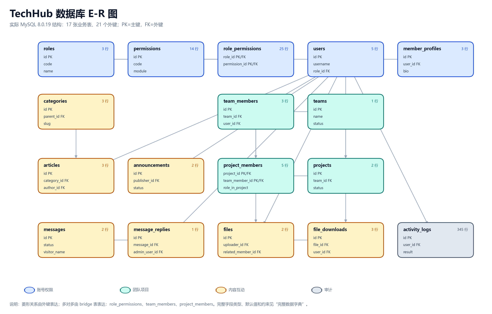
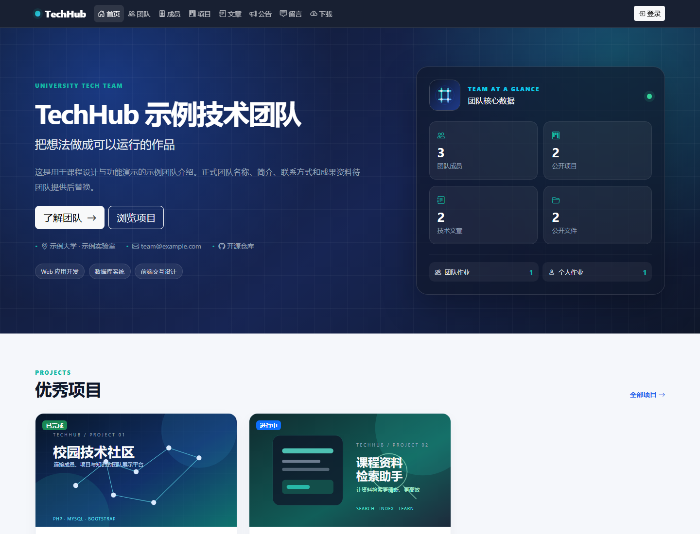
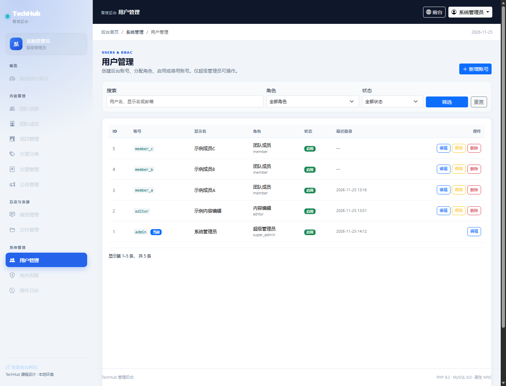
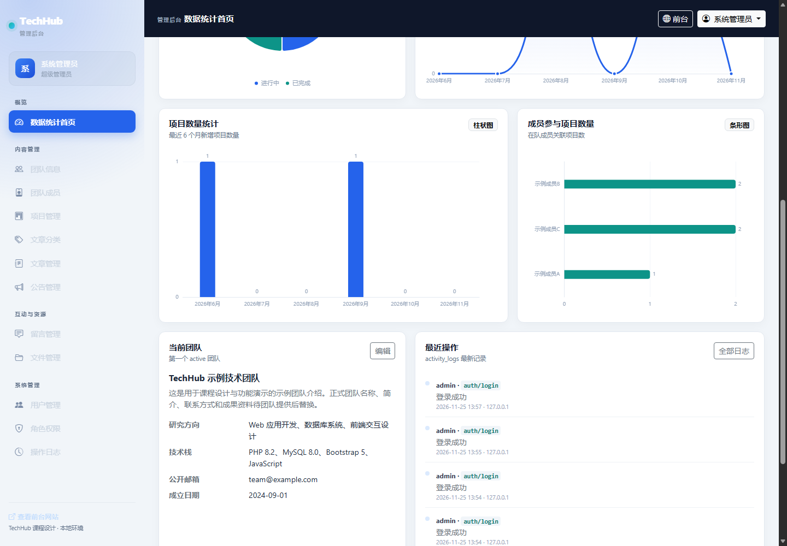

# TechHub 项目展示

## Slide 1 封面

**TechHub 高校技术团队展示与管理平台**

冰冰冰队

- 刚栋冰 2412888（组长）
- 成钧翔 2411259
- 罗清 2413238
- 王毅豪 2412509

课程设计答辩 · 2026-11-25

> 备注：团队分工和工作量比例来自团队提供的真实名单与任务说明。

## Slide 2 项目背景

### 问题

- 团队资料散落在聊天群、网盘和在线文档
- 成员、项目、文章和课程作业缺少统一入口
- 后台管理缺少权限控制和操作审计
- 作业文件公开下载缺少路径与状态校验

### 解决思路

用一个前后台一体的平台集中管理团队、成员、项目、内容、留言和课程文件，所有数据落 MySQL。

## Slide 3 需求分析

- 前台：团队展示、成员、项目、文章、公告、留言、下载
- 后台：11 个业务模块，覆盖内容、互动、资源和权限
- 四类角色：访客、团队成员、内容编辑、超级管理员
- 安全：PDO、CSRF、XSS 转义、RBAC、上传校验、路径边界
- 数据：17 张业务表、21 个外键
- 图表：4 张 ECharts，数据来自 SQL 聚合

## Slide 4 系统架构

- 浏览器 → `public/index.php` → Router/Middleware → Controller → Model → MySQL
- View 使用原生 PHP 模板，动态文本统一转义
- Bootstrap、Icons、ECharts 全部本地化，不依赖 CDN

## Slide 5 功能模块

前台展示 + 11 个后台业务模块：用户、团队、成员、项目、文章、分类、公告、留言、文件、角色权限、日志、统计。

## Slide 6 数据库设计

- 17 张业务表、21 个外键
- 多对多桥接：`role_permissions`、`team_members`、`project_members`
- 下载流水与操作日志分离
- 成员离队、文章归档、公告下线、文件隐藏使用状态字段保留历史

## Slide 7 前台功能展示

- 首页、团队、成员、项目、文章、公告
- 搜索、筛选、分页
- 留言审核隔离
- 团队/个人作业下载

## Slide 8 后台功能展示

- AdminLTE 风格响应式后台
- 服务端 RBAC：菜单与服务端接口使用同一权限码
- 用户/角色模块额外要求超级管理员
- 所有删除 POST + CSRF + 二次确认

## Slide 9 数据可视化

- 项目状态饼图
- 文章发布趋势折线图
- 项目新增柱状图
- 成员参与项目条形图
- 接口：`GET /admin/api/stats`，要求 `stats.view`

## Slide 10 核心技术

- 原生 PHP 8.2 MVC，不使用框架
- PDO 原生预处理，禁用模拟预处理
- Session 安全、CSRF、密码哈希、登录限流
- 项目成员、角色权限同步使用事务
- 上传扩展名/真实 MIME/大小/图片内容校验
- `realpath` 下载与删除路径边界
- 操作日志记录成功/失败结果

## Slide 11 项目特色

1. 前台完整展示，后台真实 CRUD，不是静态页面
2. 17 张表都有实际业务用途
3. 4 张 ECharts 图表全部来自 SQL 聚合
4. 作业文件位于 Web 根之外，下载必须经过 Controller
5. 超管保护：不能自停用、自删除、自我降级
6. 安装 SQL 和迁移脚本可重复执行
7. 测试与证据文件真实归档

## Slide 12 测试情况

| 测试 | 结果 |
| --- | --- |
| PHP 语法检查 | 123 个文件，0 失败 |
| 基础测试 | 14 passed, 0 failed |
| 前台数据测试 | 34 passed, 0 failed |
| 后台 HTTP 集成测试 | 79 passed, 0 failed |
| 后台 GET 页面/接口 | 30 个全部 200 |
| ECharts | 4 个 canvas 正常 |
| 390px 后台页面 | 16 个页面无横向溢出 |

未完成：Apache PHP 8.2 部署、真实移动设备、性能压测、备份恢复演练。

## Slide 13 团队分工

| 成员 | 负责模块 | 数据库表 | 核心文件 | 工作量占比 |
| --- | --- | --- | --- | --- |
| 刚栋冰 2412888（组长） | 架构、框架、用户权限、数据库统筹 | 5 张 | `User.php`、`admin/users/index.php`、`Admin/UserController.php` 及核心类 | 30% |
| 罗清 2413238 | 前台、团队与成员 | 2 张（含 1 张协作） | `Member.php`、`member/index.php`、`MemberController.php`、前台 UI | 20% |
| 成钧翔 2411259 | 项目、文章、分类、公告 | 5 张 | `Project.php`、`project/index.php`、`ProjectController.php` 及内容模块 | 30% |
| 王毅豪 2412509 | 留言、文件、统计、测试 | 4 张（含 1 张协作） | `Message.php`、`message/index.php`、`MessageController.php`、ECharts、测试 | 20% |

文档任务：刚栋冰=需求/设计；罗清=用户手册；成钧翔=设计/实现；王毅豪=实现/手册/部署。

工作量比例按团队任务包统计：刚栋冰 30% · 罗清 20% · 成钧翔 30% · 王毅豪 20%。

## Slide 14 项目分工明细

### 成员 A · 组长 刚栋冰（30%）

- 负责模块：系统架构与用户权限模块；项目统筹、核心框架、数据库整合。
- 主要工作：需求分析与技术选型、PHP MVC 基础框架、路由、数据库连接、身份认证、用户管理、角色权限管理、数据库设计与 SQL 整合、Git 仓库管理和部署。
- 负责数据库表：`users`、`roles`、`permissions`、`role_permissions`、`teams`。
- 必做 MVC：Model `User.php`；View `user/list.php`；Controller `UserController.php`。

### 成员 B · 前台业务负责人 罗清（20%）

- 负责模块：团队与成员展示模块；网站前台及团队信息管理。
- 主要工作：首页、团队介绍、成员列表与详情、成员信息编辑、团队信息编辑、前台整体 UI 和响应式布局。
- 负责数据库表：`team_members`、`files`（与成员头像相关文件业务协作）。
- 必做 MVC：Model `TeamMember.php`；View `team/member-list.php`；Controller `TeamMemberController.php`。

### 成员 C · 项目与内容负责人 成钧翔（30%）

- 负责模块：项目成果与内容管理模块。
- 主要工作：项目列表与详情、项目新增/编辑/删除、项目成员关联、技术文章发布、文章分类管理、团队公告管理。
- 负责数据库表：`projects`、`project_members`、`articles`、`categories`、`announcements`。
- 必做 MVC：Model `Project.php`；View `project/list.php`；Controller `ProjectController.php`。

### 成员 D · 互动与后台负责人 王毅豪（20%）

- 负责模块：留言、文件与数据统计模块；用户互动、后台统计及测试。
- 主要工作：留言板、留言回复和审核、文件上传与下载、作业文件管理、ECharts 数据可视化、后台统计首页、功能测试与用户手册。
- 负责数据库表：`messages`、`message_replies`、`activity_logs`、`files`（与罗清协作）。
- 必做 MVC：Model `Message.php`；View `message/list.php`；Controller `MessageController.php`。

> 课程任务中的 MVC 命名已按团队分工列出；项目实际落地文件路径与实现文档的对照表一致。

## Slide 15 总结与展望

### 已完成

- 前后台完整可运行
- 数据库、MVC、RBAC、上传、审核、日志、ECharts
- 127 项自动化测试通过（14 + 34 + 79）

### 待完成

- 宿主 Apache PHP 8.2 正式部署
- 真实团队资料与项目内容替换
- 修改本人资料/密码
- 课程材料模板适配与答辩彩排

**谢谢老师，欢迎提问。**

## 演讲备注

1. 演示前台时重点说明数据来自 MySQL，不是静态页。
2. 后台演示建议顺序：登录 → 统计 → 新建项目 → 审核留言 → 上传文件 → 角色权限 → 日志。
3. 安全演示：普通成员访问项目 403、缺 CSRF 403、上传 PHP 被拒绝、下载路径穿越被拒绝。
4. 团队分工页按团队确认的任务包展示 30/20/30/20 的工作量比例。
5. 未完成项主动说明，不把计划写成已通过。
