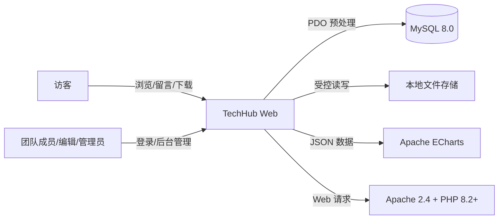
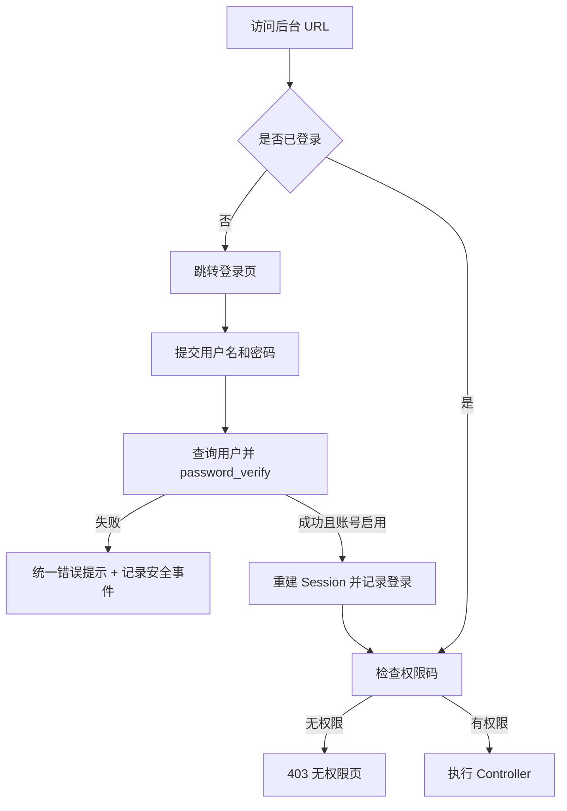
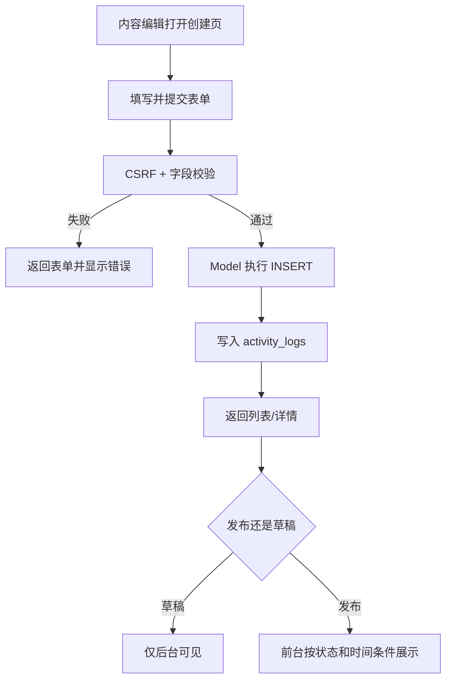
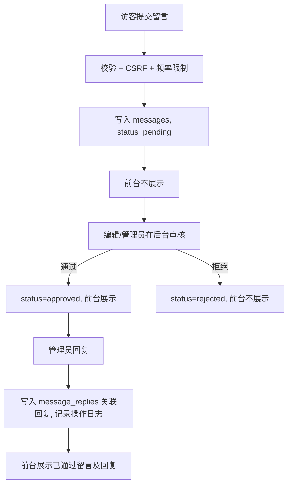
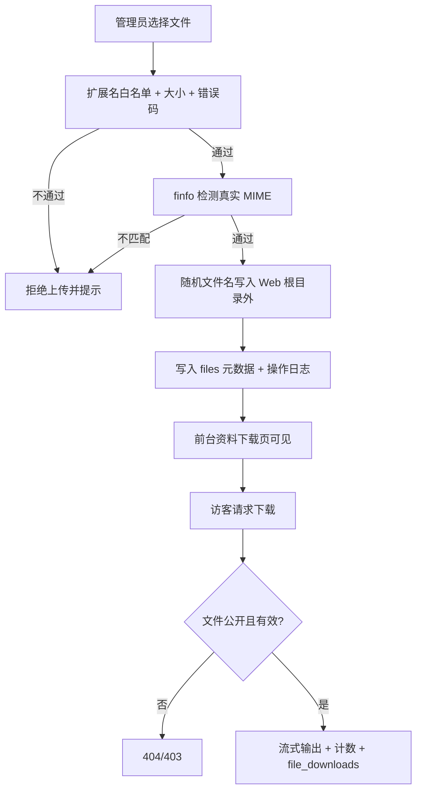
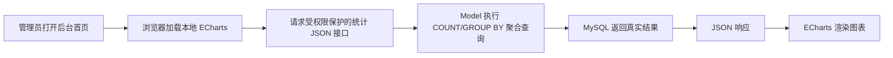

# TechHub 需求规格说明书

| 项目 | 内容 |
| --- | --- |
| 项目名称 | TechHub |
| 项目定位 | 高校技术团队展示与管理平台 |
| 课程名称 | 互联网数据库开发（以实际课程名称为准） |
| 文档版本 | v0.3（后台管理完成后修订） |
| 编写日期 | 2026-11-25 |
| 文档状态 | 数据库、MVC、前台和后台 11 个业务模块已完成验证；Apache 部署、Git、真实资料与六份材料未完成 |
| 团队信息 | 团队名称、成员姓名、学号、指导教师：**待提供** |

> 说明：本文件不写入任何虚构的团队名称、成员姓名、学号、联系方式、开发进度或测试结果。所有无法从课程要求中直接确定的信息，均以“待确认”标记。

## 1. 引言

### 1.1 编写目的

本文件用于明确 TechHub 的业务目标、用户角色、功能范围、非功能要求、系统边界、核心流程和验收标准，为后续数据库设计、MVC 架构设计、编码、测试、部署及课程文档编写提供统一依据。

### 1.2 项目背景

高校实验室、技术社团和学生开发团队通常通过分散的聊天群、文档链接和个人仓库对外展示成果。这种方式存在信息不集中、内容更新不及时、成员与项目关系不清晰、历史资料难以下载、缺少统一后台管理等问题。

TechHub 面向单支高校技术团队的实际展示与管理需求，建设一个前后台一体化的网站：

- 对外集中展示团队介绍、成员、项目成果、技术文章、公告和可公开资料；
- 为访客提供内容浏览、留言和文件下载能力；
- 为团队成员、内容编辑和超级管理员提供受身份与权限保护的后台管理能力；
- 所有核心数据保存到 MySQL，通过 PHP MVC 与 PDO 完成真实读写；
- 使用 ECharts 展示来自数据库统计查询的后台图表。

### 1.3 术语说明

| 术语 | 说明 |
| --- | --- |
| MVC | Model-View-Controller，本项目使用原生 PHP 实现 |
| 前台 | 面向访客的公开页面 |
| 后台 | 需要登录和权限校验的管理界面 |
| RBAC | 基于角色的访问控制 |
| 软隐藏 | 通过状态字段使记录不在前台展示，而非立即物理删除 |
| 团队作业 | 课程设计中由团队共同提交的作业资料 |
| 个人作业 | 课程设计中由组员分别提交的作业资料 |
| 种子数据 | 初始化数据库时写入的角色、权限及明确标注的演示数据 |

### 1.4 需求依据与课程硬性约束

以下条款来自课程要求，属于不可省略的验收条件：

1. 数据库表数量必须大于 10 张，目标设计约 15 张，实际正式设计 17 张具有真实业务意义的表。
2. 必须使用原生 PHP 实现 MVC 架构，不引入 Laravel、ThinkPHP、Vue、React 等大型框架。
3. 每位组员至少独立编写一个 Model、一个 View 和一个 Controller 文件。
4. 每个 PHP 文件必须包含规范的注释头。
5. 数据库初始化 SQL 文件必须位于 `/data/install.sql`。
6. 前台页面必须提供团队作业和个人作业的下载链接。
7. 必须提供可演示的前台与后台功能。
8. 后台统计必须使用 ECharts 动态展示，并可使用真实数据库查询获取加分。
9. 必须提供需求文档、设计文档、实现文档、用户手册、部署文档和项目展示 PPT。
10. 不允许用静态页面、硬编码数组或虚构查询结果冒充数据库功能。
11. 不得虚构开发进度、测试结果、Git 提交记录和团队成员分工。

## 2. 项目建设目标

### 2.1 业务目标

1. 建立统一、可维护的团队对外展示门户。
2. 建立围绕“团队—成员—项目—文章—公告—留言—文件”的内容管理闭环。
3. 通过登录、角色和权限控制，保证后台操作只由获得授权的人员执行。
4. 通过操作日志保留关键后台行为，便于审计与课程答辩说明。
5. 通过数据库实时统计和 ECharts 可视化，让团队运营数据可观察。

### 2.2 技术目标

1. 使用 PHP 8.2+、MySQL 8.0、PDO 和 Apache 构建可实际运行的项目。
2. 使用原生 PHP 实现清晰的前端控制器、路由、Controller、Model、View 分层。
3. 所有新增、查询、修改、删除（CRUD）均真实操作 MySQL。
4. 使用 PDO 预处理语句、输出转义、CSRF 防护、密码哈希、上传白名单等措施满足基础安全要求。
5. 使用统一的目录结构、命名规范、错误处理、日志和注释头。
6. 提供可重复执行的数据库初始化方案和部署说明。

### 2.3 可验证的成功标准

项目只有在以下条件均实际验证通过后，才可标记为“已完成”：

- 在目标环境导入 `data/install.sql` 成功，创建 17 张业务表；
- 前后台页面可访问，核心 CRUD 有真实数据库结果；
- 后台未登录或权限不足时不能执行管理操作；
- 图表接口返回 MySQL 聚合结果，页面由 ECharts 动态渲染；
- 上传文件的类型、大小和 MIME 校验有效；
- 团队作业和个人作业下载链接可访问并真实下载；
- 测试、截图、Git 记录和成员分工均来自真实过程。

## 3. 用户角色与权限

### 3.1 角色定义

| 角色 | 是否登录 | 说明 | 主要权限 |
| --- | --- | --- | --- |
| 访客 Visitor | 否 | 浏览公开内容的普通访问者 | 浏览团队、成员、项目、文章、公告；提交留言；下载公开文件 |
| 团队成员 Member | 是 | 与公开成员档案关联的普通后台账号 | 查看后台首页；维护本人公开资料；浏览授权页面 |
| 内容编辑 Editor | 是 | 负责内容和资源维护的工作人员 | 项目、文章、分类、公告、留言审核、文件、统计；不含用户与权限管理 |
| 超级管理员 Super Admin | 是 | 系统最高权限角色 | 全部后台功能，包括团队信息、用户、角色权限和操作日志 |

### 3.2 权限与账号规则

1. 不提供公开注册入口。后台账号由超级管理员创建、分配角色或停用。
2. 角色与权限关系保存在数据库，代码中的权限码只作为授权判断依据。
3. 所有后台页面与接口必须进行服务端身份认证和权限检查；仅隐藏菜单不视为安全措施。
4. 停用账号不能登录；已登录账号在被停用后，其后续请求应被拒绝。
5. 内置超级管理员角色必须保留，禁止删除；禁止用户通过角色编辑提升自身权限。
6. 访客不是 `users` 表中的账号，不占用后台账号数据。
7. 团队成员是否都能登录后台，由团队实际需要决定；若个别成员不需要登录，仍可保留公开成员档案但不创建账号。

### 3.3 角色—模块权限矩阵

| 模块 | 访客 | 团队成员 | 内容编辑 | 超级管理员 |
| --- | --- | --- | --- | --- |
| 用户与身份认证 | 仅登录页 | 登录、退出、修改密码 | 登录、退出、修改密码 | 登录、退出、修改密码、用户管理 |
| 团队信息 | 查看 | 查看 | 查看 | 查看、编辑 |
| 团队成员 | 查看公开档案 | 查看、维护本人档案 | 查看 | 查看、增删改、排序 |
| 项目成果 | 查看公开项目 | 查看 | 查看、增删改 | 查看、增删改 |
| 技术文章 | 查看已发布文章 | 查看已发布文章 | 查看、增删改、发布 | 查看、增删改、发布 |
| 文章分类 | 按分类浏览 | 按分类浏览 | 增删改、排序 | 增删改、排序 |
| 团队公告 | 查看有效公告 | 查看有效公告 | 增删改、发布、置顶 | 增删改、发布、置顶 |
| 留言与回复 | 提交、查看已审核留言 | 查看已审核留言 | 审核、回复、删除 | 审核、回复、删除 |
| 文件资源 | 查看、下载公开文件 | 查看、下载公开文件 | 上传、隐藏、删除、查看下载记录 | 上传、隐藏、删除、查看下载记录 |
| 后台数据统计 | 无 | 后台首页概览（如授权） | 查看 ECharts 统计 | 查看 ECharts 统计 |
| 角色与权限 | 无 | 无 | 无 | 角色、权限分配、账号管理 |
| 操作日志 | 无 | 无 | 无 | 查看、筛选 |

> 权限矩阵为第一阶段方案，最终以 `roles`、`permissions`、`role_permissions` 和 `users.role_id` 的实际配置为准。所有“无”权限的入口仍须由服务端拦截。

## 4. 用户使用场景

### 4.1 场景 S01：访客了解团队

访客进入首页，查看团队简介、精选项目、最新文章、置顶公告和团队作业/个人作业下载入口；随后进入团队页和成员页，了解团队构成。

### 4.2 场景 S02：访客检索并阅读内容

访客在项目、文章或公告列表中按关键词、分类或状态筛选，分页浏览；打开详情页阅读完整内容。文章浏览会更新文章浏览量。

### 4.3 场景 S03：访客留言并等待回复

访客填写昵称、邮箱、留言内容并提交。留言进入待审核状态，前台不立即显示。内容编辑或超级管理员审核通过后可公开展示，并可回复；访客能看到审核通过的管理员回复，但邮箱不会公开。

### 4.4 场景 S04：访客下载作业或资料

访客通过“资料下载”页面的“团队作业”“个人作业”入口浏览文件，点击下载后由服务端校验文件公开状态、流式输出文件，并写入下载日志和更新下载次数。

### 4.5 场景 S05：团队成员维护个人档案

团队成员登录后台，只能修改本人关联的公开成员档案中的有限字段（如简介、头像、公开邮箱、GitHub 地址），不能擅自修改职位、排序、可见状态等管理字段。修改成功后写入操作日志。

### 4.6 场景 S06：内容编辑维护内容

内容编辑登录后管理项目、成员关联、文章、分类、公告、留言和文件。文章保存为草稿后可预览，发布后出现在前台；公告可置顶和设置过期时间；留言审核与回复即时写入数据库。

### 4.7 场景 S07：超级管理员治理系统

超级管理员维护团队信息、账号和角色权限，配置角色可访问的权限，查看操作日志和 ECharts 统计图表，处理异常账号或内容。

### 4.8 场景 S08：课程评审与答辩

评审人员看到前台演示、后台真实 CRUD、SQL 初始化、数据库记录、ECharts 动态图表、文件校验、权限拦截和操作日志，并能查看六份课程文档和真实 Git 记录。

## 5. 功能需求

以下功能编号用于后续设计、实现和测试追踪。所有后台操作默认要求已登录并通过权限校验，所有写操作默认要求 CSRF 校验和操作日志记录。

### 5.1 M01 用户与身份认证

| 编号 | 需求 |
| --- | --- |
| FR-AUTH-01 | 提供统一后台登录页，使用用户名和密码登录；不提供公开注册。 |
| FR-AUTH-02 | 密码使用 `password_hash()` 保存，使用 `password_verify()` 校验；禁止明文或可逆加密存储。 |
| FR-AUTH-03 | 登录成功后重建会话 ID，保存最小必要用户信息；退出使用 POST 并销毁会话。 |
| FR-AUTH-04 | 停用账号不得登录；已登录账号被停用后，后续受保护请求必须被拒绝。 |
| FR-AUTH-05 | 登录失败返回统一错误提示，不泄露账号是否存在；记录必要的安全事件。 |
| FR-AUTH-06 | 已登录用户可修改本人密码，必须验证原密码，并满足最小密码规则。 |
| FR-AUTH-07 | 后台所有路由均通过统一认证与权限中间件校验，不能依赖前端隐藏菜单。 |
| FR-AUTH-08 | 支持登录超时/会话失效后跳转到登录页，并保留安全的返回地址。 |

### 5.2 M02 团队信息管理

| 编号 | 需求 |
| --- | --- |
| FR-TEAM-01 | 前台首页和团队页展示团队名称、口号、简介、成立时间、Logo、公开联系方式和作品链接。 |
| FR-TEAM-02 | 团队信息采用单条记录（单团队部署），超级管理员可编辑并保存到数据库。 |
| FR-TEAM-03 | 支持 Logo 上传或更换，文件类型、MIME、大小和图片有效性必须校验。 |
| FR-TEAM-04 | 保存时校验必填字段、URL 格式和长度；更新记录 `updated_by` 与 `updated_at`。 |
| FR-TEAM-05 | 团队信息变更写入操作日志。 |

### 5.3 M03 团队成员管理

| 编号 | 需求 |
| --- | --- |
| FR-MEMBER-01 | 前台展示状态可见的成员列表，可区分在队成员和已毕业/离队成员；隐藏成员不出现在前台。 |
| FR-MEMBER-02 | 提供成员详情页，展示姓名、团队职位、简介、技术方向、头像、公开联系方式、参与项目。 |
| FR-MEMBER-03 | 超级管理员可新增、编辑、隐藏、排序成员，并可将成员档案关联到后台账号。 |
| FR-MEMBER-04 | 一个后台账号最多关联一个成员档案；关联关系可解除，但不得造成数据外键错误。 |
| FR-MEMBER-05 | 团队成员登录后只能修改本人档案的允许字段，不能越权修改管理字段或他人档案。 |
| FR-MEMBER-06 | 成员档案的公开邮箱不得默认显示敏感个人联系方式；联系方式是否公开由数据字段控制。 |
| FR-MEMBER-07 | 新增、修改、隐藏成员均写入操作日志。 |

### 5.4 M04 项目成果管理

| 编号 | 需求 |
| --- | --- |
| FR-PROJECT-01 | 前台展示可见项目，支持按项目状态或关键词筛选、分页浏览。 |
| FR-PROJECT-02 | 项目详情展示摘要、详细介绍、技术栈、封面、仓库地址、演示地址、项目周期和参与成员。 |
| FR-PROJECT-03 | 内容编辑和超级管理员可新增、编辑、设置可见性、排序和删除项目。 |
| FR-PROJECT-04 | 项目可关联多名成员，并记录成员在项目中的角色；关联数据保存到 `project_members`。 |
| FR-PROJECT-05 | 项目与成员的多对多更新使用事务，避免出现部分成功。 |
| FR-PROJECT-06 | 删除项目前处理成员关联；删除或隐藏项目不影响成员档案。 |
| FR-PROJECT-07 | 项目新增、修改、删除及成员关联变更写入操作日志。 |

### 5.5 M05 技术文章管理

| 编号 | 需求 |
| --- | --- |
| FR-ARTICLE-01 | 前台展示已发布文章，支持关键词搜索、分类筛选和分页。 |
| FR-ARTICLE-02 | 文章详情展示标题、作者、分类、发布时间、摘要、正文、封面和浏览量。 |
| FR-ARTICLE-03 | 每次成功打开已发布文章详情时，以数据库自增方式更新 `view_count`。 |
| FR-ARTICLE-04 | 内容编辑和超级管理员可新建、编辑、保存草稿、发布、归档和删除文章。 |
| FR-ARTICLE-05 | 文章必须属于一个有效分类；作者自动取当前登录用户。 |
| FR-ARTICLE-06 | 正文支持受控的 Markdown 子集或纯文本换行，禁止执行任意 HTML/JavaScript；输出必须转义。 |
| FR-ARTICLE-07 | 文章支持封面、摘要和是否推荐；草稿、归档文章不出现在前台。 |
| FR-ARTICLE-08 | 文章状态与可见性变化写入操作日志。 |

### 5.6 M06 文章分类管理

| 编号 | 需求 |
| --- | --- |
| FR-CATEGORY-01 | 内容编辑和超级管理员可新增、编辑、排序、启用/停用文章分类。 |
| FR-CATEGORY-02 | 分类支持最多两级父子关系，禁止自引用和循环引用。 |
| FR-CATEGORY-03 | 分类名称和别名校验唯一性；停用分类不展示在前台筛选区。 |
| FR-CATEGORY-04 | 含有文章的分类不得直接删除，必须先迁移文章或确认无文章。 |
| FR-CATEGORY-05 | 前台按分类浏览时只显示已发布文章。 |
| FR-CATEGORY-06 | 分类增删改写入操作日志。 |

### 5.7 M07 团队公告管理

| 编号 | 需求 |
| --- | --- |
| FR-ANNOUNCEMENT-01 | 前台展示已发布且未过期的公告，支持置顶排序和分页。 |
| FR-ANNOUNCEMENT-02 | 公告详情展示标题、正文、类型、发布时间和发布人；过期内容不进入公开列表。 |
| FR-ANNOUNCEMENT-03 | 内容编辑和超级管理员可新建、编辑、发布、归档和删除公告。 |
| FR-ANNOUNCEMENT-04 | 支持置顶和过期时间；过期时间必须晚于发布时间或允许为空。 |
| FR-ANNOUNCEMENT-05 | 公告状态变化写入操作日志。 |

### 5.8 M08 留言与回复

| 编号 | 需求 |
| --- | --- |
| FR-MESSAGE-01 | 访客可提交昵称、邮箱和留言内容；昵称和内容必填，邮箱格式校验。 |
| FR-MESSAGE-02 | 新留言默认进入 `pending` 状态，未经审核不得在公开页面显示。 |
| FR-MESSAGE-03 | 公开页面只展示 `approved` 的顶级留言及其已审核回复；访客邮箱不得公开。 |
| FR-MESSAGE-04 | 内容编辑和超级管理员可查看待审核留言，执行通过、拒绝或删除。 |
| FR-MESSAGE-05 | 管理员可对已通过的留言回复；回复记录回复人、时间和内容，并公开展示。 |
| FR-MESSAGE-06 | 留言提交必须进行 CSRF 校验、长度限制、HTML 转义和基本频率限制/蜜罐校验。 |
| FR-MESSAGE-07 | 审核、回复、删除操作写入操作日志。 |
| FR-MESSAGE-08 | 留言与管理员回复拆分为 `messages` 和 `message_replies`；前台只展示已通过留言和可见回复。 |

### 5.9 M09 文件资源管理

| 编号 | 需求 |
| --- | --- |
| FR-FILE-01 | 后台可上传文件并录入标题、描述、分类、是否公开和关联成员。 |
| FR-FILE-02 | 文件分类至少包括：团队作业、个人作业、其他资源。 |
| FR-FILE-03 | 上传必须校验扩展名白名单、文件真实 MIME、文件大小和应用层错误；禁止上传 PHP、脚本、可执行文件或伪装文件。 |
| FR-FILE-04 | 文件以随机生成的安全文件名保存到 Web 根目录之外，数据库只保存相对路径与元数据；禁止通过 URL 直接访问。 |
| FR-FILE-05 | 前台“资料下载”页提供团队作业和个人作业的明确下载入口，并展示文件标题、大小、上传时间、下载次数。 |
| FR-FILE-06 | 下载通过受控控制器流式输出，校验 `is_public` 和 `status`，更新下载次数并写入 `file_downloads`。 |
| FR-FILE-07 | 支持隐藏文件；删除文件前确认记录与物理文件，避免误删。 |
| FR-FILE-08 | 上传、隐藏、删除写入操作日志；下载日志用于统计，不作为审计日志替代。 |

### 5.10 M10 后台数据统计

| 编号 | 需求 |
| --- | --- |
| FR-STAT-01 | 后台首页展示项目数、文章数、成员数、留言数、文件数、累计下载量等统计卡片。 |
| FR-STAT-02 | 使用 ECharts 展示真实数据，至少包括项目状态分布、文章分类分布、留言状态分布和近 12 个月内容/下载趋势。 |
| FR-STAT-03 | 图表数据通过受权限保护的 JSON 接口从 MySQL 聚合查询获得，禁止在前端硬编码数值。 |
| FR-STAT-04 | 无数据时显示 0 或空状态，不伪造趋势；接口异常返回明确错误状态。 |
| FR-STAT-05 | 统计查询应按状态、时间字段建立必要索引，避免无意义全表扫描。 |
| FR-STAT-06 | 统计页面仅向有 `stats.view` 权限的角色开放。 |

### 5.11 M11 角色与权限管理

| 编号 | 需求 |
| --- | --- |
| FR-RBAC-01 | 超级管理员可创建、编辑、停用/删除自定义角色，并分配权限。 |
| FR-RBAC-02 | 内置角色（至少超级管理员）不可删除；可查看权限清单。 |
| FR-RBAC-03 | 权限定义由初始化数据提供，代码只识别已登记权限码；第一阶段不开放随意创建未知权限码。 |
| FR-RBAC-04 | 超级管理员可创建后台账号、编辑账号资料、分配角色、停用账号和重置密码。 |
| FR-RBAC-05 | 禁止删除或停用当前登录的唯一超级管理员，禁止将自身角色降级导致系统无人管理。 |
| FR-RBAC-06 | 角色权限变更与账号变更必须使用事务，并写入操作日志。 |
| FR-RBAC-07 | 系统不得通过前端参数直接指定任意权限；所有授权以数据库中的角色—权限关系为准。 |

### 5.12 M12 操作日志

| 编号 | 需求 |
| --- | --- |
| FR-LOG-01 | 记录登录成功、登录失败、退出、密码修改、关键新增/修改/删除、角色变更、文件操作和留言审核。 |
| FR-LOG-02 | 日志至少记录操作人快照、模块、动作、目标类型/ID、描述、IP、User-Agent、时间。 |
| FR-LOG-03 | 超级管理员可按用户、模块、时间和关键词筛选日志，分页查看。 |
| FR-LOG-04 | 日志为追加型记录，不提供普通编辑入口；不记录明文密码、文件内容或完整敏感凭据。 |
| FR-LOG-05 | 日志写入失败不得静默忽略关键安全事件；应在应用日志中记录错误并采用可理解的降级策略。 |
| FR-LOG-06 | 日志页面仅向有 `activity.view` 权限的角色开放。 |

## 6. 非功能需求

### 6.1 安全性

| 编号 | 要求 |
| --- | --- |
| NFR-SEC-01 | 所有 SQL 使用 PDO 预处理语句；动态排序字段使用白名单映射，不直接拼接用户输入。 |
| NFR-SEC-02 | 所有动态输出默认 HTML 转义；文章正文使用受控渲染器；留言不做任意 HTML 透传。 |
| NFR-SEC-03 | 所有修改状态的表单使用 POST 并校验 CSRF Token；退出也使用 POST。 |
| NFR-SEC-04 | 密码使用 PHP 官方密码哈希 API，不能明文、MD5 或简单 SHA 存储。 |
| NFR-SEC-05 | 后台路由逐请求执行认证和权限检查；权限判断在服务端，不能以隐藏按钮代替。 |
| NFR-SEC-06 | 上传文件必须同时检查扩展名白名单、`finfo` 检测的 MIME、最大体积和文件错误码；上传目录不位于可执行 Web 路径。 |
| NFR-SEC-07 | 上传文件使用随机文件名，原始文件名只存数据库；下载接口必须做公开状态校验。 |
| NFR-SEC-08 | 数据库账号使用最小权限，配置密码放在 `.env` 等不提交文件；仓库只保留占位示例。 |
| NFR-SEC-09 | Session 使用 HttpOnly、SameSite，登录后重建 ID；生产环境启用 Secure。 |
| NFR-SEC-10 | 生产模式关闭错误详情展示，异常写入服务端日志；错误页不暴露堆栈和路径。 |

### 6.2 性能

| 编号 | 要求 |
| --- | --- |
| NFR-PERF-01 | 在课程演示数据规模下，普通页面数据库查询应力求在 500 ms 内完成（不含网络和静态资源），以实际测试为准。 |
| NFR-PERF-02 | 列表页必须分页，默认每页 10～15 条；禁止一次性渲染无上限数据。 |
| NFR-PERF-03 | 统计接口使用聚合 SQL，按需建立索引；目标在常规演示数据下 2 秒内返回。 |
| NFR-PERF-04 | 静态资源使用本地 Bootstrap、Bootstrap Icons 和 ECharts 文件，避免演示时依赖外部 CDN 网络。 |

> 上述响应时间属于设计目标，当前尚未进行任何性能测试，不得在文档中表述为已达到的结果。

### 6.3 可靠性、一致性与可恢复性

1. 关键多表操作使用事务（如项目成员关联、角色权限分配、用户与成员关联）。
2. 外键约束由 MySQL 执行，应用层同时进行可理解的业务校验。
3. 文件删除采用“先校验、再删除记录与物理文件”的顺序，并对失败情况给出提示。
4. 提供数据库备份与恢复说明；上传目录与数据库应一并备份。
5. 应用异常记录到 `storage/logs/`，不能把敏感信息直接输出给浏览器。

### 6.4 易用性与兼容性

1. 前台和后台使用统一 Bootstrap 5 视觉体系，移动端可基本使用。
2. 表单提供必填标识、错误摘要和成功反馈；破坏性操作二次确认。
3. 面向现代版 Chrome、Edge、Firefox；以课程演示电脑实际浏览器为准。
4. 中文界面统一 UTF-8 编码，数据库使用 `utf8mb4`。
5. 列表和详情有清晰的空状态、404 和权限错误提示。

### 6.5 可维护性与工程规范

1. 遵循 MVC：Model 不输出 HTML，View 不直接查询数据库，Controller 不直接拼接 SQL。
2. 文件名、类名、表名、字段名采用统一规范并贯穿数据库、代码和文档。
3. 每个 PHP 文件包含文件说明、模块、职责、作者占位、创建/修改日期等注释头；作者信息由实际编写者填写，禁止代填。
4. 关键业务逻辑应可读、可测试；公共逻辑集中在 Core 和 Service，不复制粘贴。
5. Git 提交与实际开发同步，不补造历史。

### 6.6 可审计性与隐私

1. 后台关键写操作产生操作日志，日志不保存密码或完整敏感正文。
2. 访客邮箱只在后台可见，不公开展示。
3. 公开成员资料由负责人确认；不默认公开身份证号、手机号等敏感信息。
4. 文件下载记录 IP 和 User-Agent 用于统计与安全排查，应仅管理员可见。

## 7. 系统边界

### 7.1 系统内部范围

- 单团队官网前台与内容展示；
- 后台登录与 RBAC 授权；
- 团队信息、成员、项目、文章、分类、公告、留言、文件管理；
- 后台统计图表与操作日志；
- 本地文件上传与受控下载；
- MySQL 数据库初始化、种子数据与真实 CRUD。

### 7.2 系统外部依赖

- Apache Web 服务器；
- PHP 8.2+ 及 PDO MySQL、fileinfo、mbstring、session 等扩展；
- MySQL 8.0 数据库；
- 浏览器；
- 本地文件系统；
- 可选 Docker Compose 环境（当前未安装，未验证）。

### 7.3 明确不包含的范围

- 多团队/多租户隔离；
- 访客公开注册、第三方 OAuth、短信/邮箱验证；
- 在线支付、订单、商城；
- 实时聊天、即时通知、消息推送；
- 邮件发送服务；
- 云对象存储、CDN、视频转码；
- 原生移动端应用；
- 复杂工作流审批和版本对比；
- 任意 HTML/JavaScript 富文本执行。

### 7.4 系统上下文

## 8. 核心业务流程

### 8.1 登录与权限校验流程

### 8.2 内容发布流程（文章/公告/项目）

### 8.3 留言审核与回复流程

### 8.4 文件上传与下载流程

### 8.5 统计图表流程

## 9. 项目开发范围与交付物

### 9.1 必须交付（P0）

| 范围 | 内容 |
| --- | --- |
| 前台 | 首页、团队、成员、项目、文章、公告、留言、资料下载、404/403 |
| 后台 | 登录、仪表盘、团队、成员、项目、文章、分类、公告、留言、文件、用户、角色权限、日志 |
| 数据库 | 17 张业务表、外键和索引、`data/install.sql`、初始化角色/权限、演示数据策略 |
| 安全 | PDO 预处理、密码哈希、CSRF、XSS 转义、RBAC、上传校验、敏感配置隔离 |
| 可视化 | ECharts 真实数据统计图表 |
| 课程材料 | 需求文档、设计文档、实现文档、用户手册、部署文档、项目展示 PPT |
| 过程证据 | 真实截图、SQL 执行证据、真实 Git 记录、真实成员分工 |

### 9.2 可选增强（P1，不替代 P0）

- 文章/项目/文件的高级搜索与组合筛选；
- 统计时间范围筛选和 CSV 导出；
- 备份脚本；
- Docker Compose 部署文件（当前环境未安装 Docker，若交付必须实际验证）；
- 更细粒度的内容所有权（仅允许作者编辑自己的文章）；
- 简单登录限流和验证码。

### 9.3 明确不通过“静态页面”实现的内容

- 项目、文章、公告、成员、分类、留言、文件、统计、日志、角色权限必须来自数据库查询或真实写入。
- 不能用 PHP 数组固定返回统计数值。
- 不能只生成 HTML 模板而没有路由、Controller、Model 和 SQL。

## 10. 约束、假设与待确认事项

### 10.1 已采用的假设

1. 本系统为**单团队**部署，不实现多租户；如实际需要多个团队，需要调整团队表与所有内容归属关系。
2. 不提供公开注册；后台账号由超级管理员建立。
3. 前台默认中文，内容由团队后续提供；演示数据必须显式标记为“示例数据”。
4. 文件使用本地磁盘存储，不接入云存储；单文件上限暂定 20 MB，最终可调整。
5. 单角色绑定一个用户（`users.role_id`），暂不实现一个用户多角色。
6. 文章正文采用纯文本/受控 Markdown，不执行任意 HTML。
7. 当前只启用一条 active 团队记录，前台读取主团队；表结构保留团队实体扩展能力。
8. 统计以课程演示数据规模为目标，不作高并发承诺。

### 10.2 环境约束（已检查）

| 项目 | 课程要求 | 当前检查结果 | 结论 |
| --- | --- | --- | --- |
| 项目目录 | 新目录/已有项目需先分析 | `WWW/TechHub` 从空目录初始化 | 已建立 MVC/数据库骨架 |
| Git | 需要 Git | Git 2.49.0 已安装；本地仓库已初始化并配置远程 `origin`；尚未提交/推送 | 下一阶段确认提交策略 |
| PHP | 8.2+ | 已安装 PHP 8.2.36 NTS；PDO MySQL、fileinfo、mbstring、openssl 等扩展已验证 | **已满足**；内置服务器已验证 |
| MySQL | 8.0 | 已启动独立 MySQL 8.0.19 实例（3308），`techhub` 数据库和最小权限账号已创建 | **已满足**；与现有 3306/3307 实例隔离 |
| Apache | 可用 | Apache 2.4.39 在 80 端口仍使用 PHP 7.3.4 Fcgid；尚未切换本项目的 PHP 8.2 | **部署待完成** |
| Composer | 未硬性要求 | 未安装 | 采用自定义自动加载 |
| Docker | 可选 | 未安装 | 不作为当前阶段前置 |

> 环境检查包含 2026-11-25 的实际安装与验证结果；Apache 生产接入仍需在部署阶段配置并复测。

### 10.3 尚需用户/团队提供的信息

1. 实际团队名称、团队简介、Logo、公开联系方式、指导教师、课程名称、班级和截止日期。
2. 组员人数、姓名、学号、Git 账号和真实分工；本项目不预先代填。
3. 是否确认单团队部署；若要多团队，需重新设计内容归属。
4. 真实或脱敏的团队、成员、项目、文章、公告和文件内容，或确认继续使用带“示例”标记的数据。
5. 本地访问方式：是否配置 `techhub.local` / Apache 虚拟主机，还是保留当前 PHP 内置服务器地址。
6. Apache 切换到 PHP 8.2 的时间和方式，以及是否允许调整 phpstudy 站点配置。
7. 是否需要提交到 GitHub/Gitee 当前远程仓库，以及分支与提交规范。
8. 是否只需要中文，以及是否已有学校报告模板、PPT 模板或封面格式。
9. 课程截止日期和答辩日期，以便把相对阶段计划转换为确定日程。
10. 正式交付时是否允许继续使用 20 MB 单文件上限和当前附件白名单（pdf/doc/docx/ppt/pptx/zip/txt/png/jpg/webp/gif）。

## 11. 验收标准

以下标准是项目最终验收基线。当前功能模块、RBAC、ECharts 和测试记录已完成，但 Apache PHP 8.2 部署、真实成员 Git 分工和六份材料尚未完成，因此**不能将整个项目判定为最终验收通过**。

| 编号 | 验收标准 |
| --- | --- |
| AC-01 | 在 MySQL 8.0 目标环境执行 `data/install.sql` 成功，创建 17 张具有真实业务关系的表，并配置外键/索引。 |
| AC-02 | 前台可访问首页、团队、成员、项目、文章、分类、公告、留言、资料下载等实际页面。 |
| AC-03 | 后台可登录，并完成团队、成员、项目、文章、分类、公告、留言、文件、用户、角色权限、日志等管理。 |
| AC-04 | 项目中不存在用硬编码数组冒充数据库查询结果的核心业务数据。 |
| AC-05 | 新增、编辑、删除、查询操作均真实改变或读取 MySQL 数据，并能用 SQL 结果复核。 |
| AC-06 | 使用 PDO 预处理语句；用户输入输出转义；密码哈希；后台 RBAC 生效。 |
| AC-07 | 未登录/无权限访问后台接口被拒绝；停用账号失效；CSRF 保护生效。 |
| AC-08 | 文件上传拒绝非法扩展名、错误 MIME、超限文件；下载受控且记录真实下载。 |
| AC-09 | 后台 ECharts 图表使用真实 SQL 聚合结果，非静态数据。 |
| AC-10 | 前台提供清晰可用的团队作业和个人作业下载链接。 |
| AC-11 | PHP 使用 MVC 分层；每名组员至少独立提交一个 Model、一个 View、一个 Controller，并有真实 Git 记录。 |
| AC-12 | 每个 PHP 文件具有规范注释头，命名与目录规范一致。 |
| AC-13 | 需求、设计、实现、用户手册、部署文档和 PPT 齐备，内容与实际代码一致。 |
| AC-14 | 提供真实测试记录、截图和演示步骤；不得伪造测试通过、进度或分工。 |
| AC-15 | 在目标环境完成端到端演示，前台与后台链路均可运行。 |

### 11.1 当前实际验收状态

| 验收项 | 当前状态 | 说明 |
| --- | --- | --- |
| AC-01 数据库安装 | 通过 | 临时新库连续导入两次，17 表、21 外键 |
| AC-02 前台页面 | 通过 | 首页、团队、成员、项目、文章、公告、留言、下载已实测 |
| AC-03 后台管理 | 通过 | 团队、成员、项目、分类、文章、公告、留言、文件、用户、角色、日志已实测 |
| AC-04 禁止硬编码核心数据 | 通过 | 页面和图表均从 MySQL/JSON 聚合读取 |
| AC-05 CRUD 真实落库 | 通过 | 后台 79 项 HTTP 集成测试覆盖 |
| AC-06 PDO/转义/哈希/RBAC | 通过 | 实际请求与数据库检查 |
| AC-07 未登录/越权/CSRF | 通过 | 302、403 均实测 |
| AC-08 上传与下载安全 | 通过 | `.php`、MIME 伪装、路径穿越、物理删除均实测 |
| AC-09 ECharts 真实聚合 | 通过 | 4 个 canvas，接口来自 SQL |
| AC-10 团队/个人作业下载 | 通过 | 前台双入口、后台文件管理、下载计数/日志 |
| AC-11 每人独立 M/V/C 与 Git | 未完成 | 团队名单、分工和 Git 提交待提供 |
| AC-12 PHP 注释头 | 部分通过 | 文件均有注释头，真实作者待填写 |
| AC-13 六份文档与 PPT | 部分完成 | 已有需求、数据库、架构、前后台记录、开发计划；完整材料待完成 |
| AC-14 真实测试与截图 | 通过 | 当前测试输出、截图和限制均已记录 |
| AC-15 目标环境端到端演示 | 部分通过 | PHP 内置服务器端到端通过；Apache PHP 8.2 未切换 |

## 12. 需求变更管理

1. 新增模块、修改表结构或调整权限模型时，必须同步更新本文件、`database-design.md`、`feature-list.md`、`architecture-plan.md` 和 `data/install.sql`。
2. 表结构变更必须有对应 SQL 迁移记录；不得只改代码不更新 SQL。
3. 任何超出课程范围的增强功能，不得挤占必做模块和文档时间。
4. 后续阶段继续在现有 MVC 骨架上实现业务模块；数据库结构变更必须同步更新设计文档和 SQL。
